# Descent Systems

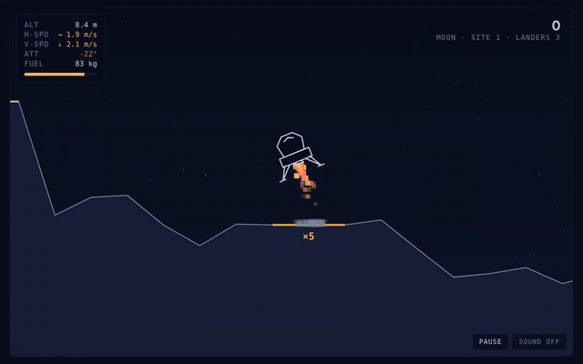

A Lunar Lander–style browser game. Pick a world, fight its gravity and weather, and set your lander down on a flat pad before the fuel runs out.

**▶ Play it here: [chaseharding.github.io/Descent-Systems](https://chaseharding.github.io/Descent-Systems/)**

The whole game is a single `index.html` file: plain HTML, CSS and JavaScript on a canvas, with no frameworks, build step or server.

## Features

- **Twelve worlds** with real surface gravity, each with its own sky, terrain and atmosphere, plus geysers on Europa, eruptions on Io, blinding clouds on Venus, fuel-boiling sunlight on Mercury, a spinning asteroid, instrument-scrambling storms on Ganymede, and the pitch-dark ice of Eris, where all you have is your landing light
- **Moving landing pads**: rovers that drive back and forth across most worlds, and a barge rocking on Earth's ocean. Match their speed, then touch down
- **Meteor showers** on airless worlds: red markers and dotted tracks show where each meteor will land, so you can dodge them
- **Guided tutorial** that teaches a first landing step by step
- **Wind and air drag** on worlds with an atmosphere, shown on a live wind gauge
- **Auto-zoom** that eases the camera in for the final approach
- **Landing replays**: rewatch any touchdown or crash with a close camera and slow motion, plus dust, screen shake and a slow-motion beat on soft landings
- **Five landers** that fly differently: Biscuit the all-rounder, Rex's fast and thirsty Apex Vector, Wren's slow, steady Lark, Dottie's Workhorse cargo hauler and Whisker, the twitchy little lander Gus built for Apogee. Each keeps its own paint, flame and flag
- **Credits and a hangar** where you spend your banked points on hull finishes and engine flames
- **Gus's workshop**: upgrades for a bigger fuel tank, a more efficient engine, softer landing struts and a landing radar that shows where you'll touch down
- **Mission campaign**: a brand-new story of 38 missions in four acts, with Act 1 playable now, with precision landings, cargo runs, canyon flying and rescues, each rated 1–3 stars, plus a story told over the radio by a small pixel-art cast
- **Two more aliens to date**: Nerri, a bubbly ocean-dweller from under Europa's ice, and Brix, a gentle stone poet from Vesta, each with a full romance arc
- **New crew to meet**: Bao runs the kitchen, Kit the cadet stows away once the ship flies, and a botanist auditions to join as you progress
- **Side missions**: twenty-one optional jobs from the crew, each with its own twist: fragile cargo, a coffee countdown, a cat passenger, a survey route through the clouds of Venus, melting ice cream on Mercury, skipping across an asteroid, a blind landing in a magnetic storm, landing on a moving rover, flying a telescope on a swinging cable, landing through a meteor shower, a pad-hopping race against a rival, aurora photography and shadow hopping on Mercury
- **Round trips**: nine missions where landing is only the start. Crumb the rover rolls down a ramp to grab samples, fix beacons or find a runaway cat, then you launch again and dock with the mothership
- **Break room**: hang out with the crew between flights. They chat about how your career is going, and Apogee the cat naps somewhere new every visit. It also holds a bulletin board, a postcard album and Biscuit's maintenance log
- **The ship**: three decks (Command, Living and Engines), each with its own corridor, joined by a **lift** the crew ride too, with a live **ship map** and intercom announcements. The rooms include **the Bridge**, where you pick missions at the nav console, take calls on comms and sit in the captain's chair. A **garden** where you grow homegrown gifts for the crew, and sealed doors to an observation dome and the crew quarters that hint at rooms still to come
- **The Pad**: your own cozy spaceship cabin to walk around in. Walk up to any spot in the room to decorate it with posters, shelf trinkets, desk gadgets, rugs, bedding, seating, wall finishes, flooring, glowing light strips and the view out the big window
- **Endless run**: one lander, random worlds, fuel that carries over, and a perk from Gus after every landing
- **Hot-seat mode** for two players taking turns on the same descents
- **Ghost replay** that lets you race a see-through copy of your friend's run, or your own last attempt
- **Ghost links**: after a free-flight landing, send a friend a link. They fly your exact terrain from the same start, racing your pink ghost, and can send their own ghost back
- **Synthesized sound**: engine rumble, thrusters, wind, a low-fuel alarm, touchdowns and crashes, with no audio files
- **Generated music**: slow, drifting pads on the menus, a cozy swung track in the break room, and flight music that speeds up and builds as you get closer to the ground. It's all composed in code as you play
- **Daily challenge**: the same world and terrain for every pilot each day, with a shareable result
- **Crew requests**: three small jobs from the crew every day, like soft landings, ×5 pads, rovers or petting Apogee, each paying credits, with a bonus for finishing all three
- **An engine room**: Gus's workshop and the ship's glowing core, with three paid pipe-puzzle repair jobs every ship day
- **39 badges** to earn, 29 of which unlock exclusive cosmetics
- **Celebrations**: confetti, a fanfare and a cheer from the crew when you finish an act, complete a ship project, buy your first outfit, level up a friendship or start dating someone
- **Ship events**: every fourth ship day is a holiday, like Harvest Festival, Polka Night or Apogee's Birthday, with decorations in every room, one small goal, a party with the crew and a keepsake for your shelf
- **Evening glow**: the more you fly in a ship day, the warmer and dimmer the ship's rooms get, until you sleep
- **Pause** with P or Esc, and automatic pausing when you switch tabs
- **Touch controls** on phones and tablets
- **Saved progress** for best scores, credits and unlocks, kept in your browser

## Worlds

| World | Gravity | Conditions | Score bonus |
|---|---|---|---|
| Pluto | 0.62 m/s² | No atmosphere, slow and floaty | ×0.75 |
| Vesta | 0.25 m/s² | A tiny asteroid: barely any gravity, ground that curves away at the edges, and a spin that pushes you outward from the middle | ×1.25 |
| Moon | 1.62 m/s² | No atmosphere, the classic | ×1 |
| Europa | 1.31 m/s² | Vapor geysers burst from the ice and shove you upward | ×1.25 |
| Ganymede | 1.43 m/s² | Auroras overhead. Magnetic storms roll in every so often and scramble your instruments, so you land by eye | ×1.5 |
| Titan | 1.35 m/s² | Thick air drag, light wind | ×1 |
| Io | 1.80 m/s² | Volcanic vents glow, then erupt. Touching an eruption is a crash | ×1.75 |
| Mercury | 3.70 m/s² | A huge sun and no air. Sunlight boils fuel out of the tank, so hop between the shadows of crater rims | ×1.75 |
| Mars | 3.71 m/s² | Thin air, gusting dust storms | ×1.5 |
| Earth | 9.81 m/s² | Fast falls, strong wind | ×2.5 |
| Venus | 8.87 m/s² | Extreme mode: crushing air, hurricane winds, and clouds that hide everything except the pad beacons | ×3 |
| Eris | 0.82 m/s² | So far from the Sun that it's nearly pitch dark. Your landing light shows the ground right below you, and pad beacons shine through. Opens for free flight after Patchwork, at the end of Act 3 | ×1.5 |

### What each world looks like

Every world has its own sky and ground, drawn around the flight without changing the terrain or the physics:

- **Something in the sky.** Charon hangs over Pluto. Earth turns slowly above the Moon. A huge banded Jupiter with its red spot looms over Europa, Ganymede and Io. Saturn and its rings show through Titan's haze. Mars has its two tiny moons, Phobos and Deimos. Earth has the Moon and drifting clouds. Venus is all cloud bands and a smothered sun glow. Distant suns burn as bright pinpricks over Vesta, Pluto and Eris, and little asteroids tumble past above Vesta.
- **Distant ridges** in two layers that drift slower than the ground as the camera moves: jagged peaks on the Moon and Mercury, ice spikes on Europa, flat-topped mesas on Mars, rolling hills on Earth and Titan, and Io's volcano cones puffing sulfur plumes.
- **Textured ground** that's lit near the surface and darker underneath, with layers that follow the shape of the land, pebbles and a soft glow along the rim. Then each world gets its own detail: craters on the Moon, Mercury, Pluto, Vesta, Ganymede and Eris, glowing blue cracks in Europa's ice, pulsing lava veins under Io, grooved terrain on Ganymede, and rock layers on Mars, Titan, Earth and Venus. Worlds with air get a haze along the horizon.

<p align="center">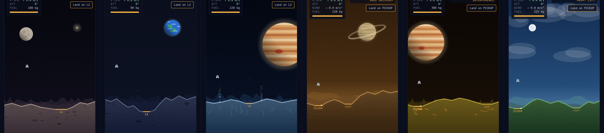</p>

## Life on the ship

There's no title menu. The game opens in **your Pad**, and everything is a room you walk to. In Act 1 home is the **Moon base** (see below); the ship's decks open once the Second Wind lifts off. Your Pad's door opens onto the deck 2 corridor, and a lift takes you up to the **Bridge** or down to the **hangar** and the **engine room** (see [The ship](#the-ship)). When you finish a flight or close a screen, **Back to the ship** returns you to whichever room you were last in.

**Moving around** feels like one ship: walking through a door fades through black with a soft whoosh, your footsteps change with the floor (metal in the hallway, carpet in the quarters, tile in the garden and galley, wood in the break room), and each room has its own quiet background sound: the Bridge's engine hum, drips in the garden, the galley's sizzle, the hangar's machinery, an airy hush in the dome. **The crew notice you**: when you walk in they turn and wave, hallway wanderers stop to say hi as you pass, and a little **!** bubble floats over anyone you haven't chatted with today. Chat with them and you get a ♥ (first chat of the day) or a … bubble. Sometimes Apogee turns up in the hallway and trots after you for a while before curling up for a nap; tap her for a purr.

**The menu.** Every room has a **☰ Menu** button (or press Escape) that opens a tabbed menu, a bit like pausing in Stardew Valley:

- The **Ship** map and the **Today** list used to live here. They're on your phone now (see below).
- **Crew ♥:** everyone you've met, with their face, hearts, friendship status and whether you've chatted and given a gift today. A **Hang out ♥** tag shows when a heart scene is ready. **Gifts and hangouts** opens the full Friends ♥ screen.
- **Journal:** your **postcards**, the **bulletin board**, Gus's **maintenance log**, **badges**, your **pilot license** and **settings**, plus **How to play** (the tutorial) and **Install app** where your browser supports it.

**Radio lines don't vanish.** Lines like "FLIGHT: …" stay up long enough to read (longer lines stay longer) and can't be overwritten for their first couple of seconds. Anything that arrives meanwhile waits its turn.

**Your phone.** A little phone sits on the right edge of the screen. It wiggles and shows a red count when something new arrives, and hides while you're flying and during cutscenes. Tap it for the home screen and four apps:

- **Texts.** The crew text you overnight (one or two people a day), after missions (each crewmate in their own voice, with different lines for a three-star run and an okay one, sometimes about the kind of job: "Crumb’s back and won’t stop beeping happily"; the two reply options and their answers vary every time), and your partner says goodnight. Every text comes with reply choices, so you're never typing:
  - **Warm** replies grow hearts the most, **funny** ones a bit less, and **cold** ones ("k.") cost you.
  - Once someone's at 4 hearts (with Romance on) there's a **flirty** option. Flirting by text with someone else while you're dating makes your partner suspicious.
  - **Text first.** Tap **✏️ New text** (or open anyone's thread when it's your turn). Each day you get a fresh set of openers: something warm, something funny, a **personal topic** for that person ("How's Biscuit doing?" for Gus, "How's Pebble?" for Brix, "Sing me something?" for Nerri) and, once you're close, something flirty. You can start one conversation per person per ship day. They type back (watch the dots) and like you a little more.
  - **Variety.** Everyone has five or so texts they might send you, several different comebacks for each kind of reply, and the flirty and cold reply options change from text to text, so conversations don't repeat.
  - **Real photos.** Picture texts show up as actual pixel-art photos in the thread, drawn with the crew's own faces: Gus's greasy thumbs-up selfie, Biscuit in a party hat, Wren's old Kepler crew in faded sepia, Rex mid-hair-flip, Dottie's improvement graph, Brix with a ladybug, Bao's dumplings (one shaped like Biscuit), Kit's rainbow supply closet, Theo's blue Mars sunset, Kestrel's lap-time chart with your line circled, and more (16 in all). Tap one to see it full screen.
  - **Crew group chat.** After 12 big story moments, the whole crew talks at once in the **Second Wind crew 🚀** thread: roll call after the storm, Gus texting by flashlight in the dark, Theo and Kestrel joining, the vote, coming home. Messages arrive one at a time with typing dots while you watch, and each moment ends with two replies for you. Crew who haven't joined yet, or who were lost, never post.
  - Gus sends photos (Biscuit in a tiny party hat, a wrench with googly eyes), Zib shouts in all caps, and Brix's "good morning" arrives at night. Leave someone on read and they'll send a "Hello?? 😢". An ex doesn't text at all.
- **Inbox.** Crew messages, radio calls during flights and intercom announcements still pop up as before, but they're also saved here (the newest 120, grouped by ship day) so nothing is missed. **Clear all** empties it.
- **Ship map.** All three decks, where you are and where everyone is. There's no fast travel: you get around on foot, through doors and the lift. Missions and every flight mode are on the Bridge's nav console (Deck 1).
- **Today.** Upcoming events, today's crew requests (with a button to open them), the garden, ship projects, Crumb and flights. Each card says where to go (📍 The Garden · Deck 2) rather than taking you there.

<p align="center"></p>

A dot on a tab means something new is inside it. Screens you open from the menu come back to the menu, and **Back to** returns you to the room you were in.

<p align="center">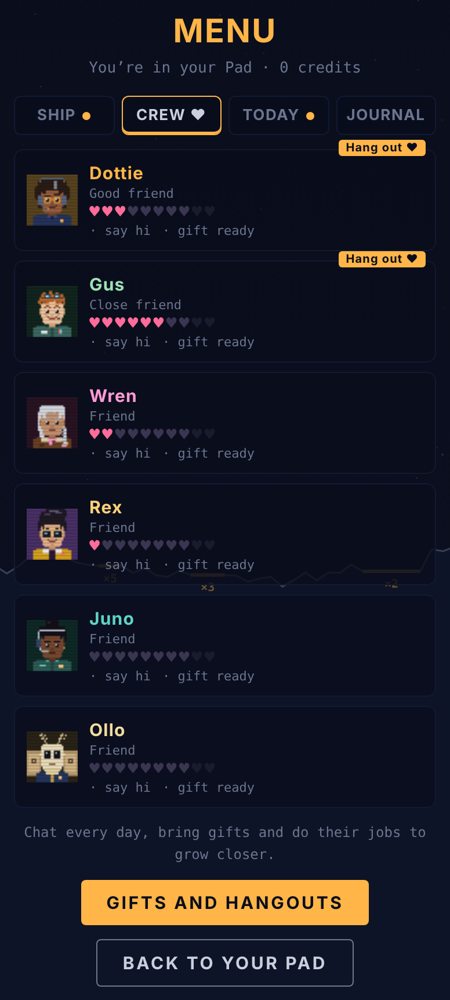</p>

**The ship guide.** The first time something new opens up (the garden, the project board, the mining pod, Crumb's salvage runs, the wardrobe, someone's room, a hangout, the dome), Dottie, Gus or Crumb gives you a one-line heads-up, at most one every so often so nothing piles up. The menu's Journal tab has a **Ship guide** listing every activity with where to find it: a ✓ once you've tried it, a dot if it's open and waiting, and a 🔒 with what unlocks it.

**The flight deck.** Walk up to the nav console on the Bridge (or press **Flight deck** under the room, or pick it from the menu) to choose how to fly: **Missions**, **Free flight**, **Daily challenge**, **Hot-seat** and **Endless run**, plus a **Crew requests** strip showing who's asking and how many of today's jobs are still open. Screens you open from here come back here.

<p align="center">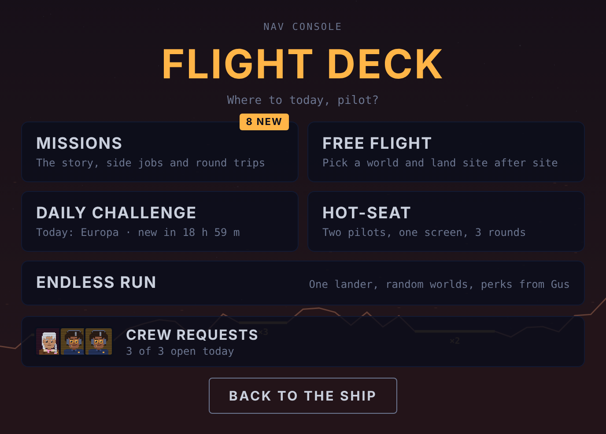</p>

### First launch

Brand-new players get a short guided start, about two to three minutes:

1. **Welcome aboard.** Dottie comes on the radio, and six quick illustrated cards introduce Descent Systems: the cozy Moon base, the Second Wind waiting in the hangar, Biscuit (Gus would like you not to scratch her), the bake sale that paid for her, and Apogee, who technically outranks you.
2. **Your pilot license.** Type your name and pick your look, then Dottie stamps it **LICENSED · CADET**.
3. **The certification flight.** This is the tutorial. It holds the lander in place while you learn to fire the engine and tilt, then switches gravity on and walks you through your first landing, with a nervous Gus on the radio.
4. **Meet the crew.** A short guided tour of the break room: the crew, the bulletin board, today's crew requests, your first postcard, Gus's maintenance log and Apogee.
5. **Your Pad.** Gus brings a housewarming gift (pick a lander poster, a fern or a rug) and shows you how decorating works, while Apogee claims your bunk.
6. You're left in your bunk at the Moon base, and Dottie points you down the corridor to the **OFFICE**, where **Missions** on her desk is marked **Start here**.

<p align="center">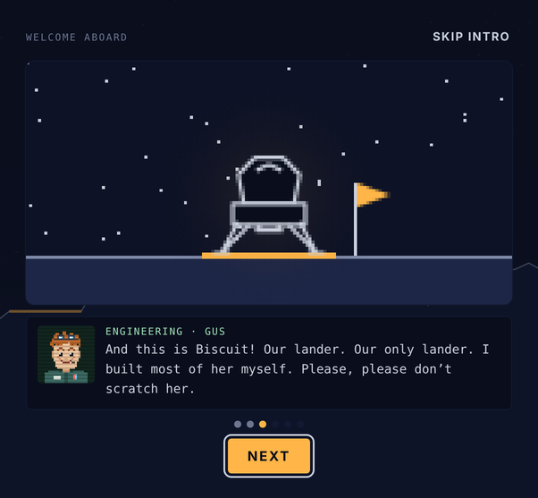</p>

Every step has a **Skip** button. Players with an existing save never see the intro, and anyone can watch it again from **Settings → Replay intro**. Players who skip it can still start the tutorial from **How to play** in the menu's Journal tab.

**Settings** has switches for full 360° rotation, auto-zoom, story scenes, ghosts, sound and music, plus a list of the controls.

## How to play

Land with **both feet on a pad** while staying inside the safe limits:

- Vertical speed under **2 m/s**
- Horizontal speed under **1 m/s**
- Tilt under **10°**

The HUD readouts turn amber, then red, as you go past each limit. If you crash, the game tells you which limit you broke.

### Controls

| Key | Action |
|---|---|
| ↑ / W | Main engine |
| ← → / A D | Rotate |
| ← → (world picker) | Switch world |
| Space / Enter | Start or continue |
| H | Open the hangar |
| R | Open the break room |
| Z | Toggle auto-zoom |
| G | Toggle ghosts |
| M | Toggle sound |
| N | Toggle music |
| P / Esc | Pause and resume (Esc also backs out of menus) |
| B | Open badges |
| Esc | Back out of a menu screen |

On touch screens, on-screen **ROT / THRUST / ROT** buttons appear below the game, and a **Pause** button sits in the corner while you fly. While Crumb the rover is out on a round trip, the same keys and buttons drive it: ← → (**DRIVE**) roll it along and ↑ (**HOP**) jumps.

### Scoring

- Pads pay **×5**, **×3** or **×2**. The narrowest pad pays the most.
- From the second site on, many worlds can add a **moving pad worth ×4**: a rover driving back and forth on a flat track (Pluto, Vesta, the Moon, Ganymede, Titan, Mercury and Mars) or a barge rocking on the sea (Earth). Only your speed relative to the deck counts, so match its speed before you touch down. The driver hits the brakes once you're aboard. Missing the barge means splashing into the ocean.
- From the second site on, Pluto, Vesta, the Moon and Mercury sometimes have a **meteor shower**. Before each meteor lands, a pulsing red marker appears on the ground with a dotted track up into the sky, about two seconds ahead. Getting hit is a crash. The shower's timing is fixed when the site is built, so daily and hot-seat pilots face the same one.
- Unused fuel adds a bonus, and a touchdown under 0.8 m/s adds another 50 points.
- The world's score bonus multiplies the total.
- In solo, you have 3 landers. Each new site has rougher terrain and less fuel.

## Hangar

Every point you score is banked as credits the moment you touch down. Spend them in the hangar on cosmetics. Cosmetics never change how the lander flies.

Walking into the **hangar** takes you into the **garage**, a room you walk around like the break room. Your current lander stands on the landing pad in the middle in its own paint, every other lander you own is parked in the side bays, and the ones you haven't unlocked yet wait under covers (walk up to one to hear how to get it). The big hangar door is rolled up onto the world you flew last, with Gus's workbench and a fuel tank on one side and Crumb's charging dock on the other. **Walk up to a lander** to open the hangar screen on it, or use the **workbench** (or the *Open the hangar* button) for the one you're flying. The hangar's *Back to the garage* button brings you back, and the door on the right leads to the break room.

The hangar is a garage: Biscuit hovers over the pad in front of a big open door looking out on the world you flew last, and Gus works at his bench and comments on everything you put on her.

- **Tabs** for **Hull**, **Flame** and **Flag**, each showing how many you own.
- **Try anything on.** Click an item to see it on Biscuit in the garage.
- **Your look** adds up the hull, flame and flag you're trying on, shows the total cost, and buys and equips everything in one go (or resets to what you had).
- **Locked badge rewards** say which badge earns them and how close you are, with a progress bar where there is one.

### The fleet

The top of the hangar shows your five landers. Tap one to fly it. Each lander remembers its own hull, flame and flag, so you can dress them all differently.

| Lander | Who it's from | How it flies | How to get it |
|---|---|---|---|
| **Biscuit** | Gus | The all-rounder: balanced in every way | You start with her |
| **Apex Vector** | Rex | 22% stronger engine, turns 45% faster, but burns 40% more fuel from a 15% smaller tank, with stiffer legs (safe touchdown 0.2 m/s lower) and more wind push | Finish Star Client, or buy it for 6,000 credits |
| **Lark** | Wren | 12% weaker engine, turns 30% slower, but a 45% bigger tank, 15% thriftier engine, soft legs (safe touchdown 0.4 m/s higher) and only 60% of the wind push | Finish The Neighbor, or buy it for 3,000 credits |
| **Workhorse** | Dottie | 5% stronger engine and a 25% bigger tank, but burns 10% more and turns 15% slower. Cargo doesn't weigh it down, sling loads feel 40% lighter, its legs are tougher (safe touchdown 0.2 m/s higher) and wind pushes it 15% less | Finish First Port, or buy it for 5,000 credits |
| **Whisker** | Apogee (via Gus) | Turns 60% faster with free side thrusters (no fuel for RCS) and springy legs (safe touchdown 0.6 m/s higher), but an 8% weaker engine, a 20% smaller tank and 30% more wind push | Finish Stowaway, or buy it for 2,000 credits |

The Vector comes with its own **Vector Red** paint, the Lark with **Surveyor Olive**, the Workhorse with **Dottie Navy** and the Whisker with **Tabby**. The daily challenge always uses Biscuit, so everyone competes on the same lander. Hot-seat players share whichever lander is selected.

### Gus's workshop

The fourth tab in the hangar, **Workshop**, sells upgrades that actually change how Biscuit flies:

| Upgrade | Levels | Effect | Prices |
|---|---|---|---|
| Bigger tank | 3 | +10% / +20% / +30% fuel at the start of every flight | 800 / 1,800 / 3,500 |
| Efficient engine | 3 | The main engine burns 8% / 16% / 24% less fuel | 900 / 2,000 / 3,800 |
| Soft struts | 3 | Safe touchdown speed rises from 2.0 to 2.3 / 2.6 / 3.0 m/s | 1,000 / 2,200 / 4,000 |
| Landing radar | 1 | A dotted line shows where you'll come down if you cut the engine now, with the touchdown speed: green when it would be a safe landing on a pad | 2,500 |

Upgrades apply in free flight and missions. They're always off in the daily challenge, hot-seat, endless run and the tutorial, so those stay fair, and a **Use upgrades** switch turns them off everywhere if you want to fly old-school.

- **Hull finishes:** Mission White, Gold Foil, Mars Rust, Titan Amber, Chrome
- **Engine flames:** Methane Blue, Boron Green, White-Hot, Rainbow, Pulsing Plasma
- **Landing flags:** Pennant (free), Tricolor, Lone Star, Checkered, Jolly Roger, Waving Banner. Your flag plants itself beside the lander after every touchdown.

Badge rewards (Grand Tour, Champion, Pathfinder, Spa Day, Wren's Original and more) appear in the hangar once you earn them.

<p align="center">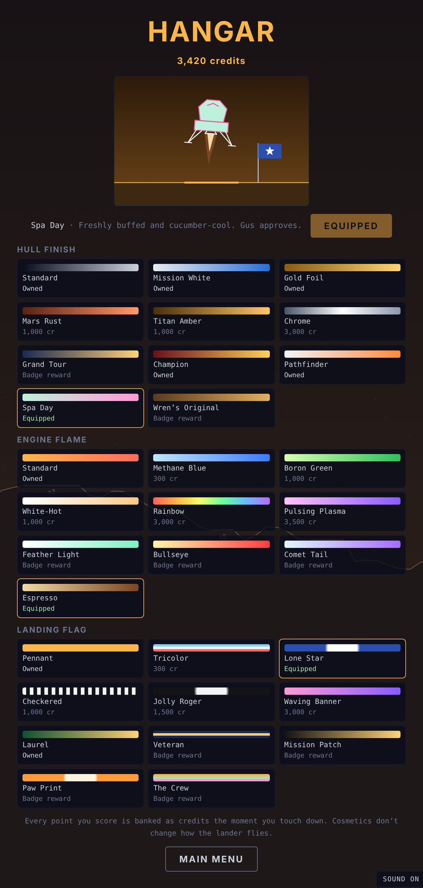</p>

## Missions

Open **Missions** from the flight deck (in Act 1 that's **Dottie's desk** in the base's OFFICE; later, the nav console on the Bridge). The story is being rebuilt from scratch: **38 missions in four acts**, and finishing one unlocks the next. **The whole story, all four acts, is playable now.** The rest already shows in the list with every planned mission marked **Coming soon**.

**Results.** When a mission ends, its stars pop in one at a time with a rising chime. Stars you just earned glow gold, the credits count up, and a fresh three-star run gets confetti.

**Travel encounters.** When you head to a mission on a different world from your last one, about one time in three something happens on the way (only after the ship has left the Moon, and never two missions in a row). Each encounter is a short scene with a picture, a crewmate's take, and two or three choices with their costs shown up front:
- **Distress call:** tow a stranded miner (costs fuel, Wren loves it), radio for help, or fly on.
- **A derelict:** suit up and salvage its drifting crates on a spacewalk, send Crumb over (credits, a gem… or a lampshade), or leave the haunted ship alone.
- **You're being followed:** Sable's goons. Hide behind an asteroid (usually works; if not, their warning shot breaches the hull), outrun them for fuel, or pay their "toll".
- **The Wandering Market:** buy a rare gem, a spare fuel cell, or Bao's spices.
- **A comet:** stop and watch it with the whole crew, or stay on schedule.
- **Something big:** a real space whale, singing, and the break room coffee machine sings back.
- **Port patrol:** show your license, pay the fee, or gamble on letting Rex talk.
- **A mail capsule:** deliver it for Kit, or peek inside.
- **An ice field:** take Dottie's long safe route, or thread straight through (and maybe take a hit).

Outcomes can mean credits, more or less fuel on that landing, friendship, gifts in your basket, a text later, or a hull breach you have to fix before you land. Encounters you haven't seen yet come up first.

**The Whale.** The break room coffee machine is a little game now. Walk up to it and a crewmate places an order in their own style: Dottie's strict double espresso, Gus's "just make it brown" with three sugars, Zib's seven sugars (he counts), Rex's big foam for his feed, Brix's tiny ROCK mug, and more. **Pump**: hold to build pressure and keep the needle in the green while the old machine wobbles and burps. Push it into the red and it lets out a giant whale groan and blasts steam from its blowhole. **Pour**: hold to pour and let go at the red line (it keeps dripping a little). Then add sugar (tap once per cube) or froth foam to the blue line if they asked. You get one to three cups and their reaction. A crewmate's first coffee each day earns friendship.

**Spacewalks and ship emergencies.** Sometimes something goes wrong outside the ship, and you have to suit up and fix it:
- **When:** once the ship has left the Moon, an emergency sometimes hits when you get back from a mission (about one in six), or right as you try to launch ("Hold the launch!"). Never two close together.
- **What you see:** red alert lights pulse around the edge of the screen, a banner at the top says what happened, Gus texts you, and your phone's Today screen shows it first. **No missions launch until it's fixed.** Free flight still works.
- **Fixing it:** walk to the hangar, where the suit locker by the big window is flashing red, and suit up (or tap **Suit up**). Each emergency is laid out fresh: one to three hull breaches in random spots, or two or three crates drifting off after the cargo door blew. Fix it and you get credits and the alert clears. Run out of oxygen and Gus reels you in, and the problem is still waiting.

**How spacewalks play.** The controls are the same (◀ ROT, THRUST, ROT ▶), but there's no gravity: a push keeps you drifting until you push the other way, so the skill is stopping. A tether clips you to the airlock and gently pulls you back if you drift too far, and **oxygen** is your fuel. To patch a breach, come to a near stop at it and hold steady while the patch welds on (come in too fast and the spark spins you away). To fetch a crate, match its speed, grab it and bring it back to the airlock; it makes you heavier and slower to stop. Each spacewalk has three stars (finish the job, oxygen left, time).

**Two story emergencies** in Act 3: after **Dead Air**, storm damage sets off **Hull Breach** (patch three holes). After **The Overdrive**, the torn cargo net sets off **Loose Parts** (bring back four crates of engine parts). Both start from the hangar like any other emergency, and both keep your best stars.

**Up next.** The Story tab opens with an **Up next** banner that takes you straight to the next story mission (or tells you to sleep first). That mission's tile has a glowing NEXT badge, and each act shows a one-line summary and a progress bar.

**Pause.** Pausing during a mission shows what you're doing right now, how each of the three stars is going (fuel left, time so far, time limit), and lets you Restart or Retry from the last stop.

**Intro cards.** When you launch from a briefing, a quick title card shows the mission number, the world, the job type and its **twist** ("Tiny pad. Big gusts.", "Pitch black. Headlamp only."), plus gravity, fuel, the time limit and how many stops. The flight is frozen while the card is up. It clears on its own after about three seconds, or tap (or press any key) to fly right away. Retries skip the card. Every story mission has a hand-written twist; side jobs get one picked from what makes them tricky.

**Finding your way.** The pad you're heading for right now glows **mint green**, with a soft light beam and a bouncing ▼ over it; the other pads stay dim amber. A small arrow circles Biscuit and always points at your next pad (or the next marker, or straight up when it's time to climb to orbit). When the target is off screen, a pill on the screen edge shows its name and how far away it is, like **◀ WRECK1 155 m**. During a storm the distance is scrambled, but the arrow still points the way.

**Act 1 · Grounded**: odd jobs around the Moon. Each one pays for a repair on the Second Wind.

| # | Mission | Type | Repair it pays for |
|---|---|---|---|
| 1 | Final Notice | Precision | Power: the hangar lights come on |
| 2 | Scrap Run | Multi-stop: plating from two wrecks | Hull |
| 3 | The Neighbor | Cargo: Wren's old engine bell (Wren joins) | Engine bell |
| 4 | Star Client | Passenger: keep movie star Rex Valor from getting space-sick (Rex joins) | Life support |
| 5 | Dark Side | Rover trip for a navigation computer | Navigation |
| 6 | Moonquake | Rescue for Moonbase Pim | Reactor |
| 7 | Apex Calling | Race: beat Kestrel from Apex Landings through three markers | Pride |
| 8 | Test Fire | Ring route while the ship's engines fire | Engines |
| 9 | All Systems Go | Multi-stop: fuel, Apogee and Gus's lucky wrench | Everything |

**One story mission a day.** After you finish a new story mission, the next one shows **💤 Sleep first** until you sleep in your bunk (or your Pad once you're aboard). Side missions, free flight and replays of finished story missions stay open, so the story can't be rushed but there's always something to fly.

**Cinematics.** The big moments open with a short, wordless animated shot of the Second Wind, with a caption or two (tap Skip, or press Space or Esc, to skip): the dusty ship in the dark hangar before Final Notice, the hangar lighting up bank by bank as she powers on, liftoff through the open roof, the solar storm killing the engine, drifting helplessly past the Moon, the engine relighting blue at Eris, the slingshot around Jupiter, and the final descent into the hangar at home.

Smaller beats get shorter shots too: the Moon base shaking in the quake, a silver Apex lander dropping onto the pad beside Biscuit, the engines firing for the first time in the hangar, Biscuit descending toward Earth, Juno's dust-buried spire on Mars, Gus alone in the engine room at night with something small, red and glowing, shuttles fleeing the Venus resort, Juno's dock firing supply pods into the drift, Ganymede's floating market under Jupiter, a white-and-red Apex ship landing beside you at Eris, and Kestrel ejecting under a red parachute.

**Scenes on the ship.** Some story moments happen in the rooms themselves, with no cutscene. Walk into the right room after a story mission, and the crew are already there: they walk to their marks, turn toward whoever's talking (with a little "…" over their head), and the lines play in the usual speech panel. Tap the panel to move on. Each plays once:

| After | Where | What happens |
|---|---|---|
| Moonquake | Base kitchen | Bao serves miner's stew to the heroes |
| Apex Calling | Base corridor | The crew grumble about Kestrel's shiny lander |
| Liftoff | Ship corridor | Rex hauls bag seven of eleven past Wren and Gus |
| First Port | Galley | Kit's first real meal, and dish duty |
| Sun-Side | Engine room | Wren catches Gus with his "bolt shield" |
| Storm Front | Corridor | The crew, under red emergency light, decide to stay together |
| Catch! | Galley | Theo arrives and fixes the coffee machine |
| The Overdrive | Engine room | Wren sits with Gus after his confession |
| Still Crew | Galley | A toast to Gus |
| Patchwork | Bridge | "Everything is steady, Dottie." |
| The Rescue | Corridor | Kestrel comes aboard with her bag |

<p align="center">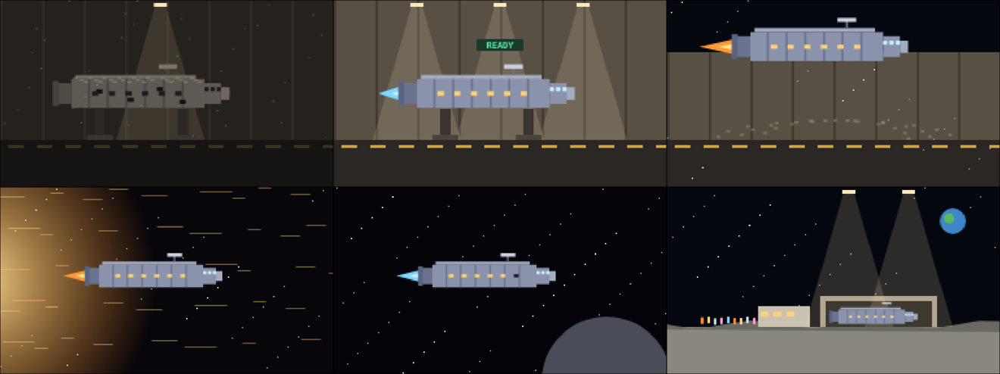</p>

Finishing All Systems Go unlocks an **Act 1 ending** scene, with the whole crew in the hangar as the Second Wind powers up.

**Act 2 · Lift Off**: the Second Wind flies, and the crew finds work on new worlds.

| # | Mission | World | Type |
|---|---|---|---|
| 10 | Liftoff | Moon | Multi-stop: clear two boulders off the launch path |
| 11 | First Port | Earth | Cargo (a stowaway cadet, Kit, is in one crate) |
| 12 | Red Dock | Mars | Precision on Juno's spire pad (Juno joins) |
| 13 | Dust Bowl | Mars | Timed delivery before a dust storm |
| 14 | Stone Patient | Vesta | Fragile cargo: Brix's pet rock (Brix joins) |
| 15 | Overdue | Mars | Precision. Sable Voss of Apex has bought your loans: 40,000 credits in ten days |
| 16 | Sun-Side | Mercury | Heat cargo: the big job. Gus quietly bolts something onto the engine |
| 17 | Storm Front | Mercury | Blind landing in a solar storm, and the first **hard call** |
| 18 | Dead Air | Venus | Multi-stop: salvage an evacuating sky resort while drifting (Marisol joins) |

Finishing Liftoff plays **Moving Day**: everyone carries their stuff aboard, the base is left behind, and the ship's decks, garden, dome and quarters open.

Storm Front kills the engine and the **drift** begins. Until the engine is relit in Act 3, the ship runs on **emergency power**: every room has a dim red tint that flickers now and then, the intercom has drift announcements, and the phone's Map shows a **drift chart** of where the ship is heading. Finishing Dead Air plays the **Act 2 ending** as the ship drifts helplessly past the Moon and the old base.

**Hard calls.** A few moments in the story can cost you a crewmate for good. The first is in **Storm Front**: Kit is out on the hull at **KIT** and the spare fuel cell is on the pad at **CELL**, and you can only land on one before climbing back to the ship.

- **Save Kit**: she's fine, but without the spare cell you start Dead Air with less fuel.
- **Take the cell**: if Kit has 3 or more hearts with you, she trusts you enough to reach an escape pod, and you find her at Venus. If not, she's **missing**: gone from the ship, the crew, chats and texts, and the Act 2 ending notices the empty spot.

Only your first finish of Storm Front decides it. One mission before each hard call, the results screen warns you (♥) who's at risk, like "Juno and Marisol have been quiet since the storm", so there's time to spend with them first.

The second hard call is **Europa's port** in Still Crew: anyone who has lost faith can get off. Up to two crewmates with fewer than 2 hearts leave for good (Kit, Bao, Juno, Marisol, Tamsin or Pim; story crew and anyone who joined in Act 3 always stay). The results screen says who left, and the forgiveness scene notices.

The third is **Brix holding the door** in Cold Storage: with 3 or more hearts he trusts you, lets go when you call, and makes it out. Otherwise he's left behind under the ice, and the Act 3 ending remembers him. Random mission surprises are switched off for Storm Front and for the race against Kestrel in Apex Calling. The last is **the buyout** on Eris: up to two crewmates with fewer than 2 hearts take Sable's offer and leave on her ship (the Titan crew are too new to be tempted).

**Act 3 · Adrift**: the drift carries the ship out past Mars to Jupiter, picking up crew along the way.

| # | Mission | World | Type |
|---|---|---|---|
| 19 | Catch! | Mars | **Catch**: Juno's dock fires supply pods on parachutes into the ship's path. Catch 6 of 10 in mid-air before they hit the dust (each gives fuel and credits), then climb out |
| 20 | Market Day | Ganymede | Multi-stop: ice for two stalls, then Zib's stall (Zib joins) |
| 21 | Under the Ice | Europa | Rescue in a geyser field (Nerri joins) |
| 22 | Left Behind | Ganymede | SOS: rescue Dash, an Apex courier her own company abandoned (Dash joins) |
| 23 | The Overdrive | Io | Multi-stop: salvage between two lava vents |

| 24 | Still Crew | Europa | **In the dark**: a parts run through a pitch-black ice cave lit only by Biscuit's headlamp, with pads showing as blinking beacons and Gus talking on the radio |
| 25 | Lantern Light | Titan | **Follow the light**: stay inside Ollo's lantern glow as it leads you down through the haze. It waits if you fall behind, but a meter drains while you're outside the light (Ollo joins) |
| 26 | The Envoys | Titan | **Ferry**: carry messages between the WEST and EAST docks before the talks collapse, topping up at each dock (Kael and Lyra join) |
| 27 | Cold Storage | Pluto | **Collapse**: a rover round trip into a crumbling ice station. Icicles shiver, cast a shadow, then drop, and each hit costs time off the clock, which is Brix holding the door |
| 28 | Patchwork | Eris | Sling load: lower the rebuilt engine section into place at the edge of the map |

Left Behind ends with **They Knew**: Dash reveals Apex sent the Mercury job through a fake company, knowing the storm was coming. The Overdrive ends with **The Confession**: Gus admits his secret booster is what really killed the engine. Still Crew ends with the crew forgiving him on stage, and Patchwork ends with the **Act 3 ending**, **Blue in the Dark**: the engine relit, the emergency lighting gone, and the ship turning for home.

**Coming soon**

**Act 4 · The Slingshot**: the long way home.

| # | Mission | World | Type |
|---|---|---|---|
| 29 | The Buyout | Eris | Precision beside Sable's ship, then **The Vote** and the last **hard call** |
| 30 | Wren's Old Partner | Pluto | Canyon: Wren faces Sable and takes her flight logs |
| 31 | First Burn | Pluto | **Beacon drop**: fly low over each of three peaks, inside the dashed zone, and a beacon releases on its own (no landing), then climb out before the burn window closes |
| 32 | Sulfur Stop | Io | Multi-stop: refuel at two old depots, then hop a lava vent |
| 33 | Ice for the Road | Europa | Cargo across a geyser field |
| 34 | The Slingshot | Ganymede | **Moving rings**: the marker rings swing as you go, so time your pass |
| 35 | Homecoming | Mars | Precision in front of a welcome-back crowd |
| 36 | The Earth Contract | Earth | **A real race**: Kestrel's silver lander flies the course beside you. Beat her to the pad (her progress shows in the objective bar) |
| 37 | The Rescue | Earth | **Catch**: Kestrel's lander fails, so you give up the contract to catch her escape pod in mid-air |
| 38 | Home | Moon | The final landing at the old hangar |

Home ends with the finale: how the debt still gets paid, what happens to Apex and Sable, who made it home, and a signal from beyond Eris that sets up a future Act 5.

<p align="center"></p>

- **Precision:** land on the marked pad, LZ.
- **Cargo:** land on PICKUP and hold still while the crate loads, then fly it to DROP. The crate makes the lander heavier and slower to turn.
- **Canyon:** fly beneath rock overhangs to reach the pad. Touching the rock overhead is a crash.
- **Rescue:** land on CREW and hold still while they board, then climb out of the top of the screen to reach orbit.
- **Pad hopping:** touch down safely on numbered pads in order.
- **Sling load:** the cargo hangs on a cable below the lander and swings with momentum, and its pull tugs the lander around. Don't drag it into the ground, and lower it gently onto DROP. While it's hanging, the altitude readout shows the load's height.

<p align="center">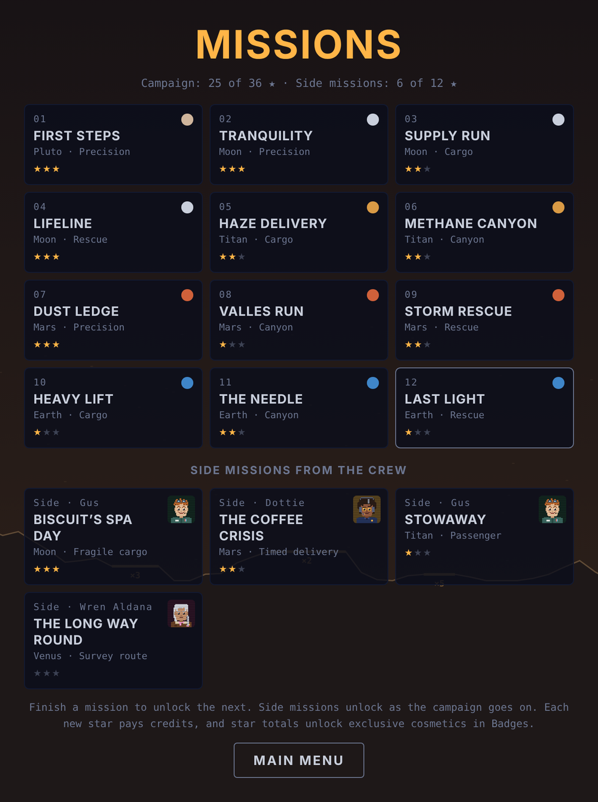</p>

The campaign tells a story over the radio and on stage. You fly for Descent Systems, a broke little landing agency run out of a cramped base on the Moon by flight director **Dottie Reyes** and engineer **Gus**. Next door, in the hangar, sits their mothership, the **Second Wind**, which hasn't flown in six years. The bank wants paying, and **Apex Landings**, a slick company run by **Sable Voss**, wants to buy the ship for scrap. Their ace pilot **Kestrel** turns up in Act 1 to race you for a contract.

Crew join as the story goes: **Wren**, the grumpy retired pilot next door, moves in to supervise after The Neighbor; **Rex Valor** invests and moves in (with eleven bags) after Star Client; **Bao** takes over the base kitchen; **Crumb** the rover has always lived in the garage. In Act 2, **Kit** turns up in a crate on Earth and tags along to learn, **Juno** comes aboard to run the docking after Red Dock, **Brix** joins after Stone Patient, and **Marisol**, the resort's medic, joins after Dead Air. In Act 3, **Zib** moves in after Market Day, **Nerri** after Under the Ice, **Dash** after Left Behind, **Ollo** after Lantern Light, and **Kael and Lyra** after The Envoys. **Tamsin** still auditions through the recruitment board once the ship reaches Titan. **Theo Okafor**, Juno's dock deputy, is the voice on the Mars dock radio in Act 2 and the one firing supply pods at you in Catch!; he joins right after it, sent by Juno "to keep that ship in one piece". **Kestrel**, Apex's ace, joins for good after The Rescue as the ship reaches their worlds. Side missions follow the same rule: each world's jobs open once the Second Wind gets there.

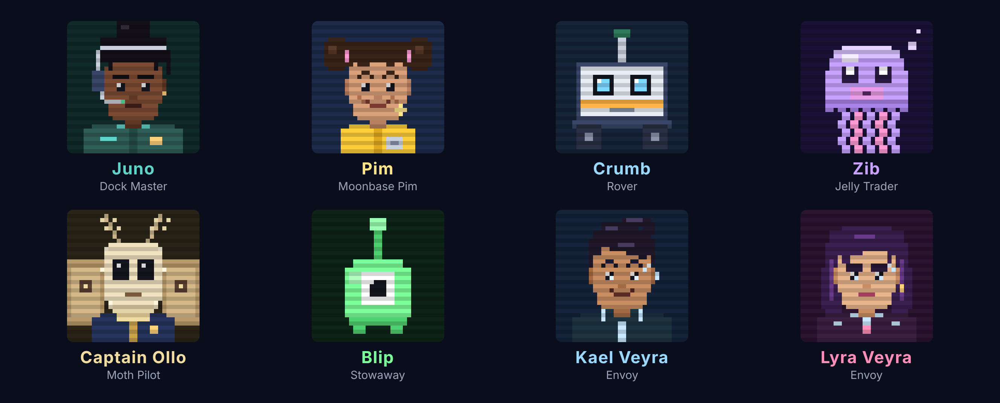

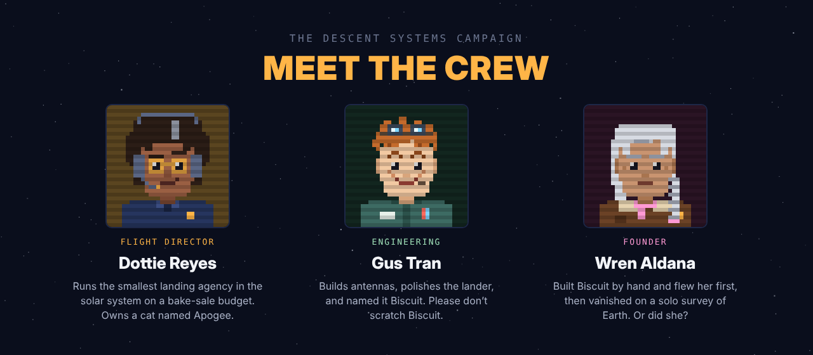

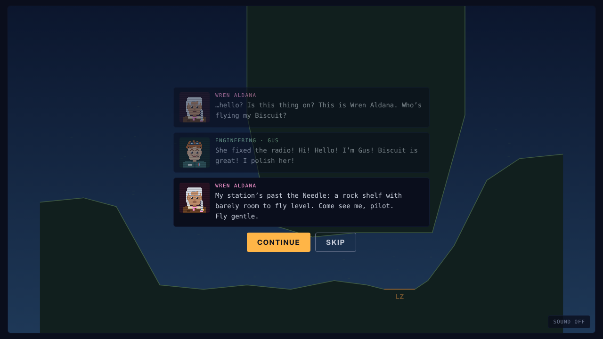

### Side missions

Below the campaign is a row of optional side missions. Each one is a favor for someone on the crew and has its own rule on top of the usual landing limits. Most unlock partway through the campaign. Ice Cream Social, Skipping Stones and Static unlock the first time you land on their world in free flight.

| Side mission | From | World | Unlocks after | The twist |
|---|---|---|---|---|
| Biscuit's Spa Day | Gus | Moon | Scrap Run | **3 stops.** Fragile cargo: with the crate aboard, touch down slower than 1.2 m/s or it cracks |
| The Coffee Crisis | Dottie | Mars | Dust Bowl | **3 stops.** Timed delivery: grab a fresh pot, pour Gus a cup on the way, and get the rest to DROP within 125 seconds, while Dottie counts down on the radio |
| Stowaway | Gus | Titan | Lantern Light | **2 stops.** Passenger: Apogee the cat rides along. Turning, tilting past 20° or flying faster than 6 m/s makes her queasy, and her comfort shows in the goal box |
| The Long Way Round | Wren | Venus | Dead Air | Survey route: fly through Wren's three numbered markers in order, then land |
| Ice Cream Social | Gus | Mercury | Landing on Mercury in free flight | **3 stops.** Melting cargo: sunlight melts the ice cream, shadows stop it. It fails at 100% melted |
| Skipping Stones | Gus | Vesta | Landing on Vesta in free flight | Survey route: fly through four markers over the curve of the asteroid, then land on the far side |
| Static | Dottie | Ganymede | Landing on Ganymede in free flight | **2 stops.** Blind landing: a magnetic storm scrambles your instruments the whole way down |
| Ride Along | Gus | Moon | The Neighbor | **2 stops.** Moving pad: land on Moonbase Pim's supply rover while it drives (its brakes are "on order") |
| Swing Shift | Gus | Moon | Moonquake | Sling load: fly Gus's telescope on a 9-meter cable and set it down on DROP slower than 1.5 m/s |
| Shooting Stars | Dottie | Moon | Final Notice | **2 stops.** Meteor shower: reach the far LZ through a heavy shower |
| Hopscotch | Rex | Vesta | Stone Patient | Pad hopping: touch down on pads 1, 2 and 3 in order, and try to beat Rex's 90 seconds |
| Northern Lights | Dottie | Ganymede | Market Day | Photo route: fly through three markers up in the aurora, then land |
| Shadow Hopper | Wren | Mercury | Sun-Side | Pad hopping: hop between three pads in the shadows while the sun boils your fuel |
| Polka Radio | Gus | Moon | Test Fire | Broadcast route: fly through three markers to switch on Gus's all-polka radio station, then land |
| Geyser Surfing | Rex | Europa | Under the Ice | Pad hopping between erupting geysers, and try to beat Rex's 75 seconds |
| Catnip Run | Dottie | Titan | The Envoys | **3 stops.** Fragile cargo: Titan catnip for Apogee. Touch down slower than 1.3 m/s with it aboard |
| Seedling Run | Tamsin | Titan | Lantern Light | **3 stops.** **Audition.** Fragile cargo: take the botanist's comet-forest seedlings to the greenhouse, slower than 1.3 m/s. Pass it and she joins |
| Captain Floaty | Pim | Moon | Swing Shift | Balloon chase: Pim's balloon escaped the Moonbase Pim airlock. Fly through the three markers along its path, then land to hand it back |
| Meteor Watch | Wren | Mercury | Sun-Side | **2 stops.** Meteor shower over Mercury: get to the shade by the LZ while the meteors fall |
| Dark Picnic | Gus | Eris | Patchwork | **3 stops.** Fragile cargo in the dark: carry Gus's picnic basket to DROP, touching down slower than 1.3 m/s |
| Ice Regatta | Lyra | Europa | The Envoys | Race route: fly Lyra's three markers over the ice, then land, to settle who's the better pilot, her or Kael |

#### Co-pilots, landing grades and pickups

Every mission now has three extras:

- **Bring a co-pilot.** The mission card has a row of faces: tap someone you've met to bring them along, or fly **Solo**. Each crewmate brings one perk and chats on the radio during the flight. Your partner flirts, and an ex makes it clear they're only there for the perk.

| Co-pilot | Perk |
|---|---|
| Dottie | Mission planner: time goals for the third star are 15% longer |
| Gus | Steady hands: once per flight, if you tip past 60°, he snaps Biscuit level |
| Wren | Old pilot instincts: wind pushes you half as hard |
| Rex | Sponsorship deal: +25% credits from the mission |
| Juno | Approach guidance: a dotted guide line to your next stop |
| Zib | Shiny sense: grabs pickups from twice as far away |
| Ollo | Steady wings: you can touch down 0.3 m/s faster without crashing |
| Kael | Smooth talker: fuel goals for the third star are 20% easier |
| Lyra | Fuel deal: start with 10% more fuel |
| Nerri | Glider: engines burn 15% less fuel |
| Brix | Stone steady: fragile cargo can take 0.3 m/s more at touchdown |
| Kit | Eager cadet: +10 credits for every Clean or Butter landing |
| Bao | Packed lunch: the first time you run dry, he finds 40 kg of fuel in his lunchbox |
| Marisol | Medic: forgives one crash per flight and puts you back in the air |
| Tamsin | Green thumb: stardust and crystals are worth double |
| Dash | Afterburner: 12% more engine thrust |

- **Landing grades.** Every touchdown on a mission is graded, and the grade floats up from the pad. **BUTTER!** is under 0.7 m/s, nearly level and near the middle of the pad (+20 credits). **Clean** is under 1.3 m/s (+8). **Bumpy** is everything else that's still safe.
- **Floating pickups.** Each mission scatters six pickups around the map, some well off the safe path: **fuel canisters** (+35 kg, straight into the tank), **stardust** (+15 credits) and one **crystal** hidden low by the ground (+60 credits). Fuel helps right away. Credits are only paid if you finish, so a greedy detour that ends in a crash costs you everything.

<p align="center"></p>

**Surprises.** On about half of all flights (never on the first three campaign missions), something unexpected happens:

- **Change of plans.** As you line up your final landing, Dottie radios that the pad is out ("Crumb's cousin is napping on it") and diverts you to a new **ALT** pad. Land there for +30.
- **Engine trouble.** The engine coughs out for a couple of seconds and you have to glide. It only happens when you're high enough to recover, and with Gus as co-pilot he kicks it back to life twice as fast.
- **Falling satellite.** A comms satellite drifts down on a red parachute with a blinking light. Fly into it before it lands for +80.
- **Meteor shower.** Dottie warns of incoming rocks, even on worlds that never get them. For about fifteen seconds meteors fall on marked spots, some of them right where you are. Keep moving, and make it through for +40.
- **SOS call.** A crewmate is stuck at an **SOS** pad with a pulsing beacon over it. Swing by and land there to pick them up (+50, and they like you more). Afterwards they text you a thank-you, or a very pointed "you flew right past me. I waved. I waved a LOT."

A flight can have two at once. The result card lists what happened, and checkpoint retries keep the same surprises.

<p align="center"></p>

The result card lists your landing grades, how many pickups you got, your co-pilot and the bonus credits. Checkpoints remember all of it.

#### Multi-stop missions

Most side missions are now a short trip with several stops, flown in one go. Spa Day drops the crate and then sends you back for the cucumber water Gus forgot. Zib's Market leaves a block of ice at the fish stall on the way. Stowaway stops at the vet before bringing Apogee home. VIP Pickup has you collect both twins from opposite sides of the storm.

- **The mission card lists every stop**, and the goal box tracks where you are (**Stop 2/3 · Drop off at AID**). A radio line plays as each new stop begins.
- **Kinds of stop:** pick something up, drop part of the load and keep flying, drop everything, touch down somewhere, land at a fuel depot (Rock Steady), or climb to orbit.
- **Fuel carries over**, so a sloppy first landing makes the last one harder. Fragile cargo has to survive every touchdown, not just the last one. Some stops change the conditions: the dust picks up on the last leg of the Coffee Crisis.
- **Checkpoints:** finish a stop on a pad and it's saved. Crash on the next leg and the card offers **Retry from stop 2**, putting you back on that pad with the cargo, fuel and clock you had there. **Restart mission** starts from scratch.
- Upgraded missions pay 50% more per star, and their star goals were reset for the longer flights.

<p align="center"></p>

New missions are built this way from now on: a mission with `legs` in `SIDES` gets stops, checkpoints and the tracker automatically.

Side missions pay their own credits and have their own stars, but they don't count toward the campaign badges.

### Round trips

Round trips turn a landing into the middle of the mission. Land on LZ and Crumb, the rover Gus built out of a shopping cart, a cooler and a lot of tape, rolls down a ramp from Biscuit's hatch. Drive it to do the job before its battery runs out, drive back up the ramp, then launch and dock with the Descent Systems mothership waiting above. Docking is gentle: get close under the port and slow down, and the clamp holds you up and pulls you in.

<p align="center">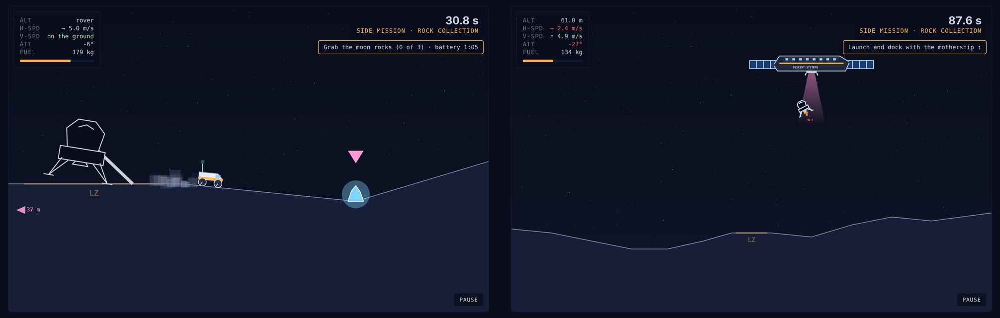</p>

Crumb drives differently on every world. Slopes steeper than 45° stop it, so steps and ledges need a **HOP**, and hops get higher as gravity drops: a small wiggle on Mars, a big bounce on Pluto. Europa's ice has little grip, and Titan's thick air slows everything down. Pink arrows at the edge of the screen point to the nearest job on each side.

| Round trip | From | World | Unlocks after | The job |
|---|---|---|---|---|
| Rock Collection | Gus | Moon | Dark Side | Grab three glowing moon rocks for the break room shelf |
| Beacon Repair | Dottie | Mars | Red Dock | Stop beside two dark landing beacons until they light up. One sits past a rock step |
| Bounce House | Rex | Pluto | Cold Storage | Hop up three ledges for the ice crystals Rex left there "for safekeeping" |
| Ice Cores | Wren | Europa | Under the Ice | Grab two ice cores and fix Wren's old seismometer, on slippery ice |
| Where's Apogee? | Apogee | Titan | Lantern Light | Find Apogee, who hopped out of the rover to explore. She runs off twice before she gives up |
| Blip! | Crumb | Mars | Beacon Repair | Catch the tiny green alien Crumb found. It hops away twice, once right over the rock step |
| Lost Luggage | Juno | Vesta | Stone Patient | Find three suitcases that floated out of a mothership hatch. Crumb floats a long way on every bump here |
| Dish Duty | Juno | Ganymede | Market Day | Stop beside two blinking relay dishes until they're fixed. Storms scramble Biscuit, not Crumb |
| Show and Tell | Pim | Moon | Captain Floaty | Collect two of Pim's drawings, then park Crumb by the classroom window so the whole class can see him |

Fuel carries through the whole trip, so a wasteful landing costs you on the climb back up. Stars are for fuel left after docking and total time.

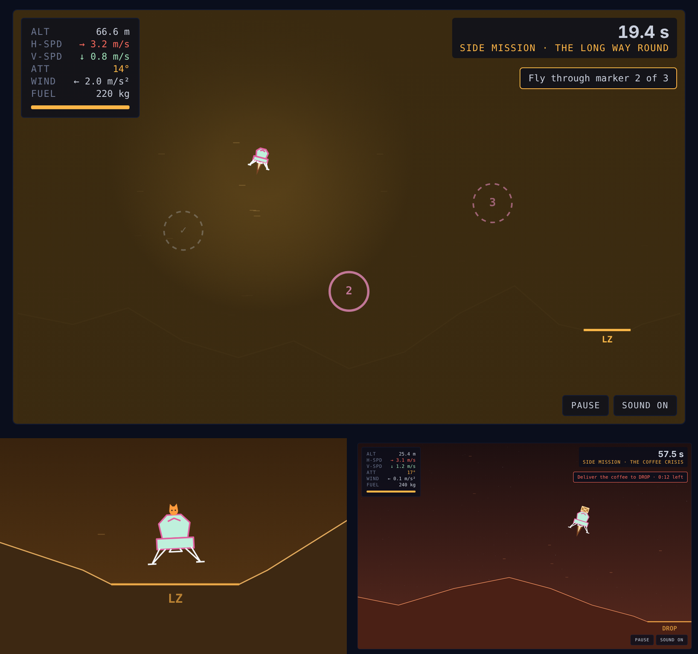

You can set down safely on any pad and lift off again. Each mission awards up to three stars: one for finishing, one for fuel left, and one for time. Every new star pays credits. If you fail, your last attempt flies beside you as a ghost.

## Badges

Open **Badges** from the menu's Journal tab to see your progress. Twenty-nine badges unlock exclusive cosmetics that can't be bought:

| Badge | How to earn it | Reward |
|---|---|---|
| First contact | Land on any pad | |
| Grand Tour | Land on the original eleven worlds (Eris doesn't count) | Grand Tour hull |
| Earthling | Land on Earth | |
| Feather | Touch down slower than 0.3 m/s | Feather Light flame |
| Plumb line | Land within 1° of level, drifting under 0.2 m/s | |
| Bullseye | Land on a ×5 pad on Mars or Earth | Bullseye flame |
| Running on fumes | Land with less than 5 kg of fuel left | |
| Clean sweep | Land at 5 sites in one solo mission | |
| Veteran | Land 25 times | Veteran flag |
| Perfect day | Finish a daily challenge without crashing | Laurel flag |
| Rival | Win a hot-seat match | Champion hull |
| Ghostbuster | In hot-seat, outscore the ghost you're racing | |
| Collector | Buy 10 items in the hangar | |
| Saver | Hold 5,000 credits at once | |
| Mission ready | Complete your first mission | |
| Campaign hero | Finish Act 1: Grounded | Pathfinder hull |
| Star collector | Earn 24 mission stars | Comet Tail flame |
| Flawless | Earn all 27 stars in Act 1 | Mission Patch flag |
| Frontier hero | Finish Act 2: Lift Off | Apex Gold hull |
| Signal chaser | Finish Act 3: Adrift | Burning Blue hull |
| Kind words | Finish Act 4: The Slingshot | Long Way Home hull |
| Off-roader | Finish every round trip | Field Kit hull |
| Beat Rex | Finish Hopscotch faster than Rex's 90 seconds | Rex's Racing Flag |
| Spa treatment | Deliver Biscuit's spa crate without a crack | Spa Day hull |
| Barista | Finish The Coffee Crisis with 15 seconds to spare | Espresso flame |
| Cat whisperer | Land Stowaway with Apogee at 75% comfort or better | Paw Print flag |
| Surveyor | Fly Wren's whole survey route on Venus | Wren's Original hull |
| Brain freeze | Deliver Gus's ice cream on Mercury less than half melted | Solar Flare flame |
| Stone skipper | Skip through all four markers on Vesta, then land | Asteroid hull |
| Blind faith | Land on Ganymede in the middle of a magnetic storm | Aurora flag |
| Hitchhiker | Land on a moving rover | Rover Yellow hull |
| Sea legs | Land on the barge rocking on Earth's ocean | Nautical flag |
| Crane operator | Set Gus's telescope down slower than 0.8 m/s | Sodium Orange flame |
| Fully loaded | Max out every upgrade in Gus's workshop | Gus Special hull |
| Long haul | Clear 10 sites in a single endless run | Infinity flag |
| Dodgeball | Land on a pad in the middle of a meteor shower | Shooting Star flag |
| Full fleet | Unlock every lander | The Fleet flag |
| Crew favorite | Earn every side-mission star | The Crew flag |

Other badges have no cosmetic reward, like **Grease monkey** (finish 10 repair jobs in the engine room).

<p align="center">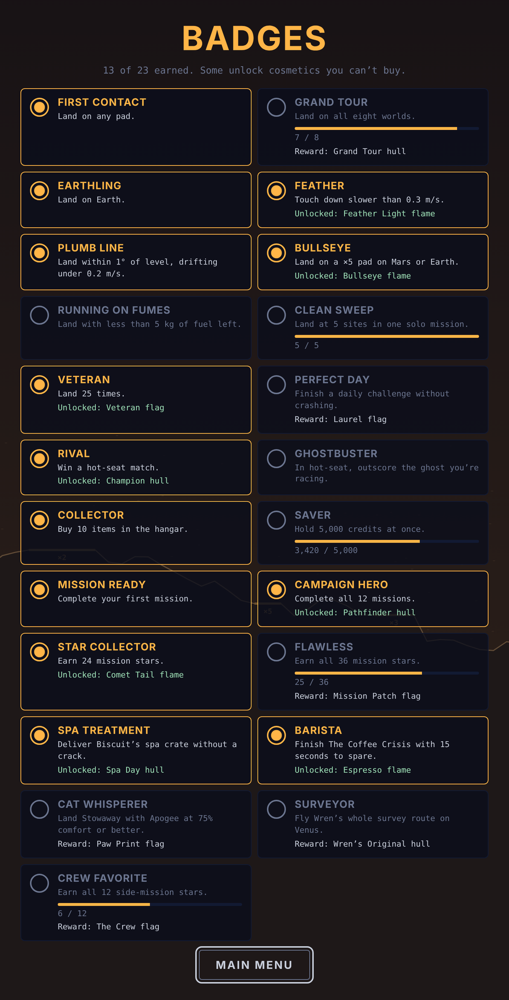</p>

## Wardrobe

Spend credits on clothes for your pilot. Open **Wardrobe** from the menu's Journal tab, or from your pilot license. What you wear shows everywhere: walking around the ship, on your license portrait and in photos.

- **Outfits:** Cozy hoodie, Workshop overalls, Bomber jacket, Holiday sweater, Moth-silk robe, Star-print flight suit, Captain's coat and Gala tux, from 800 to 3,000 credits. **License suit** switches back to your flight suit, and picking a new suit colour on your license does the same.
- **Hats:** Hair flower, Ball cap, Bobble beanie, Big bow, Party hat, Antenna headband, Star shades (400 to 1,000 credits) and a Tiny crown (5,000 credits). Hats sit on top of your glasses, goggles or headset; the helmet wins over hats.
- Tap anything to **try it on**: your pilot turns around in it and your portrait updates, then **Buy** or **Put it back**. Anything you own switches instantly.

<p align="center">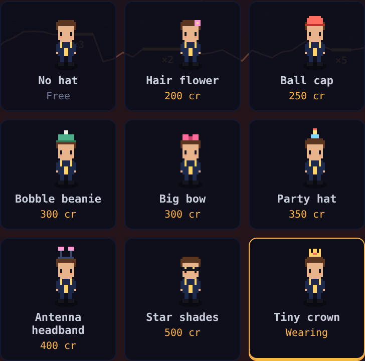</p>

## Pilot license

Open **License** from the menu's Journal tab, or tap the framed license on your Pad wall, to see your pilot ID card:

- **Your portrait**, a little pixel pilot you customize: hair style and color, skin tone, flight suit color, and glasses, goggles, a headset or a space helmet. You can also edit the name on the card.
- **Your rank**, with chevrons and a progress bar: Cadet, Junior Pilot, Pilot, Senior Pilot, Flight Lieutenant, Captain, Commander and Legend. It climbs as you land, finish missions, visit worlds and earn badges.
- **Career stats**: total landings, worlds visited, your softest touchdown, favorite world and lander (whichever you've landed with most), missions and stars, badges and crashes.
- Dottie's signature, your issue date and license number, a machine-readable strip along the bottom, and Apogee's paw-print "APPROVED" stamp once you've earned her trust on Titan.

Press **Share card** to get a crisp 1200×750 picture of it. On iPhone, **Share** opens the share sheet, so you can save it or send it to friends to compare.

<p align="center">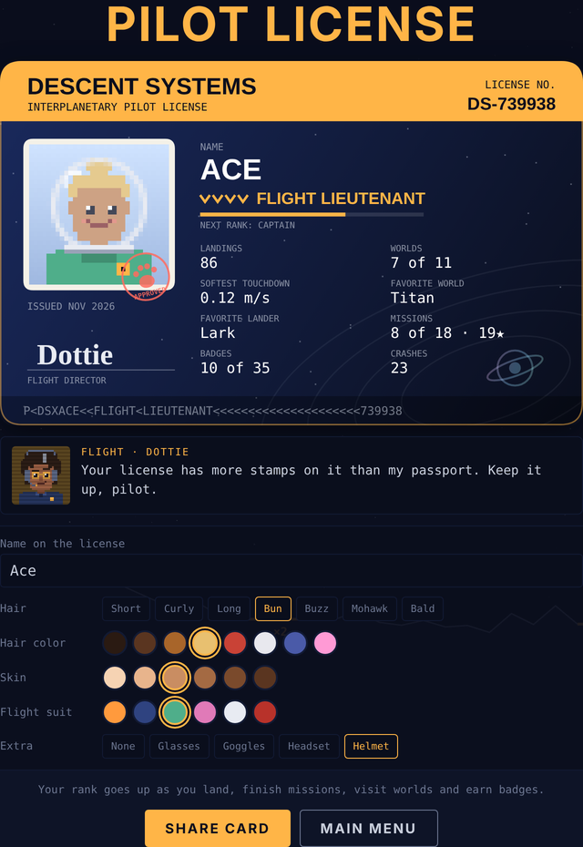</p>

## Break room


The break room is a little room you can **walk around**, in small Stardew-style pixel sprites. On phones every walkable room is zoomed in and the camera follows you, so people and things are big enough to tap; on wider screens you see the whole room at once. **Tap the floor** to walk there, or **tap someone or something** and your pilot walks over and uses it: the crew at the table, Apogee, Crumb, Blip, the radio on the counter, the coffee machine, the window, the bulletin board, the lander poster (Gus's maintenance log is behind it) and the postcard box. Conversations open with everyone's big portraits, the same as before. Gus gets up for coffee now and then. The **door on the left** goes to the hangar, the **door on the right** goes to your Pad, and the **HALL** exit at the bottom leads out to the ship's hallway. On a keyboard, walk with the arrow keys and press Enter to talk to whoever is nearest.
Walk into the **break room** to visit the crew between flights. It's a little pixel-art scene: Dottie and Gus at the table, a coffee machine that sounds like a dying whale, a window looking out on the world you flew last, a poster of Biscuit in her current paint, and a shelf with a trophy for each badge you've earned.

- Tap someone to hear what's on their mind. Everyone has well over a dozen things to say, and their lines change as you play: Dottie keeps a tally of your crashes and notices which lander you're flying, Gus comments on your feather landings, paint jobs and upgrades, Wren remembers her old routes, and the worlds you've visited, side missions you've finished and even how you've decorated the Pad come up in conversation.
- Until you finish the campaign, Wren's chair is empty, with a reserved card on the table and her photo on the wall. After the finale, she's there in person.
- Apogee the cat sleeps somewhere different every visit. Click her to pet her. She purrs, usually.

<p align="center">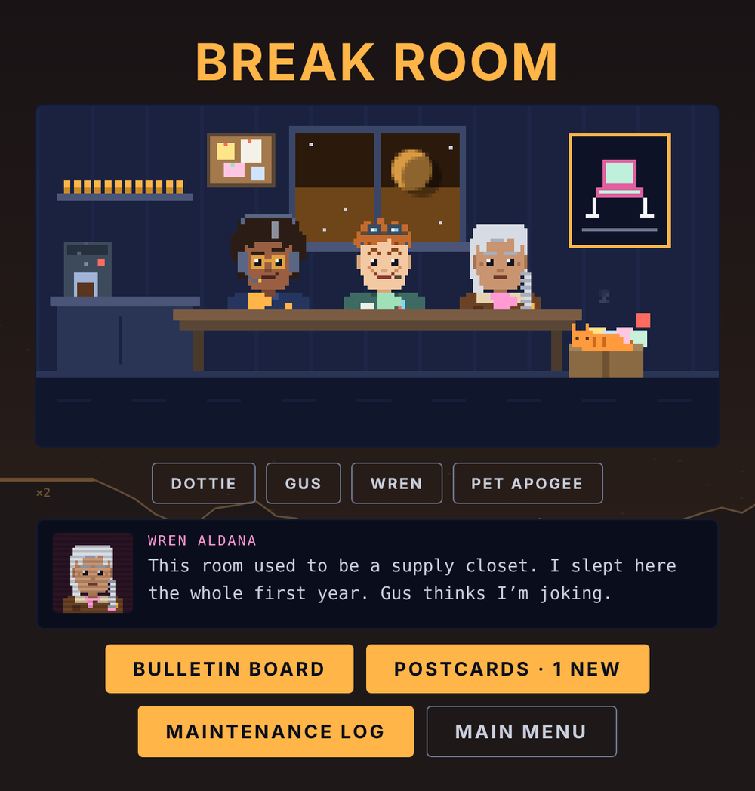</p>

- Once you've finished your first round trip, **Crumb** the rover lives here too. He trundles along the front of the room, bonks into walls and stops to look around. Some days Apogee naps on top of him while he drives. Tap him, or the **Crumb** button, and he beeps. The crew translates: he has his own lines, and he grows new ones as you finish more round trips. Dottie, Gus and Wren have things to say about him too.

- Once you've met them, a **Radio** button patches in a call from Juno on the mothership or Pim on the Moon, each with their own stack of lines. Both can also visit your Pad when you invite someone over, and they turn up in crew requests: Pim wants you to land on the Moon so she can wave, and Juno wants a docking.

- **You're there too.** Your pilot, exactly as you look on your pilot license, sits at the table with the crew and has their own mug. Change your look on the license and you change at the table. In your Pad you sit on whatever seat you've picked by the big window, and when you invite someone over they sit beside you.


### Friends ♥ (and romance)

The **Friends ♥** screen (from the menu's Crew tab) shows everyone you've met as they join in the story: Dottie, Gus, Wren (after The Neighbor), Rex (after Star Client), Juno (after Red Dock), Zib (after Market Day), Theo (after Catch!), Captain Ollo (after Lantern Light), Kael and Lyra (after The Envoys) and Kestrel (after The Rescue). Each has 10 hearts.

- **Grow closer** by chatting once a day (anywhere you find them, on the Radio or when they visit your Pad), giving one gift a day, doing their side jobs and finishing their crew requests.
- **Days on the ship are yours to end.** Press **🌙 Sleep** in the Pad, and the screen fades to night and back: it's a new ship day, so everyone can be chatted with and given a gift again, the garden can be watered again, and the crew shuffle to new spots around the ship. You need to fly at least once (land or crash) between sleeps, or Apogee will be asleep on your pillow. The current day shows at the top of the menu. The daily challenge and crew requests still follow the real calendar.
- **Gifts** cost credits. Everyone has favorites: Dottie loves fancy coffee, Gus loves a shiny wrench set, Wren loves vintage radio tapes, Rex loves premium hair gel, Juno loves a tiny fern, Zib loves anything shiny, Ollo loves a tiny desk lamp, Kael loves hair gel too, and Lyra loves flowers. Their reaction tells you how you did.
- **Hang out** at 3 and 6 hearts for a short scene with each of them. Friendship tops out at 8 hearts.

<p align="center">
  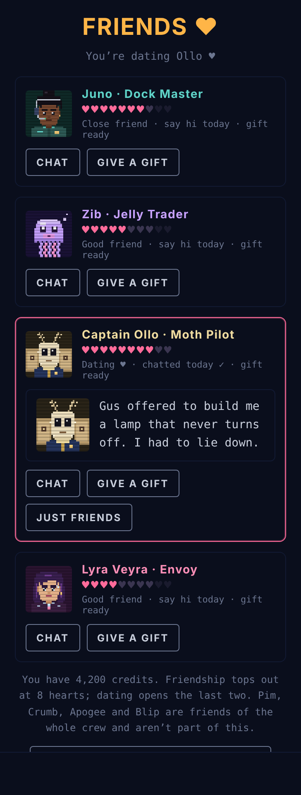
  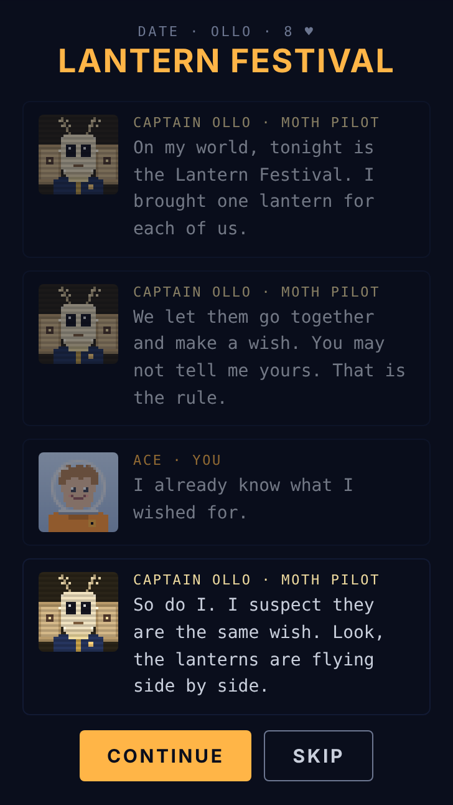
</p>

**Romance** is off by default. Turn it on in **Settings**, and once someone is at 6 hearts and you've seen their 6-heart hangout, you can **ask them out**. Dating opens their last two hearts, a date scene at 8 and another at 10, a framed photo of the two of you for your Pad's left wall, special lines, and more Pad visits. You date one person at a time, and **Just friends** (tap twice) ends it kindly. Pim, Crumb, Apogee and Blip are friends of the whole crew and are never part of romance.

**Nerri and Brix** are the newest people you can date, and you meet each of them on a side mission:

- **Nerri** (teal skin, glowing freckles, fin ears, a water-filled helmet) came up through a crack in Europa's ice to see the stars. Carry her a fresh water tank in **Bubble Trouble** (opens after Methane Canyon) and she moves aboard, spending most of her time in the garden near the sprinklers. She's amazed by everything dry: crunchy snacks, toast ("like bread, but angry") and "leaf water". Her scenes: trying every snack in the vending machine, her three-note song from under the ice, a date in the garden with the sprinklers set to rain, and the song she writes for the two of you.
- **Brix** (smooth lapis-blue stone flecked with gold, glowing amber eyes, two long head-tails banded in gold, a mossy cloak) is a poet from Vesta who thinks in centuries. Carry his four-thousand-year-old pet rock in **Rock Steady** (opens after Core Sample) and he moves into the crew wing. He loves gems as much as Zib, Rex and Lyra do. His scenes: his rock garden (a poem called "wait" that took eleven years), a geode from home, the slowest slow dance on the ship (to a whale recording), and the second line of his poem.

<p align="center"></p>

**Dating gets messy.** With Romance on, nothing stops you from seeing more than one person at once, and things get complicated:

- **Date more than one person.** Once you're dating someone, you can still ask out anyone else you're close to. They might say, "Aren't you already seeing Nerri? …I won't tell if you don't." Their Crew card shows **Dating ♥ (secretly)**.
- **Jealousy builds.** Chatting with, gifting or dating one partner while another is around makes the others suspicious. Suspicious partners start making pointed remarks: "I saw you with someone else. My helmet fogged up. Not the happy kind."
- **Getting caught.** If another partner is in the same room, they can catch you in the act. That plays a short **Busted** scene with all three of you, then a confrontation card at the top of the Crew tab with four choices:
  - **"It's not what it looks like!"** works a bit under half the time.
  - **"I'm seeing you both."** Each of them decides based on how open they are and how close you are. Zib and Nerri are easygoing about it; Rex and Dottie, not so much. If both say yes, it's out in the open and nobody gets jealous anymore.
  - **Choose one of them.** The other one dumps you.
- **Gossip travels overnight.** If someone gets suspicious enough, they may hear about it while you sleep and wake you with "We need to talk."
- **Exes.** Whoever dumps you spends the next few ship days frosty: they give cold one-liners, refuse your gifts and won't warm up from chatting. After that, you can win them back.
- **Secret admirers.** Someone close to you whom you aren't dating may slip a note under your door that smells of coffee, engine grease or seawater. Chat with the right person and they'll own up.
- **Gus's gossip corner.** It comes over the intercom, covering everything from suspicious double desserts to who's frosty with whom this week.

Turning Romance off in Settings returns everyone to being friends.

**The crew has a love life of its own.** Five pairs on the ship have a soft spot for each other: Gus and Juno, Dottie and Wren, Kael and Lyra, Zib and Nerri, and Rex and Ollo. Their crushes grow a little each night and show up under **Crew crushes** on the Crew tab, with a progress bar and a line about what they've been up to ("Gus keeps finding things to fix right next to Juno's console"). On their own they only get so far. To actually get them together, tap **Put in a good word** (once a day per pair). When the bar fills, a short scene plays where they finally confess, followed by a celebration. Couples hang out in the same rooms, get their own chat lines and turn up in Gus's gossip corner. Their cards say **With Juno ♥**, and they're off the market for you, so the last good word comes with a warning.

And it gets messier still:

- **Rivals.** If you're dating someone with a crush, their crush may start flirting with them. A card on the Crew tab warns you, and you have two ship days to chat with them and give them a gift, or they leave you for the rival (and the two of them become a couple). You can also tell the rival to back off. That usually works, but sometimes your partner snaps, "You don't own me, pilot."
- **Double booked.** Going on a date, or inviting a partner over to your Pad, might bring the other one along too. You then choose: **Stay with** one of them, **Go with** the other, or **"All three of us, then!"** That last one is either weirdly lovely or exactly the moment they both work it out.
- **The photo.** If a partner visits your Pad while the photo of you with someone else is on the wall, they will notice. "That's my… cousin" won't cut it.

<p align="center"></p>

<p align="center"></p>

<p align="center"></p>

**Hangouts and dates play as little cutscenes.** Each one has its own pixel-art backdrop to match what you're doing: Dottie's office, Gus's workshop, a picnic on the Moon (helmets on), Wren's spot overlooking Saturn, Rex's zero-g disco, a spacewalk on the hull with Juno, the glowing ice under Europa with Zib, Ollo's lantern festival, a candlelit dinner by the observation window, an embassy study and more, over 20 settings in all. The scene opens with a slow push-in and letterbox bars while the two of you walk in from either side and the title card fades up. Then the dialogue plays below the scene, and whoever's talking bobs along. Dates and asking someone out (always in the dome) have hearts drifting up, and every scene ends with a fade, plus a burst of hearts for the romantic ones. Tap the scene or **Next** to skip ahead, or **Skip** to jump to the end.

<p align="center">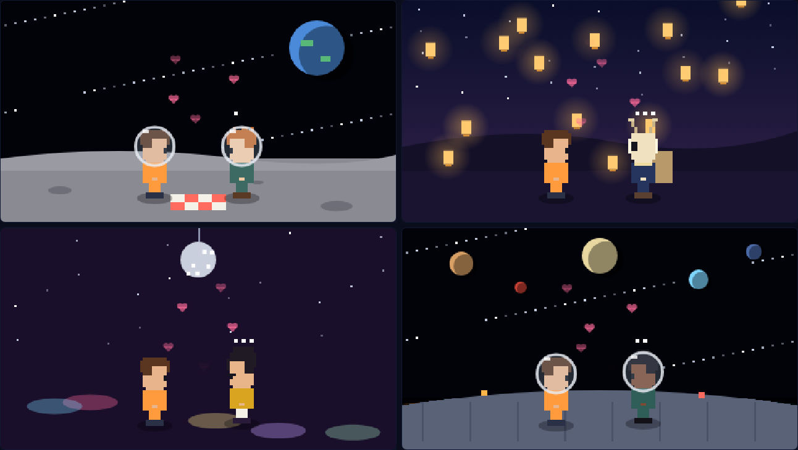</p>

### Postcards

The first time you land on each world, someone on the crew sends you a postcard: a pixel-art picture of that world with Biscuit on a pad (in her current paint) and a note on the back. Open **Postcards** in the menu's Journal tab, or tap the box in the break room corner, to see your album. Tap a card to flip it over. New cards are marked until you read them, and every world has one.

### Maintenance log

Gus writes up every crash and every hard landing in Biscuit's maintenance log. Each entry depends on what went wrong: too fast, tilted, sliding sideways, missing the pad, hitting a canyon roof or flying through an eruption on Io. He also names the dents. Open **Maintenance log** in the menu's Journal tab, or tap the Biscuit poster on the break room wall. It keeps your 40 most recent entries and a running total of repairs.

<p align="center">
  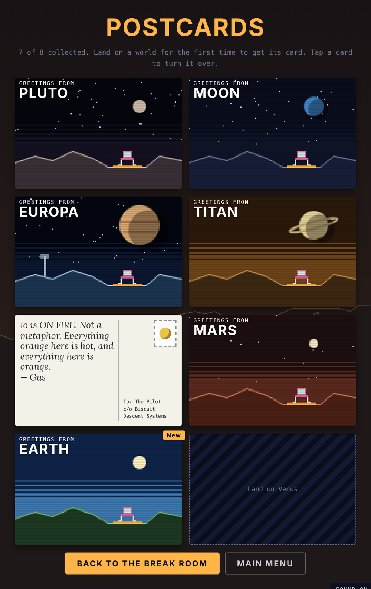
  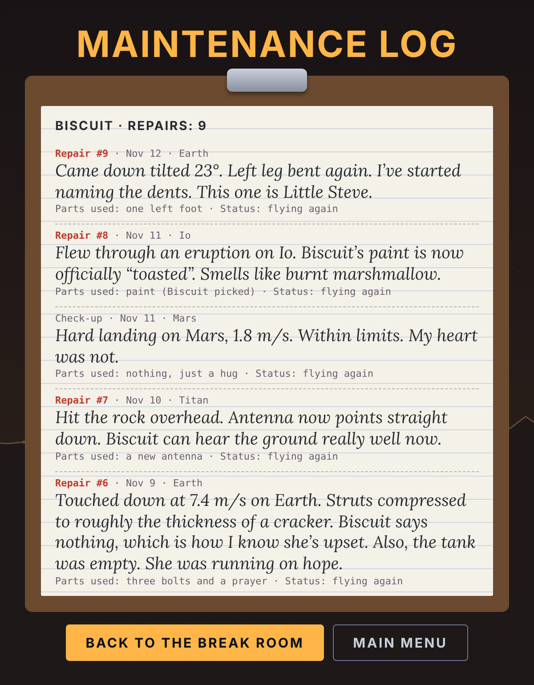
</p>

### Bulletin board

Tap the corkboard on the break room wall, or open **Bulletin board** in the menu's Journal tab, to read the notes the crew pins up. They keep track of you:

- Dottie's pad notice ("WHO KEEPS LANDING ON THE ×2 PAD") counts which free-flight pads you land on, with tally marks.
- **Landing of the week** shows your best free-flight landing: the score, the world, the pad and how softly you touched down.
- **Days since last crash** resets every time you crash.
- A lost-cat poster for Apogee, a karaoke sign-up sheet (with your name on it if you set one in hot-seat), Gus's yogurt experiment, today's daily challenge and a progress chart. Some notes change once you've finished certain missions.

<p align="center">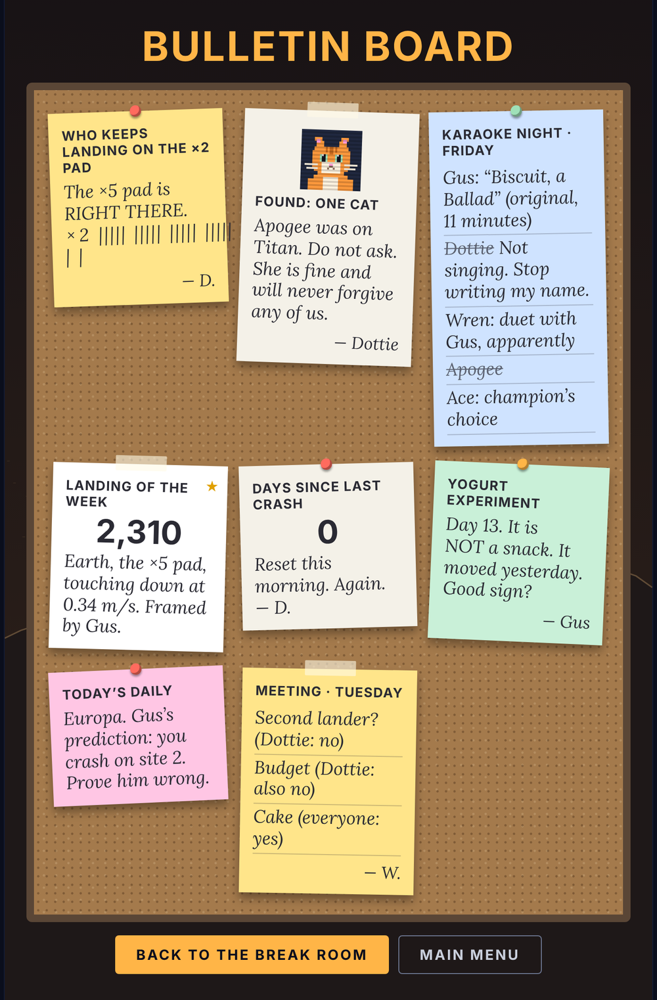</p>

## The Moon base

Until the Second Wind flies, the crew lives in a small base on the Moon: one cramped corridor with prefab walls, rubber floor matting and a painted walkway.

- **GARAGE**: Biscuit's hangar, as before.
- **OFFICE**: Dottie's desk, where the flight deck (missions, free flight, daily challenge, mining) lives in Act 1.
- **The hangar window**: a big window onto the Second Wind on her cradle. She changes with every Act 1 repair: lights in her windows, patched plating instead of holes, Wren's engine bell, blinking life-support lights, a nav dish, a blue reactor glow, an engine flicker after Test Fire, and finally a green **READY** sign. Tap it and Gus or Dottie tells you how far along she is and which job pays for the next repair.
- **Bills board**: a pinboard of overdue bills by the office. It gets emptier as you fly. The red one from the bank is called Gerald.
- **KITCHEN**: Bao's kitchen, with warm prefab walls, a red-and-cream diner floor, his old **BAO'S** sign flickering on the wall and a window onto the Moon and Earth.
- **BUNKS**: **your bunk**, your Pad in base form. Everything you decorate comes with you, and its big window looks out on grey lunar hills with Earth in the sky.

<p align="center"></p>

The base gets more crowded as the crew grows, which is a running joke: a stack of salvaged plating after Scrap Run, Wren's armchair after The Neighbor, Rex's luggage tower after Star Client, a humming reactor core after Moonquake. The crew hang out in the corridor and the kitchen, the phone's Map shows the base, and the garden and ship projects wait for the ship. After Liftoff (Act 2), everyone moves aboard and the decks below open up.

## The ship

The ship has **three decks**, stacked on top of each other, and each has its own corridor that scrolls as you walk. Tap anywhere to walk, or tap near either edge of the screen to keep walking that way. Step out of any room and you're in the corridor of the deck that room is on.

| Deck | Look | Doors |
|---|---|---|
| **1 · Command** | Clean blue panels, a long window strip full of stars, a cool guide light down the floor | The Bridge, the observation dome (sealed until you fund its repair), Dottie's office (sealed, being repainted) |
| **2 · Living** | Warm walls, wooden floorboards and a long runner rug, the project board and bench | The garden, the galley, the break room, your Pad, the crew quarters wing |
| **3 · Engines** | Copper pipes along the ceiling, metal grating, a hazard stripe down the middle | The hangar, the airlock and the cargo bay (both sealed for now), the engine room |

Every deck has a **LIFT** door, with the deck number painted big on the wall beside it. Step into the lift and press a deck on its panel (or walk up to the button panel inside). The doors slide shut, the display counts the decks, the car hums and shakes a little, and a ding lets you out on the new deck, right by its lift door. On the menu's **Ship** tab, the ship map and the room list both show which deck every room is on, and you can still jump straight to any of them.

Tap a sealed door and someone on the intercom tells you why it's shut, for now. The break room still has its side doors to your Pad and (down the stairs) the hangar. Crumb sometimes trundles along the corridors, and so does the crew (see [The crew's day](#the-crews-day)).

<p align="center"></p>

<p align="center"></p>

### Ship map

The menu's **Ship** tab opens with a cross-section **map** of all three decks, front of the ship on the left. Each deck shows its rooms in the order you'd pass them, with the lift shaft in the middle and sealed rooms hatched with a lock. A colored dot with an initial marks where each crew member is right now (anyone in their room, or visiting a friend, shows up in Crew), and an amber **You** marks where you are. The strip under each deck is its corridor, so you can see who's wandering where. Tap a room to go straight there, tap a corridor to step out onto that deck by the lift, or tap the lift shaft to step into the lift.

<p align="center"></p>

### Life between decks

- **Crew use the lift too.** Crew wandering the corridors are on a particular deck, and every so often one strolls to the lift door and heads off to another deck with a ding. You'll find them there later (the map knows where they went).
- **Sometimes you share the lift.** Step in and someone might already be riding: tap them to chat (everyone has their own lift small talk). Pick a deck and they ride along with you, and if they were out wandering, they step out onto the new deck right beside you.
- **The intercom.** Every couple of minutes while you're walking around the ship, the intercom chimes and a banner drops in at the top of the screen. Mostly it's Dottie: reminders when something's ripe in the garden, Gus has repairs waiting, there are new missions on the Bridge, or it's an event day, plus plenty of ship chatter (“Gus to the engine room. Your coffee is boiling over. Again.”).

<p align="center"></p>

**The Bridge** sits behind the big double doors on deck 1. A huge curved window looks down on the world you flew last, with three consoles in front of it:

- **Nav console** (middle): opens the **flight deck** with every way to fly. A red light means there are new missions.
- **Comms** (left): takes a call from Juno, Pim, Zib, Ollo or the Veyra twins, whoever you've met, with their face on the screen. It counts as chatting with them for the day, the same as the Radio in the break room.
- **Star map** (right): a dot for every world, lit once you've landed there.

The **captain's chair** sits in the middle of the room. Walk up to it and you sit down. Rex Valor leans by the left wall once he's joined (after Star Client), and Captain Ollo stands on the right once you've met. Tap them to chat. The **Flight deck** button under the room is a shortcut to the nav console, and the **HALL** exit at the bottom takes you back out.

<p align="center">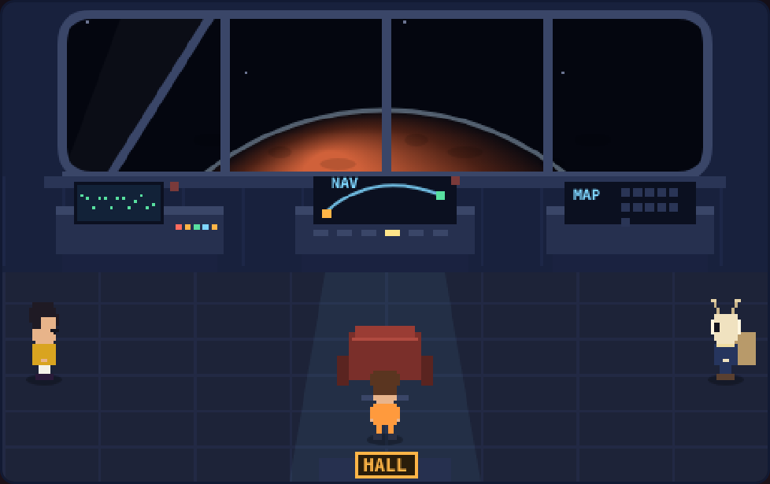</p>

**The Garden** is behind the GARDEN door, a hydroponics room with six planters under pink grow lamps.

- **Plant:** tap a planter and pick a seed. Moon tea and Tiny ferns cost 20 credits and take 2 landings, Hydroponic flowers and Coffee beans cost 30 and take 3, and Cacao pods cost 40 and take 4.
- **Grow:** crops grow a little every time you land safely, anywhere in the game. Walk up to the **tap** on the left once a ship day (sleep in your bunk to start a new one) to water everything for an extra day's growth.
- **Harvest:** a ripe planter sparkles (and so does the GARDEN door on deck 2). Tap it and press **Harvest** to put the crop in your basket.
- **Give:** on the **Friends ♥** screen, homegrown gifts show up first in the gift list, marked 🌱. They're free, and they give a little extra ♥ on top of the usual amount. Each crop becomes the matching gift (tea, fern, flowers, coffee beans or chocolate), so everyone's tastes still count.
- The **seed cabinet** on the right gives Gus's tips on who loves which crop, based on who you've met.

<p align="center">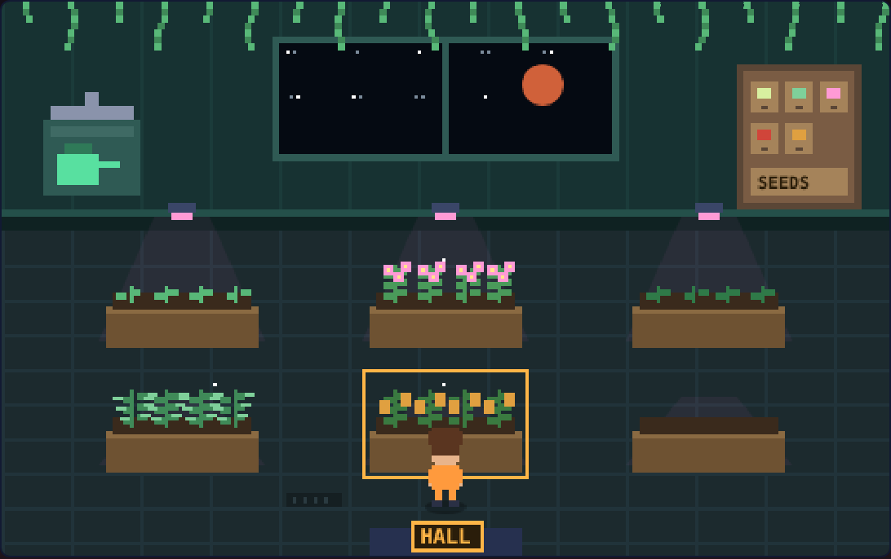</p>

**Crew quarters** are behind the CREW door: a carpeted corridor with a bedroom door for each crew member and guest (Dottie, Gus, Wren, Rex, Juno, Zib, Ollo, Kael and Lyra). Doors for people you haven't met yet say VACANT.

- **Rooms open at 3 hearts.** A locked door has a red light by the handle instead of a green one. Knock, and whoever's inside tells you to get to know them better first, or Dottie reminds you of the rule (she made the rule).
- **A warm light under a door** means that person is home. The doors are plain, though a few people have stuck something on theirs: a wrench on Gus's, a gold star on Rex's and a little jelly on Zib's.
- **Inside**, every room is decorated in its owner's style: Dottie's filing cabinets and Employee of the Month posters, Gus's half-built coffee robot and lava lamp, Wren's pinned flight maps and forty years of logbooks, Rex's poster of himself and trophy shelf, Juno's tea set and ferns, Zib's spoon collection and a tank of jelly cousins, Ollo's moth lamp and teacups, Kael's mirror and treaty drafts, and Lyra's diaries and embassy chocolates. Tap anything and its owner tells you about it.
- If you're dating someone, a framed photo of the two of you hangs over their bed.
- If the owner is home you can chat with them there, and sometimes a friend is visiting too. If they're out, Dottie tells you where they went.
- There's a snack machine at the end of the corridor. Results vary.

<p align="center">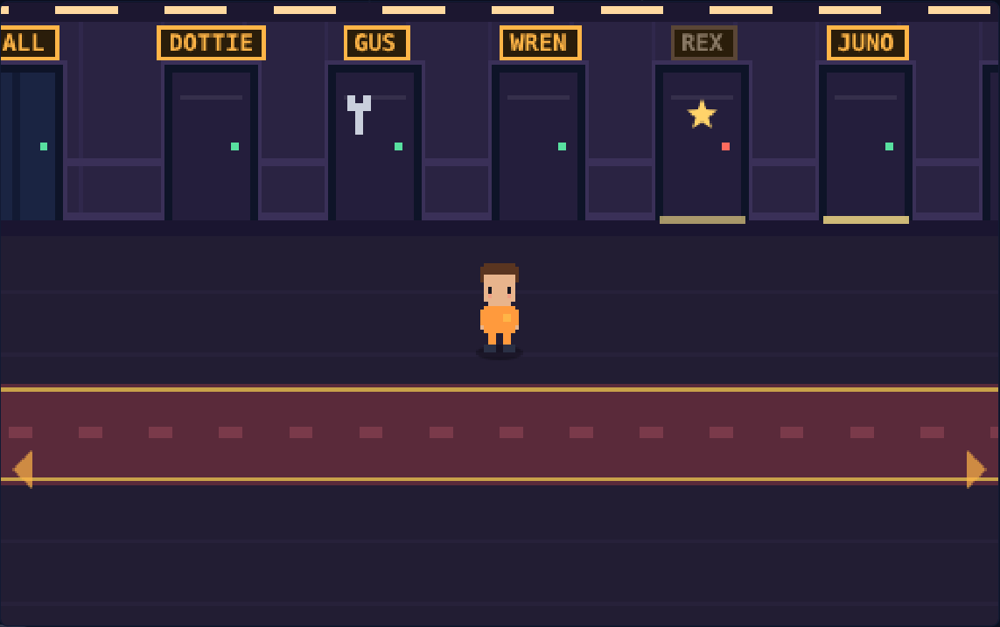</p>

### Ship projects

A corkboard over the bench on deck 2 holds Gus and Dottie's **repair projects**. Tap it (or open **Ship projects** from the menu's Today tab) to chip in credits a bit at a time: +100, +500, or finish it in one go. Partial payments are saved, and each finished project changes something on the ship and gives whoever posted it a few hearts.

| Project | Cost | What it does |
|---|---|---|
| Fix the hallway lights | 800 cr | The flickering ceiling lights go steady and warm |
| Open the Pad balcony | 2,500 cr | Unseals the glass door in your Pad onto a balcony of your own |
| Garden sprinklers | 3,000 cr | The garden waters itself every new ship day |
| Hallway lounge corner | 4,000 cr | A couch, rug and lamp along the deck 2 corridor |
| Break room jukebox | 5,000 cr | Wren's old jukebox plays again in the break room corner |
| Repair the observation dome | 12,000 cr | Opens the dome |

**The observation dome** sits behind the DOME door once it's repaired: a glass dome full of twinkling stars and the world you last flew, over a round platform with a telescope, a curved bench and two plants. Tap the telescope for what it's pointed at, the bench to sit a while (your partner has things to say there), or the sky. The crew sometimes go stargazing here instead of the garden.

<p align="center">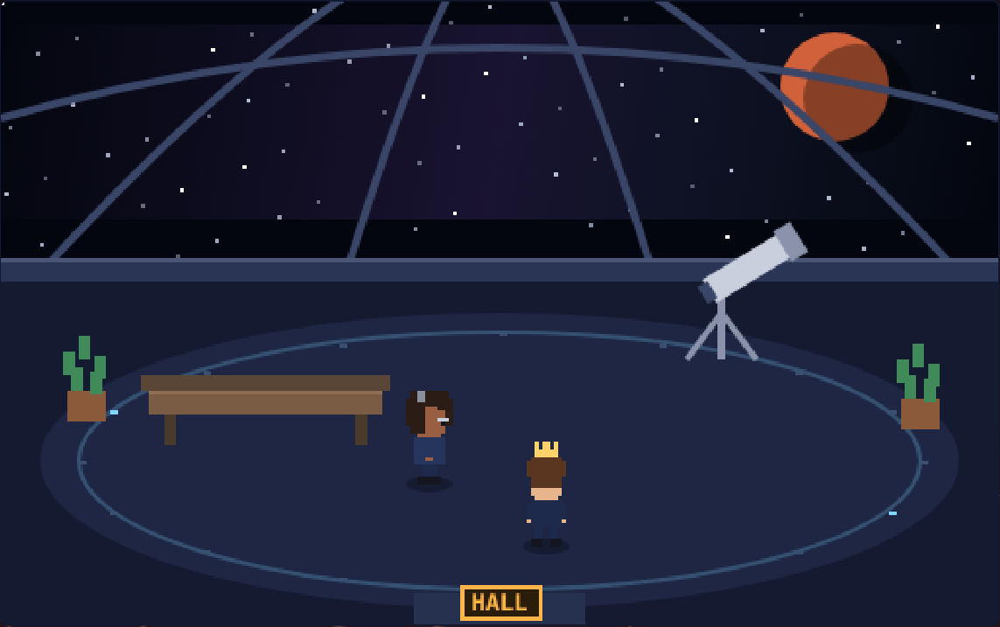</p>

### Engine room

The **ENGINE** door on deck 3 opens on Gus's domain: a tall glass core with rings of light rising through it, Gus's workbench and tool board, two wobbly gauges, a big red lever that isn't connected to anything, and the **power junction** panel on the right. Gus spends a good part of his day in here.

Something on the ship breaks every day, so Gus has **three repair jobs** each ship day, like a jukebox that plays one note, a coffee maker that makes soup, or Rex's hair dryer tripping the whole deck. Walk up to the junction and start the next job: it's a pipe puzzle. Tap a pipe piece to turn it, and connect the glow from the core on the left all the way to the broken part on the right. Each fix pays 120 credits, plus 60 more if you do it tidily (in no more than two turns over the fewest possible). The three jobs grow from a 4×4 grid to 5×6. The gauges and the junction lights show amber while something is still broken and go green when the day's jobs are done. Finish 10 repairs for the **Grease monkey** badge.

<p align="center"></p>

<p align="center"></p>

### Side activities

Three things to do between flights, all paying out in credits or gifts:

**Asteroid mining.** Press **⛏ Asteroid mining** in the hangar, or pick it on the flight deck, to take the little mining pod into the belt. Drag your finger (or use the arrow keys) and the pod follows. Scoop up copper (12 cr), gold (40 cr) and the occasional gem, and dodge the tumbling rocks: three dents and you head home early. Runs last 45 seconds and get busier as they go. Ore sells automatically; gems can be sold for 100 cr each or kept as gifts (Zib, Rex and Lyra love them, and everyone else likes them). You get **3 runs per ship day**; sleeping refuels the pod.

<p align="center">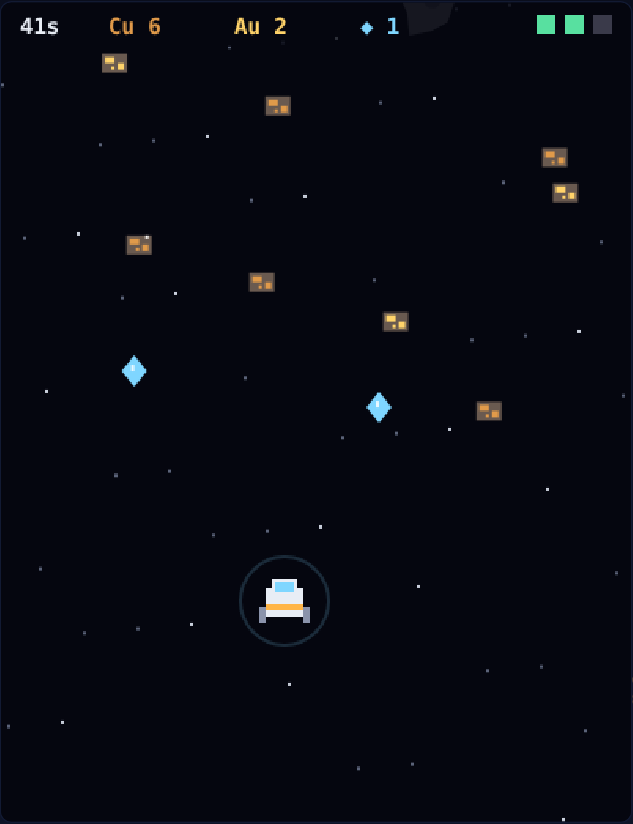</p>

**Cooking in the galley.** The GALLEY door on deck 2 leads to a tiled kitchen with a pantry, a stove, a sink and a fridge (Gus's yogurt is in there; don't touch it). Walk up to the stove and pick a recipe, each made from two garden crops: **Homemade mocha** (coffee + cacao), **Moon tea cakes** (tea + flowers), **Fern soup** (fern + tea), **Chocolate flower tart** (cacao + flowers) and a **Breakfast plate** (coffee + fern), plus two that Bao teaches you: **Garden dumplings** (fern + flowers) and **Spiced cocoa** (tea + cacao). Then tap **Stir!** three times while the marker is in the green zone, which gets narrower and faster each stir. Three good stirs make two portions, one or two make one, and a miss on all three burns it (Gus eats it anyway). **Meals are the best gifts on the ship**: everyone loves a home-cooked meal, and they give extra hearts on top. Bao the cook is usually there, and Dottie, Gus and Wren sometimes sneak in for a snack.

<p align="center">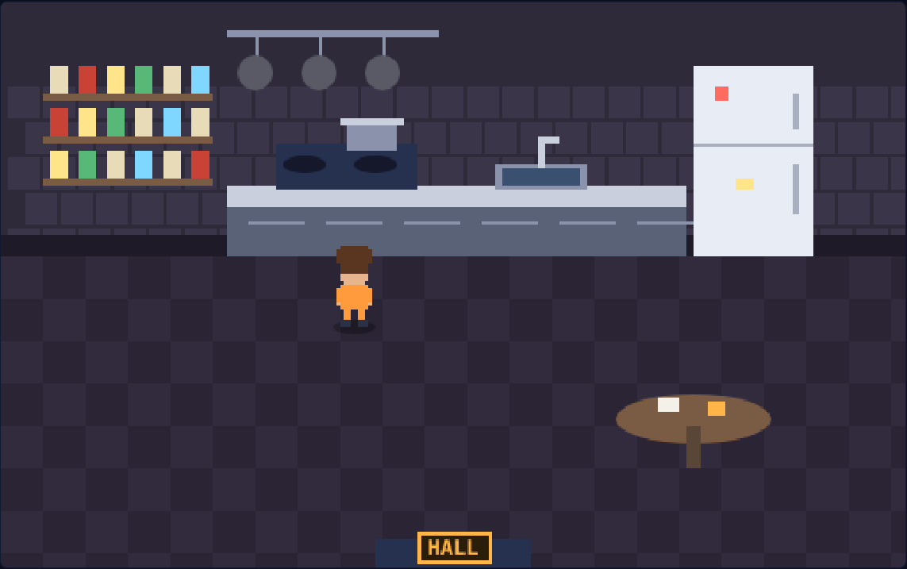</p>

**Salvage with Crumb.** Walk up to Crumb's charging dock in the hangar and pick a world you've landed on. Crumb hops a supply drone and is away from the ship (he won't be in any rooms) until you've flown once. When he's back he bounces on his dock until you come and see: 100 to 300 credits of salvage, a one-in-three chance of a gem, either some excellent junk (a rock shaped exactly like Gus) or, rarely, a real find worth another 600 credits. The menu's Today tab tells you where he is, and the Hangar gets a **New** tag when he's home with loot.

Gems and meals go in the same basket as garden crops, so they show up first in the gift list on the Friends ♥ screen, marked 💎 mined or 🍳 homemade.

### New crew

The crew grows as the story goes. Bao is in the base kitchen from the start, Kit stows away in Act 2, and Marisol and Dash join through the story; Tamsin is the one applicant left on the recruitment board. They all have hearts, gifts, chat lines, two hangout scenes (at 3 and 6 hearts), a room in the crew wing, lift small talk and visits to your Pad. They're friends only: no dating.

- **Kit, the cadet** (blue jacket, red team cap) stows away in a crate on Earth in First Port. The first time you step out into the ship after that, Kit introduces himself and then **tags along a step behind you for three ship days**, with something to say about every room ("Do the plants have names? I'm going to name that one Kevin."). After that he studies on the Bridge, mostly. His hangouts are his first simulator run and the day he earns his cadet wings.
- **Bao, the galley cook** (chef's hat, big mustache) runs the galley and feeds everyone whether they're hungry or not. Kit tells you about him; say hello in the galley. Bao teaches you **two new recipes** through his hangouts: **garden dumplings** (fern + flowers) after his 3-heart scene, and his grandmother's **spiced cocoa** (tea + chocolate) after his 6-heart scene.
- **The recruitment board.** The menu's **Crew ♥** tab ends with **Crew applications**. Each applicant shows up there (and Dottie mentions them on the intercom) once you've flown far enough, with a short audition in Side missions. Pass it and they move into the crew wing:
  - **Doc Marisol**, a medic (teal scrubs, soft dark waves, thin gold glasses): fifteen years on the Mars ambulance runs, grumpy on purpose, kind underneath. The Venus resort's medic; you pick her up in Dead Air.
  - **Tamsin**, a botanist (a cloud of red hair with a leaf in it): grew a forest on a comet and talks to the garden, where she spends most of her day. Applies once the ship reaches Titan, with an audition in Side missions.
  - **Dash**, a courier (racing goggles, yellow jacket): the fastest courier in the inner system, always on the move around the corridors. An Apex courier you rescue in Left Behind.

**Two more dateable crewmates:**

- **Theo Okafor**, Juno's dock deputy (orange dock jumpsuit, short fade, a grease smudge on one cheek): cocky, warm, never left Mars until now, and calls you "ace". He fires the supply pods at you in Catch! and joins right after. Loves pastries and old radio tapes. As co-pilot (**Dockhand**), pickups and pods pay 50% more. His dates: the pod launcher, his first time off Mars, a telescope on the hull, and the speech he's been saving.
- **Kestrel**, ex-Apex ace (silver undercut, navy flight jacket): cool, competitive and slowly thawing, and she times everything. Joins after The Rescue. Loves energy gel and star charts. As co-pilot (**Racing line**), time stars are 25% easier. Her dates: your lap times, the Apex badge she can't throw away, a midnight flight with no clock, and a new number worth keeping.

Both have rooms in the crew wing (the snack machine moved down the corridor to make space), chat lines, texts, gifts, lift and Pad visits, and their own drama if you date around. Theo can be lost in the buyout like other crew; Kestrel is story crew and always safe.

Kit and Bao also post crew requests: Bao asks you to cook something in the galley, and Kit wants three landings in a day for his tally.

<p align="center"></p>

<p align="center"></p>

### The crew's day

The crew don't sit in one place any more. Every 15 minutes of real time, and every time you sleep, everyone picks somewhere to be:

- **Dottie, Gus and Wren** are usually at the break room table. Their chair is empty when they're somewhere else.
- **Rex and Ollo** usually hang about the Bridge.
- **Juno, Zib, Kael, Lyra and Doc Marisol** mostly stay in their rooms.
- **Bao** is usually in the galley, **Tamsin** in the garden, **Kit** on the Bridge (once he's done tagging along with you), and **Dash** is always somewhere in the corridors.
- Now and then anyone might **wander the corridors**, pop into the **garden** or **visit a friend** who's at home. Visitors show up in the host's bedroom, and both have something to say about it.

Tap anyone you meet to chat. It counts as your daily chat for hearts, wherever you find them. The **Crew ♥** tab in the menu shows where everyone is right now (📍 In the break room, Wandering the corridors, Visiting Zib…) and whose room is open to you. If you walk into an empty break room, Apogee has taken all three chairs.

<p align="center"></p>

### Evenings

Each ship day starts in the morning. After your third flight the lights start to turn warm, and by your sixth it's night: every room on the ship goes golden and dim, with a soft glow around the edges. The first time it turns evening, someone on the crew mentions it, and the ship menu shows the time of day next to the day number. Sleep in your bunk to start a fresh morning.

<p align="center"></p>

### Celebrations

The big moments get confetti, a little fanfare and a cheer from the crew: finishing an act, completing a ship project, buying your first outfit or hat, finishing all three crew requests in a day, and every badge. Friendships get their own version, with pink pixel hearts floating up each time someone's heart level goes up, a bigger burst when you max out a friendship, and a shower of hearts when you start dating someone.

<p align="center"></p>

### Ship events

Every fourth ship day is a holiday aboard. When you wake up on one, the sleep screen tells you what's on, the host says hello, and bunting goes up across the top of every room, along with something themed floating around (falling leaves, music notes and a disco ball, balloons, gold sparkles, paper stars or snow). The menu's **Today** tab shows today's event and its goal, or which one is coming up and in how many days.

Each event has one small goal. Finish it and the party starts the next time you walk into a room on the ship. It's a proper cutscene, around a dozen lines long, with **everyone you've met on stage** (the host plus up to seven of the crew):

- **The camera glides to whoever's talking,** and they step forward while they speak. Everyone else turns to look at them.
- **Stage directions:** people dance, cheer, jump and spin on cue (all of Polka Night ends with the whole crew dancing), little pixel emotes pop over heads (♪ ♥ ! ? …), confetti bursts on the big moments, and narration lines set the scene in italics.
- **Apogee makes an entrance** at her own birthday (and joins the cocoa pile).
- **Newer crew get cameos** once you've met them: Tamsin's tomatoes at the Harvest Feast, Dash and Ollo at Polka Night, Marisol checking whether crowns are food, Nerri seeing a meteor shower for the first time.
- **Your partner** finds you near the end ("Come stand with me. Best spot at the party. ♥"), and **an ex** is "only here for the snacks".

The same staging runs every other scene in the game too:

- **Hangouts and dates.** You and your crewmate walk in from opposite sides. Lines get a light touch of acting (a heart over someone's head, a little jump on an exclamation, a question mark), floating hearts drift up on romantic dates, and on the last line of a romantic scene the two of you step close together.
- **Drama.** In **Busted**, you and the person you're with are standing close when the door opens and your other partner storms in from off stage. When you're double booked, the second date walks in mid-dinner (or knocks on your Pad door). **The photo** gets a "?", then a "!".
- **Story intros.** A mission's opening radio chat plays on a set that suits whoever starts it: Dottie's office, Gus's workshop, Juno's dock, Zib's market, Ollo's lantern room, the embassy for the Veyra twins, and so on. Rovers and other voices without a body talk from off stage.

Afterwards you get 300 credits, the host gets some hearts, and the first time you celebrate each event you get a keepsake for your Pad's shelf.

| Event | Host | Goal | Keepsake |
|---|---|---|---|
| Harvest Festival | Gus | Give someone a homegrown gift: a crop, a gem or a home-cooked meal | Harvest gourd (with a face) |
| Polka Night | Gus | Fly until the lights go warm in the evening, then come to the break room | Polka record |
| Apogee's Birthday | Dottie | Find Apogee and give her a birthday pet | Apogee's party hat |
| Launch Day | Dottie | Land three times in the day, anywhere | Launch Day pin |
| Starfall Night | Wren | Watch the meteor shower from the dome, or from the Bridge window if the dome isn't open yet | Star jar |
| Cocoa Night | Dottie | Cook something in the galley | Cocoa mug |

The six events take turns, so each one comes around every 24 ship days. Keepsakes have their own group in the Pad's shelf picker.

<p align="center"></p>

<p align="center"></p>


## The Pad

**The Pad** is your own cabin, where the game starts, a cozy retro-future spaceship room. It has curved walls, glowing light strips along the ceiling, a capsule bunk, a window bench with cushions, a backlit shelf alcove, a floating desk with an egg chair, and a big rounded window looking down on a planet. It's a room you can **walk around**: your decorated cabin fills the back wall, and a floor in your chosen flooring runs toward you. **Tap anywhere** to walk, even right up against the furniture, so you can pose for photos without opening anything. Furniture only reacts to taps while you're decorating; outside of that, **Play the arcade** opens the arcade cabinet and the menu's Journal tab has your license. Guests you invite wander around the room as little sprites, admiring things, and you walk up to them to chat. Apogee naps on the furniture, Crumb rolls around the floor, and the **door on the right** opens onto the hallway (or back to the break room, if that's how you came in). The Pad opens as a **big, uncluttered view** of the room with the decorating panels tucked away. Press **Decorate** to open the full editor with every spot and item (while decorating, tap a piece of furniture and your pilot walks over and opens the picker for that spot), and **Done decorating** to close it and get the big room back. On a keyboard, arrow keys walk and Enter uses whatever's nearest. You can also pick a spot from the buttons under the room to change what goes there:

| Spot | What can go there |
|---|---|
| Left wall | Lander poster (in your current paint), star chart, company pennant, Apogee calendar, solar system map, a signed Rex Valor poster, a wall aquarium with two fish, a round brass mirror, hanging vines |
| Window | In orbit over the last world you flew, blinds down, Earth from orbit, Saturn, a nebula, a Jupiter close-up, a comet that sails past every few seconds |
| Right wall | A wall clock that keeps your real local time, your pilot license, a mission patch, a crew photo, a flickering neon LAND sign, a dartboard, a wall of framed records |
| Shelf (6 spots) | Your souvenirs (below), plus a cactus, flight manuals, okayest-pilot mug, rubber duck, snow globe, model rocket and gold trophy, plus a bubbling lava lamp, a little snow globe of the base and a Zib plushie |
| Desk | Desk lamp, succulents, a retro computer, the crew radio, a scale model of your lander, a fishbowl (the goldfish is called Captain), a steaming espresso machine |
| Corner | Potted fern, beanbag, a cat bed for Apogee, mini fridge, guitar, telescope, an arched floor lamp, a monstera, a big speaker that thumps, or a working arcade cabinet (see below) |
| Rug | Orange rug, striped runner, Saturn rug, cat face rug, a teal shag rug, a swirling galaxy rug |
| Bedding | Six colors for the bunk and your seat's cushions and fabric: crimson, cloud cream, blush pink, tangerine, starry night and mint |
| Seating | Where you (and a guest) sit by the big window: the window bench, a comfy couch, a bean bag pair you sink right into, a hammock between two posts, or a hover sofa with a soft glow underneath. Fabric follows your bedding colors |
| Walls | Ivory hull, moon white, blush, graphite, the classic navy bulkhead, a twinkling starfield, mint, forest green or sunset peach |
| Flooring | Plush carpet, gloss floor, glowing light panels, rose carpet, deck grating, wood floor or tatami mats |
| Lights | The color of the glowing strips: amber, ice blue, rose, color-cycling aurora, pulsing red alert, a disco ball, flickering candlelight, a rippling underwater ocean glow, or night mode with just the window and your reading light |

Free items are yours from the start. Everything else costs 100 to 2,000 credits. Tap an item to try it in the room first, then buy it or put it back. Each shelf item can only sit on one shelf at a time. Your room is saved in your browser along with everything else.

<p align="center"></p>

### The balcony

Fund **Open the Pad balcony** on the repair board (2,500 cr) and the sealed glass door on the left of your Pad opens onto a **balcony**: a glassed-in deck with a railing and a huge view. Walk through the door, or tap **Balcony →**, and **← Back inside** to return. Your guest comes too and has something to say about the view. It decorates just like the Pad: tap **Decorate**, pick a spot, try things, then buy them.

| Spot | What can go there |
|---|---|
| The view | Saturn, Earthrise over the Moon, a pink and violet nebula, Jupiter filling half the sky, a green aurora over an icy moon, twin suns setting |
| Railing | String lights that twinkle, rainbow bunting, flower boxes, glowing paper lanterns from Ollo's festival, wind chimes (Gus rigged a fan) |
| Left and right planters | Tomato vine, sunflowers, a bonsai, glowing mushrooms, a purple space cactus, a lemon tree (Bao keeps stealing the lemons) |
| Seating | Striped deck chairs, a hammock that sways, a porch swing, beanbags, or a bubbling, steaming hot tub (Dottie has filed eleven forms) |
| Side table | A brass telescope, a smoking grill, a tea table, a crackling fire pit, a record player with drifting notes |
| Decking | Teak planks, steel grating with stars between the slats, fake grass, terracotta tiles, or a glass floor with nothing but space underneath |

<p align="center"></p>

### The arcade cabinet

Put the **arcade cabinet** (2,000 cr) in your Pad's corner, then tap it, or press **Play the arcade**, to play **Descent Systems Classic**: a tiny green vector-graphics lander game in the style of the 1979 arcade machines, on a glowing CRT screen with scanlines.

- Turn with ◀ ▶ (or ← →) and hold **Thrust** (or ↑ / Space). On phones, the three big buttons under the screen support holding thrust while you turn.
- Each round drops you in from the top left, drifting sideways, over new jagged terrain with three pads: 2×, 3× and a narrow 5×. The view zooms in as you get close to the ground.
- A perfect landing scores 100 × the pad's multiplier and refills a little fuel. A hard landing scores 30 ×. Crashing costs 150 fuel, and the game ends when the tank runs dry.
- It keeps a top-five high score table. The crew are already on it, and Gus's 2,400 sits at the top under the name "NOT GUS". Beat it and he'll mention it in the break room.

<p align="center">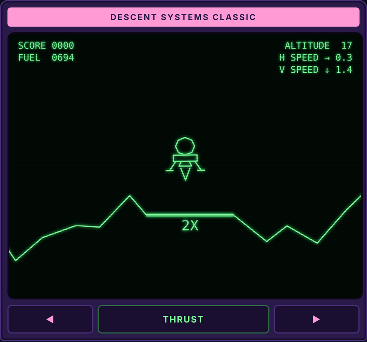</p>

### Photo mode

Press **Take a photo** in the Pad to snap a crisp 1200×600 picture of your cabin, with Apogee and whoever's visiting, and a small "Descent Systems · The Pad" caption in the corner. On iPhone, **Share** opens the share sheet, where **Save Image** puts it in your photos (you can also press and hold the picture). On a computer, **Save** downloads it as a PNG. Saving doesn't work in sandboxed previews, but it does on the hosted game.

### Souvenirs

The first time you land on each world, you bring a souvenir home for your shelf, along with that world's postcard. You can't buy them; the shelf picker shows which ones you still need and where to land to get them:

| World | Souvenir |
|---|---|
| Pluto | A chunk of the heart-shaped ice plain |
| Moon | A Moon rock in a glass case (officially "sample 0047") |
| Europa | An ice shard that sounds like the ocean, or the air vent |
| Ganymede | A bottle of aurora that glows and sometimes plays polka |
| Titan | A jar of orange haze. Do not open |
| Io | A sulfur crystal that smells like a very angry egg |
| Vesta | A rock chip that floats over a magnet stand |
| Mercury | SPF 9000 sunscreen |
| Mars | A vial of red dust that pours like an hourglass |
| Venus | A sealed jar of cloud |
| Earth | A seashell from the ocean by the landing barge |
| Eris | A jam-jar copy of the first-burn guidance beacons that blinks three times |

#### Crumb's finds

Each round trip also brings home a shelf item, found by Crumb: three moon rocks (one looks like Dottie), the old beacon bulb from Mars, one of Rex's ice crystals, a slice of Wren's Europa ice core, the pebble Apogee brought you from Titan, and Juno's lucky keychain from the lost luggage. Show and Tell earns Pim's crayon drawing of you, Biscuit and Crumb for your left wall. They have their own group in the shelf picker. Crumb also visits the Pad, rolling around the floor, and you can tap him there to say hi.

### Company

The Pad isn't empty for long:

- **Apogee** lets herself in on most visits and naps somewhere: on your bunk, the window bench, the rug, sunk into a beanbag, or flat across your keyboard. Tap her, or press **Pet Apogee**, to wake her up. Buy the **cat bed** and she'll use it most of the time, though she'll pretend she isn't impressed.
- **The crew drop by.** About half the time someone is already sitting on your window bench when you walk in: Dottie, Gus, Wren once she's home, or Rex once you've rescued him. Press **Invite someone over** to knock on another door.
- **They notice your decor.** Gus gets excited about the arcade cabinet and the disco ball, Dottie spots the mug she gave you and the red alert lighting, Wren recognizes her star chart and gets misty over the piece of Pluto, and Rex is delighted to find his own poster on your wall. Souvenirs get comments too. If someone's visiting when you buy or place something, they react to it on the spot. Tap them, or press **Chat**, for another comment.

<p align="center">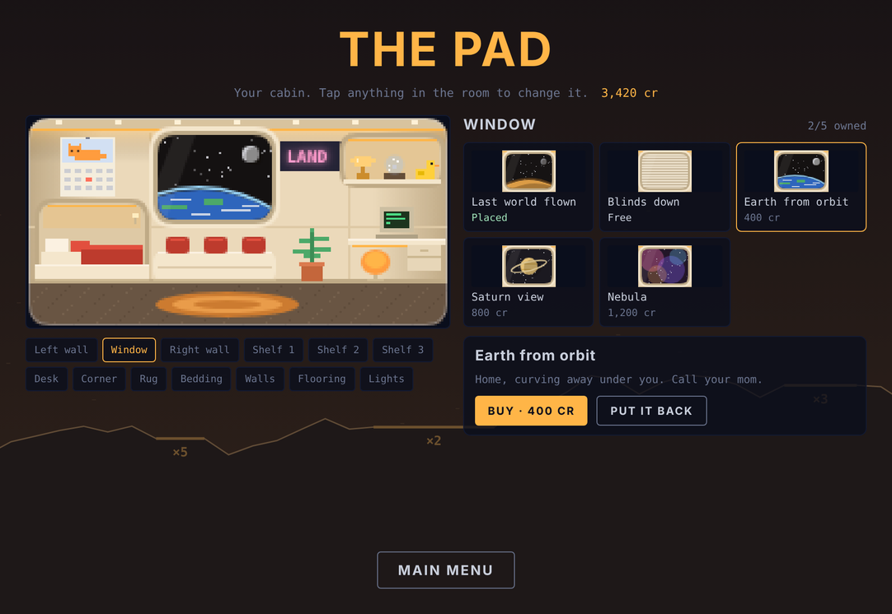</p>

## Endless run

Choose **Endless run** on the flight deck for a roguelike run: how far can one lander go?

- Every site is on a random world. The first two come from the gentler worlds, Io, Mercury and Mars join from site 3, and Earth and Venus from site 6. Terrain gets rougher as you go.
- **Fuel carries over.** Each landing refuels you a little: +15 kg for a ×2 pad, +25 for ×3, +30 for a ×4 moving pad and +40 for ×5.
- After every landing, Gus offers **three perks** and you pick one: a spare fuel canister, a bigger tank, a tuned engine, soft struts, wide feet, steady hands, free gyros, a wind shield, landing radar, a fuel refinery, or (rarely) a spare lander that saves you from one crash.
- One crash ends the run. Your best run (sites cleared and points) shows on the menu.
- Workshop upgrades are switched off during a run, so every run starts on the same lander. Landing points still earn credits.

## Ghost links

After any free-flight landing, press **Challenge a friend**. On iPhone that opens the share sheet. Elsewhere, the link is copied so you can paste it into a message.

When your friend opens the link, the game greets them with "**Ace challenged you**", showing which world and site you flew and the score to beat. They fly the exact same terrain from the exact same start, wind and rovers included, with your ghost flying beside them in pink. At the end, a scorecard shows who won. They can race again as many times as they like, watch the replay, or press **Send your ghost back** to challenge you on the same site with their own run.

<p align="center">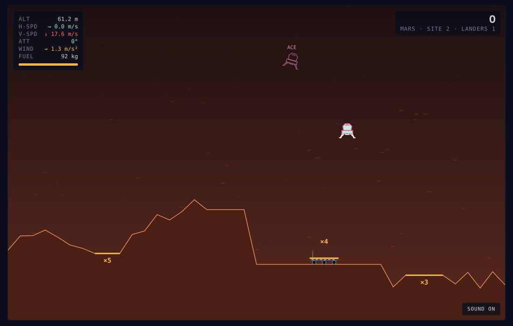</p>

No server or account is involved. Each free-flight site is built from a random seed, so the link only carries the world, the site number, the seed, your score and your flight path, sampled 15 times a second, delta-encoded and compressed. A typical link is a few hundred characters long. Links always open the game on GitHub Pages.

## Hot-seat mode

Choose **Hot-seat** on the flight deck and enter both names.

- A match is 3 rounds, and both pilots fly the exact same descent each round: same terrain, same starting drift, same wind.
- Whoever goes second races a ghost of the first pilot's run.
- The first pilot alternates every round, and the highest total after three rounds wins.

In solo, retrying after a crash also restarts you from the same spot with a ghost of your last attempt.

## Crew requests

Every day the crew posts three small jobs. Open **Crew requests** from the flight deck or the menu's Today tab to see them. Each one shows who's asking, a progress bar and what it pays:

| From | Request | Pays |
|---|---|---|
| Gus | Land twice under 0.5 m/s | 300 cr |
| Dottie | Land on a given world twice | 250 cr |
| Dottie | Land on a ×5 pad twice | 350 cr |
| Wren | Land with at least half your fuel left | 300 cr |
| Gus | Land twice with under 2° of tilt | 250 cr |
| Gus | Land on a moving rover or the barge | 350 cr |
| Dottie | Reach site 3 in a single free flight | 350 cr |
| Dottie | Earn 3 stars in missions | 300 cr |
| Dottie | Finish all three sites of the daily challenge | 300 cr |
| Gus | Reach site 4 in an endless run | 350 cr |
| Dottie | Send a friend a ghost challenge | 200 cr |
| Apogee | Pet Apogee three times | 150 cr |
| Gus | Score 600 in the arcade (once you own the cabinet) | 300 cr |
| Bao | Cook something in the galley (once you've met him) | 250 cr |
| Kit | Land three times in a day | 250 cr |

Requests count from free flight, missions, the daily challenge, endless runs and ghost races. Credits are paid the moment you finish one, and the crew member who asked pops up at the bottom of the screen to react in their own words. Gus frames your fuel receipt, the rover driver reviews your landing on her roof, and Apogee marks the appointment as completed. Finishing all three adds a 250 credit bonus, plus a gold star on your file from Dottie. Requests change at midnight UTC, the same time as the daily challenge, and everyone gets the same three each day, so friends can compare. Until Wren is home, Gus takes over her request.

## Daily challenge

Choose **Daily challenge** on the flight deck. Everyone who plays on the same day gets the same world, terrain, starting drift and wind.

- You fly 3 sites in a row with one lander. A crash ends the run.
- Retry as often as you like. Your best score for the day is saved.
- **Copy result** gives you a spoiler-free summary to send to friends:
  ```
  Descent Systems daily 2026-11-12
  Mars 🟩🟩🟥 1,240 pts
  ```
- The world rotates daily through all eleven. The challenge changes at midnight UTC, so friends in different time zones always get the same one.

## Save backup

**Settings** is split into four tabs: Flying (zoom, rotation, ghosts, controls), Sound, Story (story scenes, romance, replay intro or tutorial) and Save (backup and new game).

**Welcome back.** When you open the game, a card shows where you are: your act, the next mission, whether you need to sleep first, the day, unread texts and credits, plus the Second Wind as she is right now (dusty in the hangar, burning in Act 2, dark and drifting, blue engines, or parked home by the Moon).

All your progress (hearts, dates, ship projects, the garden, your wardrobe, everything) is saved in your browser. iPhone Safari can clear that storage for websites you haven't visited in a while, so the game has a backup in **Settings → Save backup**:

- **Copy save code** copies your whole save as one line of text starting with `DSAVE1:`. Paste it into your Notes app, an email to yourself, anywhere safe.
- **Download save file** saves the same code as a small `.txt` file, on browsers that allow downloads.
- **Restore**: paste a code into the box (or pick a save file) and press **Restore from code**. It shows whose save it is, the ship day, the credits and the date it was made, and asks you to tap once more before it replaces your current progress.

It's also how you move your save to a new phone or computer.

**Saves from before the new story** aren't wiped. The first time you open the new version, a screen explains the story has been rebuilt, shows your current save code to copy, and offers two choices:

- **Keep my stuff, start the new story**: keeps credits, landers and paint jobs, your Pad, crew hearts, side missions, badges and records. Only the old story progress is cleared, and the new intro plays. Crew rejoin as the new story reaches them, and the ship's rooms open after Liftoff.
- **Start completely fresh**: wipes everything (tap twice to confirm).

Old save codes can still be restored, and they go through the same choice.

**New game**: under Settings, **Start a new game** wipes everything and starts over. The first tap puts your current save code in the box so you can keep it; the second tap wipes.

## Install it on your phone

Descent Systems is an installable web app, so it can live on your home screen and play offline.

- **Android (Chrome):** tap **Install app** in the menu's Journal tab, or use the browser menu's **Install app** / **Add to Home screen**.
- **iPhone/iPad (Safari):** tap **Install app** in the menu's Journal tab for a reminder, then tap the **Share** button and choose **Add to Home Screen**.

Once installed, it opens full-screen and works without a connection. When you're online, it picks up new versions automatically. On iPhone, the home-screen app keeps its own save data, separate from Safari.

## Running locally

1. Clone the repo:
   ```
   git clone https://github.com/ChaseHarding/Descent-Systems.git
   ```
2. Open `index.html` in a browser.

For live reloading while you edit, use the **Live Server** extension in VS Code (right-click `index.html` → *Open with Live Server*).

## Tweaking the game

Most of the tuning lives near the top of the `<script>` block in `index.html`:

- **`WORLDS`**: gravity, engine thrust, drag, wind, colors and terrain roughness for each world. Add an entry here to create a new world.
- **`SAFE_VY`, `SAFE_VX`, `SAFE_ANG`**: the landing limits (soft struts add to `SAFE_VY`).
- **`UPGRADES`**: Gus's workshop upgrades, their prices and effects.
- **`BURN`, `RCS_BURN`**: fuel use for the main engine and rotation.
- **`HULLS`, `FLAMES`**: hangar items and their prices.
- **`ZOOM_MAX`, `ZOOM_START`, `ZOOM_FULL`**: how the auto-zoom camera behaves.
- **`ROUNDS`**: the number of rounds in a hot-seat match.
- **`MISSIONS`, `SIDES`**: the campaign and the side missions. Each entry has its terrain, pads, fuel, star goals and any special rule (`fragile`, `timeLimit`, `comfort`, `rings`). Multi-stop missions add `legs`: each leg has a `name`, an optional radio `say` line and `windMul`, and `goals` (`pickup`, `drop` with optional `keep`, `visit`, `land`, `exit`, plus `refuel`, `text` and `done` on any pad goal).

To give yourself credits while testing, open the browser console on the game page, run the following, and reload:

```js
localStorage.setItem('ds-credits', 5000)
```

## Notes

`manifest.webmanifest`, `sw.js` and the `icon-*.png` / `apple-touch-icon.png` files make the game installable and offline-capable. `sw.js` has a `VERSION` you only need to change if you rename or remove those files.

The `media/` folder holds the images used in this README (`landing.gif`, `crew.png`, `story.png`, `menu-crew.png`, `flight-deck.png`, `missions.png`, `side-missions.png`, `hangar.png`, `badges.png`, `break-room.png`, `pad.png`, `arcade.png`, `license.png`, `intro.png`, `ghost-race.png`, `bulletin-board.png`, `postcards.png` and `maintenance-log.png`, `new-friends.png`, `friends.png`, `date.png`, `round-trip.png`, `decks.png`, `lift.png`, `ship-map.png`, `lift-rider.png`, `kit-bao.png`, `recruits.png`, `nerri-brix.png`, `messy-romance.png`, `crew-crushes.png`, `double-booked.png`, `pad-decor.png`, `balcony.png`, `multi-stop.png`, `worlds.png`, `copilots.png`, `phone.png`, `surprises.png`, `bridge.png`, `garden.png`, `quarters.png`, `visit.png`, `dome.png`, `wardrobe.png`, `date-scenes.png`, `mining.png` and `galley.png`) plus `social-preview.png`, the picture GitHub shows when someone shares the repo link (set it under **Settings → General → Social preview**).

`og-image.png` is the share preview: the picture chat apps and social sites show when someone pastes the game's link. The tags that point to it are at the top of `index.html`.

Progress is saved in your browser's local storage, so it stays on that device and browser. Clearing site data resets it, and players sharing one browser share one wallet.

Fonts are [Chakra Petch](https://fonts.google.com/specimen/Chakra+Petch), [IBM Plex Mono](https://fonts.google.com/specimen/IBM+Plex+Mono) and [Caveat](https://fonts.google.com/specimen/Caveat) (the handwriting on the bulletin board), loaded from Google Fonts.
