# Descent Systems


A Lunar Lander–style browser game. Pick a world, fight its gravity and weather, and set your lander down on a flat pad before the fuel runs out.

**▶ Play it here: [chaseharding.github.io/Descent-Systems](https://chaseharding.github.io/Descent-Systems/)**

The whole game is a single `index.html` file: plain HTML, CSS and JavaScript on a canvas, with no frameworks, build step or server.

## Features

- **Eleven worlds** with real surface gravity, each with its own sky, terrain and atmosphere, plus geysers on Europa, eruptions on Io, blinding clouds on Venus, fuel-boiling sunlight on Mercury, a spinning asteroid and instrument-scrambling storms on Ganymede
- **Moving landing pads**: rovers that drive back and forth across most worlds, and a barge rocking on Earth's ocean. Match their speed, then touch down
- **Meteor showers** on airless worlds: red markers and dotted tracks show where each meteor will land, so you can dodge them
- **Guided tutorial** that teaches a first landing step by step
- **Wind and air drag** on worlds with an atmosphere, shown on a live wind gauge
- **Auto-zoom** that eases the camera in for the final approach
- **Landing replays**: rewatch any touchdown or crash with a close camera and slow motion, plus dust, screen shake and a slow-motion beat on soft landings
- **Five landers** that fly differently: Biscuit the all-rounder, Rex's fast and thirsty Apex Vector, Wren's slow, steady Lark, Dottie's Workhorse cargo hauler and Whisker, the twitchy little lander Gus built for Apogee. Each keeps its own paint, flame and flag
- **Credits and a hangar** where you spend your banked points on hull finishes and engine flames
- **Gus's workshop**: upgrades for a bigger fuel tank, a more efficient engine, softer landing struts and a landing radar that shows where you'll touch down
- **Mission campaign**: 26 hand-built missions in three acts, with precision landings, cargo runs, canyon flying and rescues, each rated 1–3 stars, plus a story told over the radio by a small pixel-art cast
- **Side missions**: seventeen optional jobs from the crew, each with its own twist: fragile cargo, a coffee countdown, a cat passenger, a survey route through the clouds of Venus, melting ice cream on Mercury, skipping across an asteroid, a blind landing in a magnetic storm, landing on a moving rover, flying a telescope on a swinging cable, landing through a meteor shower, a pad-hopping race against a rival, aurora photography and shadow hopping on Mercury
- **Round trips**: nine missions where landing is only the start. Crumb the rover rolls down a ramp to grab samples, fix beacons or find a runaway cat, then you launch again and dock with the mothership
- **Break room**: hang out with the crew between flights. They chat about how your career is going, and Apogee the cat naps somewhere new every visit. It also holds a bulletin board, a postcard album and Biscuit's maintenance log
- **The ship**: the break room, Pad and hangar are joined by a walkable **hallway**, which leads to **the Bridge**, where you pick missions at the nav console, take calls on comms and sit in the captain's chair. A **garden** where you grow homegrown gifts for the crew, and sealed doors to an observation dome and the crew quarters that hint at rooms still to come
- **The Pad**: your own cozy spaceship cabin to walk around in. Walk up to any spot in the room to decorate it with posters, shelf trinkets, desk gadgets, rugs, bedding, seating, wall finishes, flooring, glowing light strips and the view out the big window
- **Endless run**: one lander, random worlds, fuel that carries over, and a perk from Gus after every landing
- **Hot-seat mode** for two players taking turns on the same descents
- **Ghost replay** that lets you race a see-through copy of your friend's run, or your own last attempt
- **Ghost links**: after a free-flight landing, send a friend a link. They fly your exact terrain from the same start, racing your pink ghost, and can send their own ghost back
- **Synthesized sound**: engine rumble, thrusters, wind, a low-fuel alarm, touchdowns and crashes, with no audio files
- **Generated music**: slow, drifting pads on the menus, a cozy swung track in the break room, and flight music that speeds up and builds as you get closer to the ground. It's all composed in code as you play
- **Daily challenge**: the same world and terrain for every pilot each day, with a shareable result
- **Crew requests**: three small jobs from the crew every day, like soft landings, ×5 pads, rovers or petting Apogee, each paying credits, with a bonus for finishing all three
- **37 badges** to earn, 28 of which unlock exclusive cosmetics
- **Pause** with P or Esc, and automatic pausing when you switch tabs
- **Touch controls** on phones and tablets
- **Saved progress** for best scores, credits and unlocks, kept in your browser

## Worlds

| World | Gravity | Conditions | Score bonus |
|---|---|---|---|
| Pluto | 0.62 m/s² | No atmosphere, slow and floaty | ×0.75 |
| Vesta | 0.25 m/s² | A tiny asteroid: barely any gravity, ground that curves away at the edges, and a spin that pushes you outward from the middle | ×1.25 |
| Moon | 1.62 m/s² | No atmosphere, the classic | ×1 |
| Europa | 1.31 m/s² | Vapor geysers burst from the ice and shove you upward | ×1.25 |
| Ganymede | 1.43 m/s² | Auroras overhead. Magnetic storms roll in every so often and scramble your instruments, so you land by eye | ×1.5 |
| Titan | 1.35 m/s² | Thick air drag, light wind | ×1 |
| Io | 1.80 m/s² | Volcanic vents glow, then erupt. Touching an eruption is a crash | ×1.75 |
| Mercury | 3.70 m/s² | A huge sun and no air. Sunlight boils fuel out of the tank, so hop between the shadows of crater rims | ×1.75 |
| Mars | 3.71 m/s² | Thin air, gusting dust storms | ×1.5 |
| Earth | 9.81 m/s² | Fast falls, strong wind | ×2.5 |
| Venus | 8.87 m/s² | Extreme mode: crushing air, hurricane winds, and clouds that hide everything except the pad beacons | ×3 |

## Life on the ship

There's no title menu. The game opens inside the ship, in **your Pad**, and everything is a room you walk to. Your Pad's door opens onto the **hallway**, which links the **Bridge**, the **break room**, the **garden** and the **hangar** (see [The ship](#the-ship)). When you finish a flight or close a screen, **Back to the ship** returns you to whichever room you were last in.

**The ship menu.** Every room has a **☰ Ship menu** button (or press Escape). It lets you jump straight to any room, with **New** tags where something is waiting: fresh postcards or a radio call in the break room, new missions on the Bridge, a crop ready in the garden, new decorations in the Pad. Below the rooms are **Flight deck**, **Friends ♥**, **Badges**, your **pilot license**, **Settings**, **How to play** (the tutorial) and **Install app** where your browser supports it.

<p align="center">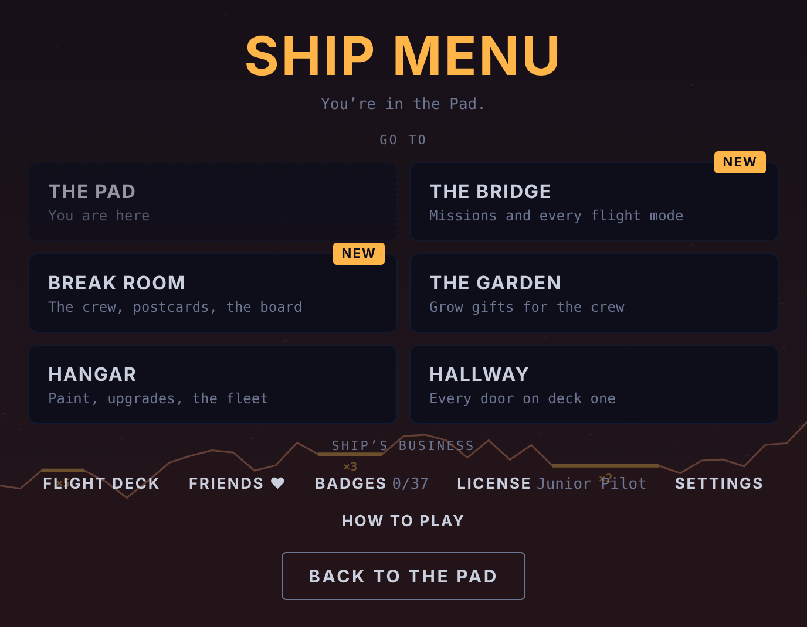</p>

**The flight deck.** Walk up to the nav console on the Bridge (or press **Flight deck** under the room, or pick it from the ship menu) to choose how to fly: **Missions**, **Free flight**, **Daily challenge**, **Hot-seat** and **Endless run**, plus a **Crew requests** strip showing who's asking and how many of today's jobs are still open. Screens you open from here come back here.

<p align="center">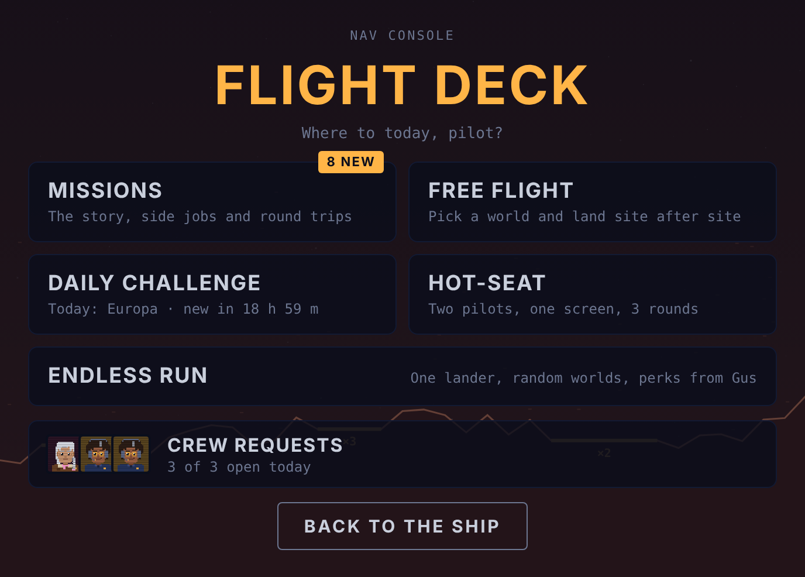</p>

### First launch

Brand-new players get a short guided start, about two to three minutes:

1. **Welcome aboard.** Dottie comes on the radio, and six quick illustrated cards introduce Descent Systems: the supply-closet head office, Biscuit (Gus would like you not to scratch her), the bake sale that paid for her, and Apogee, who technically outranks you.
2. **Your pilot license.** Type your name and pick your look, then Dottie stamps it **LICENSED · CADET**.
3. **The certification flight.** This is the tutorial. It holds the lander in place while you learn to fire the engine and tilt, then switches gravity on and walks you through your first landing, with a nervous Gus on the radio.
4. **Meet the crew.** A short guided tour of the break room: the crew, the bulletin board, today's crew requests, your first postcard, Gus's maintenance log and Apogee.
5. **Your Pad.** Gus brings a housewarming gift (pick a lander poster, a fern or a rug) and shows you how decorating works, while Apogee claims your bunk.
6. You're left in your Pad, and Dottie points you to the Bridge, where **Missions** on the flight deck is marked **Start here**.

<p align="center">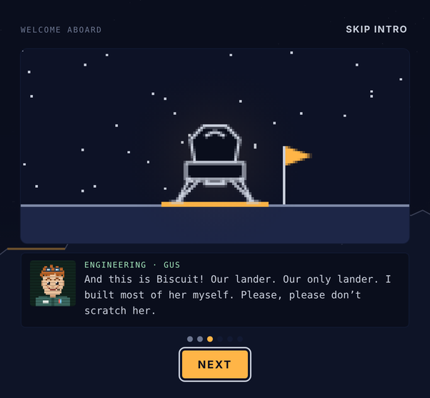</p>

Every step has a **Skip** button. Players with an existing save never see the intro, and anyone can watch it again from **Settings → Replay intro**. Players who skip it can still start the tutorial from **How to play** in the ship menu.

**Settings** has switches for full 360° rotation, auto-zoom, story scenes, ghosts, sound and music, plus a list of the controls.

## How to play

Land with **both feet on a pad** while staying inside the safe limits:

- Vertical speed under **2 m/s**
- Horizontal speed under **1 m/s**
- Tilt under **10°**

The HUD readouts turn amber, then red, as you go past each limit. If you crash, the game tells you which limit you broke.

### Controls

| Key | Action |
|---|---|
| ↑ / W | Main engine |
| ← → / A D | Rotate |
| ← → (world picker) | Switch world |
| Space / Enter | Start or continue |
| H | Open the hangar |
| R | Open the break room |
| Z | Toggle auto-zoom |
| G | Toggle ghosts |
| M | Toggle sound |
| N | Toggle music |
| P / Esc | Pause and resume (Esc also backs out of menus) |
| B | Open badges |
| Esc | Back out of a menu screen |

On touch screens, on-screen **ROT / THRUST / ROT** buttons appear below the game, and a **Pause** button sits in the corner while you fly. While Crumb the rover is out on a round trip, the same keys and buttons drive it: ← → (**DRIVE**) roll it along and ↑ (**HOP**) jumps.

### Scoring

- Pads pay **×5**, **×3** or **×2**. The narrowest pad pays the most.
- From the second site on, many worlds can add a **moving pad worth ×4**: a rover driving back and forth on a flat track (Pluto, Vesta, the Moon, Ganymede, Titan, Mercury and Mars) or a barge rocking on the sea (Earth). Only your speed relative to the deck counts, so match its speed before you touch down. The driver hits the brakes once you're aboard. Missing the barge means splashing into the ocean.
- From the second site on, Pluto, Vesta, the Moon and Mercury sometimes have a **meteor shower**. Before each meteor lands, a pulsing red marker appears on the ground with a dotted track up into the sky, about two seconds ahead. Getting hit is a crash. The shower's timing is fixed when the site is built, so daily and hot-seat pilots face the same one.
- Unused fuel adds a bonus, and a touchdown under 0.8 m/s adds another 50 points.
- The world's score bonus multiplies the total.
- In solo, you have 3 landers. Each new site has rougher terrain and less fuel.

## Hangar

Every point you score is banked as credits the moment you touch down. Spend them in the hangar on cosmetics. Cosmetics never change how the lander flies.

Walking into the **hangar** takes you into the **garage**, a room you walk around like the break room. Your current lander stands on the landing pad in the middle in its own paint, every other lander you own is parked in the side bays, and the ones you haven't unlocked yet wait under covers (walk up to one to hear how to get it). The big hangar door is rolled up onto the world you flew last, with Gus's workbench and a fuel tank on one side and Crumb's charging dock on the other. **Walk up to a lander** to open the hangar screen on it, or use the **workbench** (or the *Open the hangar* button) for the one you're flying. The hangar's *Back to the garage* button brings you back, and the door on the right leads to the break room.

The hangar is a garage: Biscuit hovers over the pad in front of a big open door looking out on the world you flew last, and Gus works at his bench and comments on everything you put on her.

- **Tabs** for **Hull**, **Flame** and **Flag**, each showing how many you own.
- **Try anything on.** Click an item to see it on Biscuit in the garage.
- **Your look** adds up the hull, flame and flag you're trying on, shows the total cost, and buys and equips everything in one go (or resets to what you had).
- **Locked badge rewards** say which badge earns them and how close you are, with a progress bar where there is one.

### The fleet

The top of the hangar shows your five landers. Tap one to fly it. Each lander remembers its own hull, flame and flag, so you can dress them all differently.

| Lander | Who it's from | How it flies | How to get it |
|---|---|---|---|
| **Biscuit** | Gus | The all-rounder: balanced in every way | You start with her |
| **Apex Vector** | Rex | 22% stronger engine, turns 45% faster, but burns 40% more fuel from a 15% smaller tank, with stiffer legs (safe touchdown 0.2 m/s lower) and more wind push | Finish Mayday, or buy it for 6,000 credits |
| **Lark** | Wren | 12% weaker engine, turns 30% slower, but a 45% bigger tank, 15% thriftier engine, soft legs (safe touchdown 0.4 m/s higher) and only 60% of the wind push | Finish Last Light, or buy it for 3,000 credits |
| **Workhorse** | Dottie | 5% stronger engine and a 25% bigger tank, but burns 10% more and turns 15% slower. Cargo doesn't weigh it down, sling loads feel 40% lighter, its legs are tougher (safe touchdown 0.2 m/s higher) and wind pushes it 15% less | Finish Heavy Lift, or buy it for 5,000 credits |
| **Whisker** | Apogee (via Gus) | Turns 60% faster with free side thrusters (no fuel for RCS) and springy legs (safe touchdown 0.6 m/s higher), but an 8% weaker engine, a 20% smaller tank and 30% more wind push | Finish Stowaway, or buy it for 2,000 credits |

The Vector comes with its own **Vector Red** paint, the Lark with **Surveyor Olive**, the Workhorse with **Dottie Navy** and the Whisker with **Tabby**. The daily challenge always uses Biscuit, so everyone competes on the same lander. Hot-seat players share whichever lander is selected.

### Gus's workshop

The fourth tab in the hangar, **Workshop**, sells upgrades that actually change how Biscuit flies:

| Upgrade | Levels | Effect | Prices |
|---|---|---|---|
| Bigger tank | 3 | +10% / +20% / +30% fuel at the start of every flight | 800 / 1,800 / 3,500 |
| Efficient engine | 3 | The main engine burns 8% / 16% / 24% less fuel | 900 / 2,000 / 3,800 |
| Soft struts | 3 | Safe touchdown speed rises from 2.0 to 2.3 / 2.6 / 3.0 m/s | 1,000 / 2,200 / 4,000 |
| Landing radar | 1 | A dotted line shows where you'll come down if you cut the engine now, with the touchdown speed: green when it would be a safe landing on a pad | 2,500 |

Upgrades apply in free flight and missions. They're always off in the daily challenge, hot-seat, endless run and the tutorial, so those stay fair, and a **Use upgrades** switch turns them off everywhere if you want to fly old-school.

- **Hull finishes:** Mission White, Gold Foil, Mars Rust, Titan Amber, Chrome
- **Engine flames:** Methane Blue, Boron Green, White-Hot, Rainbow, Pulsing Plasma
- **Landing flags:** Pennant (free), Tricolor, Lone Star, Checkered, Jolly Roger, Waving Banner. Your flag plants itself beside the lander after every touchdown.

Badge rewards (Grand Tour, Champion, Pathfinder, Spa Day, Wren's Original and more) appear in the hangar once you earn them.

<p align="center"></p>

## Missions

Open **Missions** from the flight deck on the Bridge. The campaign has 26 hand-built missions in three acts, and finishing one unlocks the next. Act 2 opens once you finish Last Light, and Act 3 once you finish Sunrise. The mission list has three tabs, **Story**, **Side jobs** and **Round trips**, each with its star total. Missions that have just unlocked get a **New** tag, and tabs holding new ones get a dot. The Break room and the Pad get the same tags when something new turns up, like a fresh Radio caller or a souvenir you haven't placed yet. In Story, finished acts fold away and the act you're on stays open. In the other two, the jobs you can fly come first.

**Act 1 · The Signal**

| # | Mission | World | Type |
|---|---|---|---|
| 1 | First Steps | Pluto | Precision |
| 2 | Tranquility | Moon | Precision |
| 3 | Supply Run | Moon | Cargo |
| 4 | Lifeline | Moon | Rescue |
| 5 | Haze Delivery | Titan | Cargo |
| 6 | Methane Canyon | Titan | Canyon |
| 7 | Dust Ledge | Mars | Precision |
| 8 | Valles Run | Mars | Canyon |
| 9 | Storm Rescue | Mars | Rescue |
| 10 | Heavy Lift | Earth | Cargo |
| 11 | The Needle | Earth | Canyon |
| 12 | Last Light | Earth | Rescue |

**Act 2 · New Frontiers**

| # | Mission | World | Type |
|---|---|---|---|
| 13 | Core Sample | Vesta | Cargo |
| 14 | Edge of the World | Vesta | Precision |
| 15 | Relay Run | Ganymede | Cargo |
| 16 | Mayday | Ganymede | Rescue |
| 17 | Spare Key | Mercury | Precision |
| 18 | Sunrise | Mercury | Rescue, against the clock |

**Act 3 · Beyond Pluto**

| # | Mission | World | Type |
|---|---|---|---|
| 19 | Big Ear | Pluto | Sling load |
| 20 | Triangulation | Moon | Pad hopping |
| 21 | Echo | Europa | Precision, through a geyser field |
| 22 | Interference | Io | Cargo, between lava eruptions |
| 23 | Cloud Relay | Venus | Relay route through the clouds |
| 24 | Old Station | Titan | Canyon |
| 25 | Rex's Shortcut | Vesta | Rescue |
| 26 | Unit Zero | Pluto | Canyon (finale) |

- **Precision:** land on the marked pad, LZ.
- **Cargo:** land on PICKUP and hold still while the crate loads, then fly it to DROP. The crate makes the lander heavier and slower to turn.
- **Canyon:** fly beneath rock overhangs to reach the pad. Touching the rock overhead is a crash.
- **Rescue:** land on CREW and hold still while they board, then climb out of the top of the screen to reach orbit.
- **Pad hopping:** touch down safely on numbered pads in order.
- **Sling load:** the cargo hangs on a cable below the lander and swings with momentum, and its pull tugs the lander around. Don't drag it into the ground, and lower it gently onto DROP. While it's hanging, the altitude readout shows the load's height.

<p align="center"></p>

The campaign tells a story over the radio. You fly for Descent Systems, the smallest landing agency in the solar system, alongside Flight Director Dottie Reyes and engineer Gus, who named the lander Biscuit. In Act 1, a mysterious signal on Biscuit's old call sign leads from the Moon across Titan and Mars to Earth. In Act 2, the newly funded agency takes on its first real contracts on Vesta, Ganymede and Mercury, crosses paths with Rex Valor, a smug rival pilot from Apex Aerospace, and races a Mercury sunrise to rescue one of its own. In Act 3, a new signal turns up: four beeps and a pause, from somewhere past Pluto. The crew chase it with a listening dish on Pluto, beacons on the Moon, a hydrophone under Europa's geysers, a noise filter through Io's eruptions, a cloud relay on Venus and Wren's old weather station on Titan, rescue Rex (again) on Vesta, and finally land at the bottom of a canyon on Pluto's far side to find what's been calling. It ends on a cliffhanger, and Act 4 is on its way.

A few friends join along the way. **Juno**, the calm dock master on the Descent Systems mothership, talks you in every time you dock (her clamp is not tape; she checked twice). **Pim**, a nine-year-old from Moonbase Pim who wants to be a pilot more than anything, writes you fan mail, loses a balloon and invites Crumb to show and tell. Out past the inner planets you'll also meet **Zib**, a floating jellyfish trader who talks about itself in the third person and loves anything shiny; **Captain Ollo**, a polite moth pilot who is helpless around lamps; **Blip**, a tiny one-eyed green stowaway who moves into the break room and says only "bip"; and **Kael and Lyra Veyra**, glamorous twin envoys from an alien fleet who look human apart from their silver eyes. Each character has a pixel-art portrait that talks as their lines type out. Short radio scenes play before each mission (replay them anytime with **Radio log**), mission control reacts to how you flew, and finishing each act unlocks an epilogue. Story scenes can be turned off in Settings.

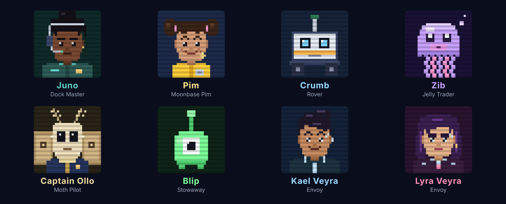


### Side missions

Below the campaign is a row of optional side missions. Each one is a favor for someone on the crew and has its own rule on top of the usual landing limits. Most unlock partway through the campaign. Ice Cream Social, Skipping Stones and Static unlock the first time you land on their world in free flight.

| Side mission | From | World | Unlocks after | The twist |
|---|---|---|---|---|
| Biscuit's Spa Day | Gus | Moon | Tranquility | Fragile cargo: with the crate aboard, touch down slower than 1.2 m/s or it cracks |
| The Coffee Crisis | Dottie | Mars | Dust Ledge | Timed delivery: get a fresh pot to DROP within 70 seconds, while Dottie counts down on the radio |
| Stowaway | Gus | Titan | Haze Delivery | Passenger: Apogee the cat rides along. Turning, tilting past 20° or flying faster than 6 m/s makes her queasy, and her comfort shows in the goal box |
| The Long Way Round | Wren | Venus | Last Light | Survey route: fly through Wren's three numbered markers in order, then land |
| Ice Cream Social | Gus | Mercury | Landing on Mercury in free flight | Melting cargo: sunlight melts the ice cream, shadows stop it. It fails at 100% melted |
| Skipping Stones | Gus | Vesta | Landing on Vesta in free flight | Survey route: fly through four markers over the curve of the asteroid, then land on the far side |
| Static | Dottie | Ganymede | Landing on Ganymede in free flight | Blind landing: a magnetic storm scrambles your instruments the whole way down |
| Ride Along | Gus | Moon | Supply Run | Moving pad: land on Moonbase Pim's supply rover while it drives (its brakes are "on order") |
| Swing Shift | Gus | Moon | Lifeline | Sling load: fly Gus's telescope on a 9-meter cable and set it down on DROP slower than 1.5 m/s |
| Shooting Stars | Dottie | Moon | Tranquility | Meteor shower: reach the far LZ through a heavy shower |
| Hopscotch | Rex | Vesta | Edge of the World | Pad hopping: touch down on pads 1, 2 and 3 in order, and try to beat Rex's 90 seconds |
| Northern Lights | Dottie | Ganymede | Relay Run | Photo route: fly through three markers up in the aurora, then land |
| Shadow Hopper | Wren | Mercury | Spare Key | Pad hopping: hop between three pads in the shadows while the sun boils your fuel |
| Polka Radio | Gus | Moon | Triangulation | Broadcast route: fly through three markers to switch on Gus's all-polka radio station, then land |
| Geyser Surfing | Rex | Europa | Echo | Pad hopping between erupting geysers, and try to beat Rex's 75 seconds |
| Catnip Run | Dottie | Titan | Old Station | Fragile cargo: Titan catnip for Apogee. Touch down slower than 1.3 m/s with it aboard |
| Moth to a Flame | Captain Ollo | Titan | Methane Canyon | A lamp slalom: fly through the three lamps Ollo hung in the haze, then land. He finds them very distracting |
| Zib's Market | Zib | Ganymede | Relay Run | Deliver a crate of ice from PICKUP to Zib's market stall at DROP. Zib is very pink about it |
| VIP Pickup | Dottie | Mars | Mayday | Diplomatic rescue: the Veyra twins' shuttle overheated in a dust storm. Land at CREW, let them board and fly them to orbit |
| Captain Floaty | Pim | Moon | Swing Shift | Balloon chase: Pim's balloon escaped the Moonbase Pim airlock. Fly through the three markers along its path, then land to hand it back |
| Meteor Watch | Wren | Mercury | Rex's Shortcut | Meteor shower over Mercury: get to the shade by the LZ while the meteors fall |

Side missions pay their own credits and have their own stars, but they don't count toward the campaign badges.

### Round trips

Round trips turn a landing into the middle of the mission. Land on LZ and Crumb, the rover Gus built out of a shopping cart, a cooler and a lot of tape, rolls down a ramp from Biscuit's hatch. Drive it to do the job before its battery runs out, drive back up the ramp, then launch and dock with the Descent Systems mothership waiting above. Docking is gentle: get close under the port and slow down, and the clamp holds you up and pulls you in.

<p align="center">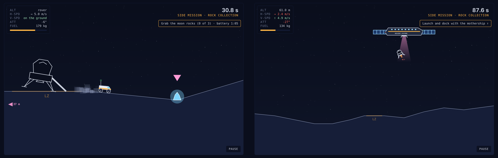</p>

Crumb drives differently on every world. Slopes steeper than 45° stop it, so steps and ledges need a **HOP**, and hops get higher as gravity drops: a small wiggle on Mars, a big bounce on Pluto. Europa's ice has little grip, and Titan's thick air slows everything down. Pink arrows at the edge of the screen point to the nearest job on each side.

| Round trip | From | World | Unlocks after | The job |
|---|---|---|---|---|
| Rock Collection | Gus | Moon | Supply Run | Grab three glowing moon rocks for the break room shelf |
| Beacon Repair | Dottie | Mars | Dust Ledge | Stop beside two dark landing beacons until they light up. One sits past a rock step |
| Bounce House | Rex | Pluto | Edge of the World | Hop up three ledges for the ice crystals Rex left there "for safekeeping" |
| Ice Cores | Wren | Europa | Echo | Grab two ice cores and fix Wren's old seismometer, on slippery ice |
| Where's Apogee? | Apogee | Titan | Methane Canyon | Find Apogee, who hopped out of the rover to explore. She runs off twice before she gives up |
| Blip! | Crumb | Mars | Beacon Repair | Catch the tiny green alien Crumb found. It hops away twice, once right over the rock step |
| Lost Luggage | Juno | Vesta | Rock Collection | Find three suitcases that floated out of a mothership hatch. Crumb floats a long way on every bump here |
| Dish Duty | Juno | Ganymede | Relay Run | Stop beside two blinking relay dishes until they're fixed. Storms scramble Biscuit, not Crumb |
| Show and Tell | Pim | Moon | Captain Floaty | Collect two of Pim's drawings, then park Crumb by the classroom window so the whole class can see him |

Fuel carries through the whole trip, so a wasteful landing costs you on the climb back up. Stars are for fuel left after docking and total time.


You can set down safely on any pad and lift off again. Each mission awards up to three stars: one for finishing, one for fuel left, and one for time. Every new star pays credits. If you fail, your last attempt flies beside you as a ghost.

## Badges

Open **Badges** from the ship menu to see your progress. Twenty-eight badges unlock exclusive cosmetics that can't be bought:

| Badge | How to earn it | Reward |
|---|---|---|
| First contact | Land on any pad | |
| Grand Tour | Land on every world | Grand Tour hull |
| Earthling | Land on Earth | |
| Feather | Touch down slower than 0.3 m/s | Feather Light flame |
| Plumb line | Land within 1° of level, drifting under 0.2 m/s | |
| Bullseye | Land on a ×5 pad on Mars or Earth | Bullseye flame |
| Running on fumes | Land with less than 5 kg of fuel left | |
| Clean sweep | Land at 5 sites in one solo mission | |
| Veteran | Land 25 times | Veteran flag |
| Perfect day | Finish a daily challenge without crashing | Laurel flag |
| Rival | Win a hot-seat match | Champion hull |
| Ghostbuster | In hot-seat, outscore the ghost you're racing | |
| Collector | Buy 10 items in the hangar | |
| Saver | Hold 5,000 credits at once | |
| Mission ready | Complete your first mission | |
| Campaign hero | Complete the original 12 missions (Act 1) | Pathfinder hull |
| Star collector | Earn 24 mission stars | Comet Tail flame |
| Flawless | Earn all 36 stars in Act 1 | Mission Patch flag |
| Frontier hero | Finish Act 2: New Frontiers | Apex Gold hull |
| Signal chaser | Finish Act 3: Beyond Pluto | Unit Zero hull |
| Off-roader | Finish every round trip | Field Kit hull |
| Beat Rex | Finish Hopscotch faster than Rex's 90 seconds | Rex's Racing Flag |
| Spa treatment | Deliver Biscuit's spa crate without a crack | Spa Day hull |
| Barista | Finish The Coffee Crisis with 15 seconds to spare | Espresso flame |
| Cat whisperer | Land Stowaway with Apogee at 75% comfort or better | Paw Print flag |
| Surveyor | Fly Wren's whole survey route on Venus | Wren's Original hull |
| Brain freeze | Deliver Gus's ice cream on Mercury less than half melted | Solar Flare flame |
| Stone skipper | Skip through all four markers on Vesta, then land | Asteroid hull |
| Blind faith | Land on Ganymede in the middle of a magnetic storm | Aurora flag |
| Hitchhiker | Land on a moving rover | Rover Yellow hull |
| Sea legs | Land on the barge rocking on Earth's ocean | Nautical flag |
| Crane operator | Set Gus's telescope down slower than 0.8 m/s | Sodium Orange flame |
| Fully loaded | Max out every upgrade in Gus's workshop | Gus Special hull |
| Long haul | Clear 10 sites in a single endless run | Infinity flag |
| Dodgeball | Land on a pad in the middle of a meteor shower | Shooting Star flag |
| Full fleet | Unlock every lander | The Fleet flag |
| Crew favorite | Earn every side-mission star | The Crew flag |

<p align="center"></p>

## Pilot license

Open **License** from the ship menu, or tap the framed license on your Pad wall, to see your pilot ID card:

- **Your portrait**, a little pixel pilot you customize: hair style and color, skin tone, flight suit color, and glasses, goggles, a headset or a space helmet. You can also edit the name on the card.
- **Your rank**, with chevrons and a progress bar: Cadet, Junior Pilot, Pilot, Senior Pilot, Flight Lieutenant, Captain, Commander and Legend. It climbs as you land, finish missions, visit worlds and earn badges.
- **Career stats**: total landings, worlds visited, your softest touchdown, favorite world and lander (whichever you've landed with most), missions and stars, badges and crashes.
- Dottie's signature, your issue date and license number, a machine-readable strip along the bottom, and Apogee's paw-print "APPROVED" stamp once you've earned her trust on Titan.

Press **Share card** to get a crisp 1200×750 picture of it. On iPhone, **Share** opens the share sheet, so you can save it or send it to friends to compare.

<p align="center">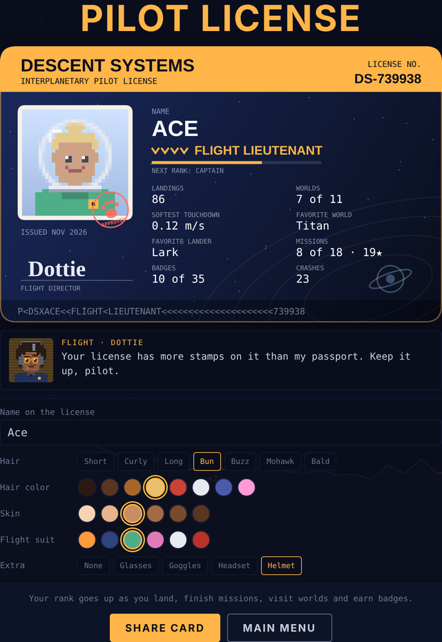</p>

## Break room


The break room is a little room you can **walk around**, in small Stardew-style pixel sprites. **Tap the floor** to walk there, or **tap someone or something** and your pilot walks over and uses it: the crew at the table, Apogee, Crumb, Blip, the radio on the counter, the coffee machine, the window, the bulletin board, the lander poster (Gus's maintenance log is behind it) and the postcard box. Conversations open with everyone's big portraits, the same as before. Gus gets up for coffee now and then. The **door on the left** goes to the hangar, the **door on the right** goes to your Pad, and the **HALL** exit at the bottom leads out to the ship's hallway. On a keyboard, walk with the arrow keys and press Enter to talk to whoever is nearest.
Walk into the **break room** to visit the crew between flights. It's a little pixel-art scene: Dottie and Gus at the table, a coffee machine that sounds like a dying whale, a window looking out on the world you flew last, a poster of Biscuit in her current paint, and a shelf with a trophy for each badge you've earned.

- Click someone, or use the buttons below the scene, to hear what's on their mind. Everyone has well over a dozen things to say, and their lines change as you play: Dottie keeps a tally of your crashes and notices which lander you're flying, Gus comments on your feather landings, paint jobs and upgrades, Wren remembers her old routes, and the worlds you've visited, side missions you've finished and even how you've decorated the Pad come up in conversation.
- Until you finish the campaign, Wren's chair is empty, with a reserved card on the table and her photo on the wall. After the finale, she's there in person.
- Apogee the cat sleeps somewhere different every visit. Click her to pet her. She purrs, usually.

<p align="center"></p>

- Once you've finished your first round trip, **Crumb** the rover lives here too. He trundles along the front of the room, bonks into walls and stops to look around. Some days Apogee naps on top of him while he drives. Tap him, or the **Crumb** button, and he beeps. The crew translates: he has his own lines, and he grows new ones as you finish more round trips. Dottie, Gus and Wren have things to say about him too.

- Once you've met them, a **Radio** button patches in a call from Juno on the mothership or Pim on the Moon, each with their own stack of lines. Both can also visit your Pad when you invite someone over, and they turn up in crew requests: Pim wants you to land on the Moon so she can wave, and Juno wants a docking.

- **You're there too.** Your pilot, exactly as you look on your pilot license, sits at the table with the crew and has their own mug. Change your look on the license and you change at the table. In your Pad you sit on whatever seat you've picked by the big window, and when you invite someone over they sit beside you.


### Friends ♥ (and romance)

The **Friends ♥** button in the break room shows everyone you've met: Dottie, Gus, Wren (once she's home), Rex (after Mayday), Juno (after your first round trip), Zib (after Zib's Market), Captain Ollo (after Moth to a Flame) and Kael and Lyra (after VIP Pickup). Each has 10 hearts.

- **Grow closer** by chatting once a day (here, in the break room, on the Radio or when they visit your Pad), giving one gift a day, doing their side jobs and finishing their crew requests.
- **Gifts** cost credits. Everyone has favorites: Dottie loves fancy coffee, Gus loves a shiny wrench set, Wren loves vintage radio tapes, Rex loves premium hair gel, Juno loves a tiny fern, Zib loves anything shiny, Ollo loves a tiny desk lamp, Kael loves hair gel too, and Lyra loves flowers. Their reaction tells you how you did.
- **Hang out** at 3 and 6 hearts for a short scene with each of them. Friendship tops out at 8 hearts.

<p align="center">
  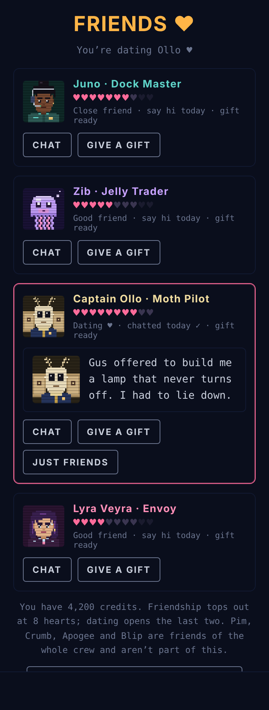
  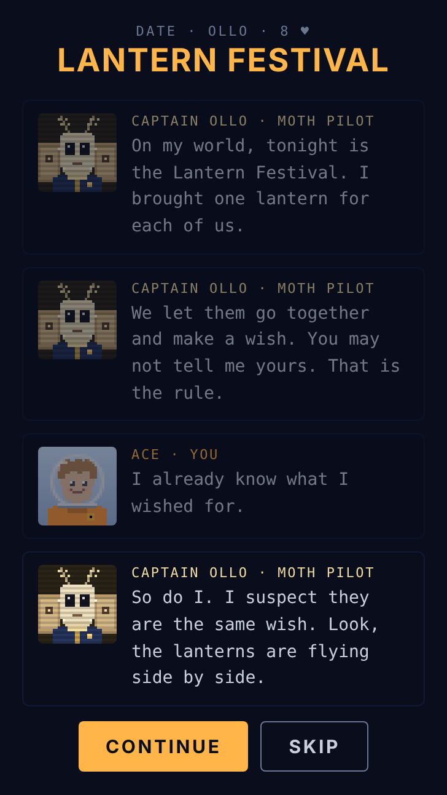
</p>

**Romance** is off by default. Turn it on in **Settings**, and once someone is at 6 hearts and you've seen their 6-heart hangout, you can **ask them out**. Dating opens their last two hearts, a date scene at 8 and another at 10, a framed photo of the two of you for your Pad's left wall, special lines, and more Pad visits. You date one person at a time, and **Just friends** (tap twice) ends it kindly. Pim, Crumb, Apogee and Blip are friends of the whole crew and are never part of romance.

### Postcards

The first time you land on each world, someone on the crew sends you a postcard: a pixel-art picture of that world with Biscuit on a pad (in her current paint) and a note on the back. Open **Postcards** in the break room, or click the box in the corner, to see your album. Tap a card to flip it over. New cards are marked until you read them, and every world has one.

### Maintenance log

Gus writes up every crash and every hard landing in Biscuit's maintenance log. Each entry depends on what went wrong: too fast, tilted, sliding sideways, missing the pad, hitting a canyon roof or flying through an eruption on Io. He also names the dents. Open **Maintenance log** in the break room, or click the Biscuit poster on the wall. It keeps your 40 most recent entries and a running total of repairs.

<p align="center">
  
  
</p>

### Bulletin board

Click the corkboard on the break room wall, or the **Bulletin board** button, to read the notes the crew pins up. They keep track of you:

- Dottie's pad notice ("WHO KEEPS LANDING ON THE ×2 PAD") counts which free-flight pads you land on, with tally marks.
- **Landing of the week** shows your best free-flight landing: the score, the world, the pad and how softly you touched down.
- **Days since last crash** resets every time you crash.
- A lost-cat poster for Apogee, a karaoke sign-up sheet (with your name on it if you set one in hot-seat), Gus's yogurt experiment, today's daily challenge and a progress chart. Some notes change once you've finished certain missions.

<p align="center"></p>

## The ship

The rooms are part of one ship. Step out of your Pad's door, or out of the break room through the **HALL** exit at the bottom, and you're in the **hallway**, a long corridor that scrolls as you walk. Tap anywhere to walk, or tap near either edge of the screen to keep walking that way. Doors along the wall lead to the **hangar**, the **garden**, the **break room**, **the Bridge** and your **Pad**. Leave the Pad or the hangar and their door takes you back the way you came. There's also the **garden** (see below). Two doors are still sealed: the observation **dome** and the **crew** quarters. Tap one and someone on the intercom tells you why it's shut, for now. Crumb sometimes trundles up and down the hallway too.

<p align="center">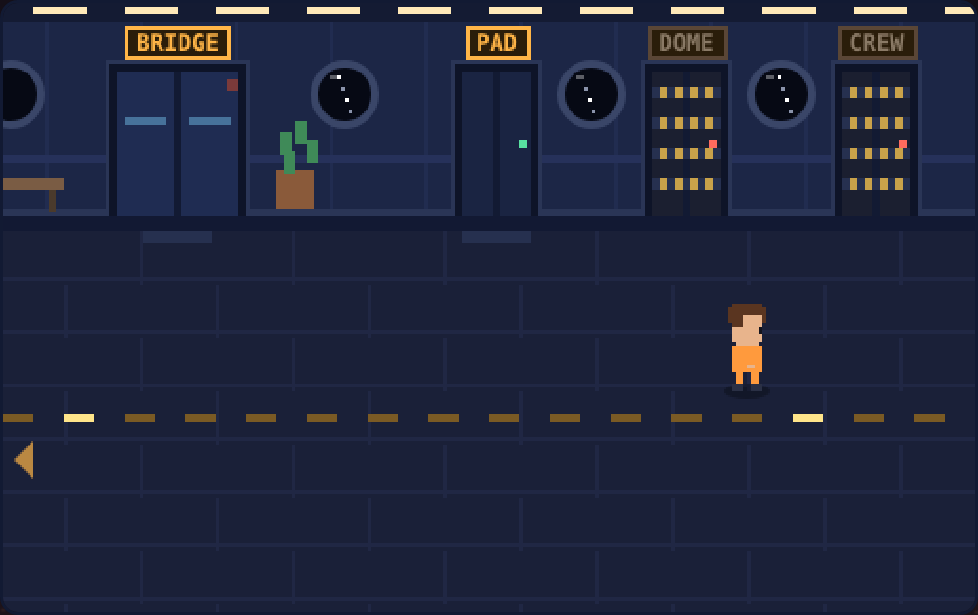</p>

**The Bridge** sits behind the big double doors in the middle of the hallway. A huge curved window looks down on the world you flew last, with three consoles in front of it:

- **Nav console** (middle): opens the **flight deck** with every way to fly. A red light means there are new missions.
- **Comms** (left): takes a call from Juno, Pim, Zib, Ollo or the Veyra twins, whoever you've met, with their face on the screen. It counts as chatting with them for the day, the same as the Radio in the break room.
- **Star map** (right): a dot for every world, lit once you've landed there.

The **captain's chair** sits in the middle of the room. Walk up to it and you sit down. Rex Valor leans by the left wall once you've flown the Mayday mission, and Captain Ollo stands on the right once you've met. Tap them to chat. The **Flight deck** button under the room is a shortcut to the nav console, and the **HALL** exit at the bottom takes you back out.

<p align="center">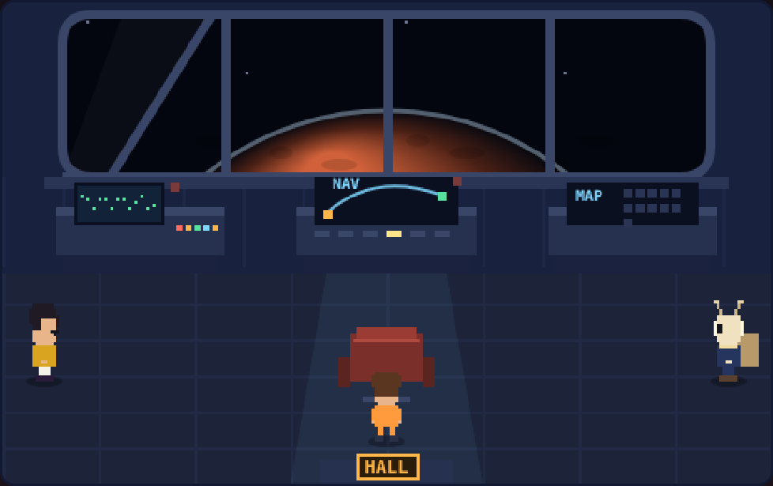</p>

**The Garden** is behind the GARDEN door, a hydroponics room with six planters under pink grow lamps.

- **Plant:** tap a planter and pick a seed. Moon tea and Tiny ferns cost 20 credits and take 2 landings, Hydroponic flowers and Coffee beans cost 30 and take 3, and Cacao pods cost 40 and take 4.
- **Grow:** crops grow a little every time you land safely, anywhere in the game. Walk up to the **tap** on the left once a day to water everything for an extra day's growth.
- **Harvest:** a ripe planter sparkles (and so does the GARDEN door in the hallway). Tap it and press **Harvest** to put the crop in your basket.
- **Give:** on the **Friends ♥** screen, homegrown gifts show up first in the gift list, marked 🌱. They're free, and they give a little extra ♥ on top of the usual amount. Each crop becomes the matching gift (tea, fern, flowers, coffee beans or chocolate), so everyone's tastes still count.
- The **seed cabinet** on the right gives Gus's tips on who loves which crop, based on who you've met.

<p align="center">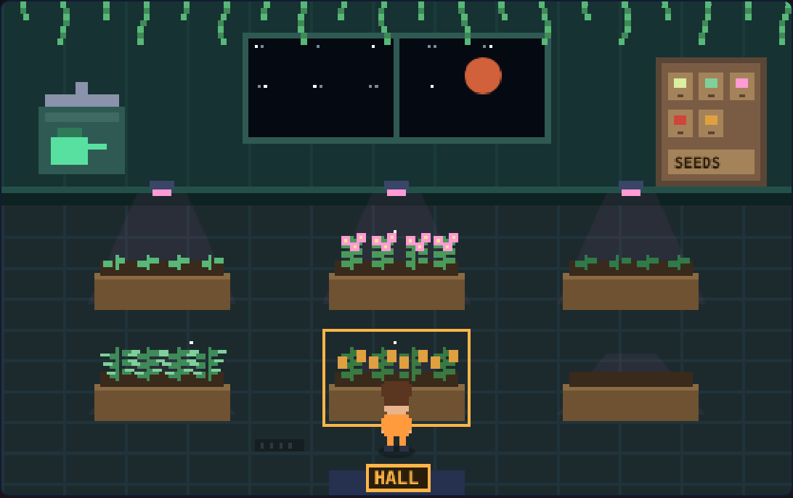</p>

## The Pad

**The Pad** is your own cabin, where the game starts, a cozy retro-future spaceship room. It has curved walls, glowing light strips along the ceiling, a capsule bunk, a window bench with cushions, a backlit shelf alcove, a floating desk with an egg chair, and a big rounded window looking down on a planet. It's a room you can **walk around**: your decorated cabin fills the back wall, and a floor in your chosen flooring runs toward you. **Tap the floor** to walk, or **tap a piece of furniture** and your pilot walks over to it and opens the decorating picker for that spot (the arcade cabinet and pilot certificate still open the arcade and your license). Guests you invite wander around the room as little sprites, admiring things, and you walk up to them to chat. Apogee naps on the furniture, Crumb rolls around the floor, and the **door on the right** opens onto the hallway (or back to the break room, if that's how you came in). The Pad opens as a **big, uncluttered view** of the room with the decorating panels tucked away. Press **Decorate** (or tap any piece of furniture) to open the full editor with every spot and item, and **Done decorating** to close it and get the big room back. On a keyboard, arrow keys walk and Enter uses whatever's nearest. You can also pick a spot from the buttons under the room to change what goes there:

| Spot | What can go there |
|---|---|
| Left wall | Lander poster (in your current paint), star chart, company pennant, Apogee calendar, solar system map, a signed Rex Valor poster |
| Window | In orbit over the last world you flew, blinds down, Earth from orbit, Saturn, a nebula |
| Right wall | A wall clock that keeps your real local time, your pilot license, a mission patch, a crew photo, a flickering neon LAND sign |
| Shelf (6 spots) | Your souvenirs (below), plus a cactus, flight manuals, okayest-pilot mug, rubber duck, snow globe, model rocket and gold trophy |
| Desk | Desk lamp, succulents, a retro computer, the crew radio, a scale model of your lander |
| Corner | Potted fern, beanbag, a cat bed for Apogee, mini fridge, guitar, telescope, or a working arcade cabinet (see below) |
| Rug | Orange rug, striped runner, Saturn rug, cat face rug |
| Bedding | Six colors for the bunk and your seat's cushions and fabric: crimson, cloud cream, blush pink, tangerine, starry night and mint |
| Seating | Where you (and a guest) sit by the big window: the window bench, a comfy couch, a bean bag pair you sink right into, a hammock between two posts, or a hover sofa with a soft glow underneath. Fabric follows your bedding colors |
| Walls | Ivory hull, moon white, blush, graphite, the classic navy bulkhead or a twinkling starfield |
| Flooring | Plush carpet, gloss floor, glowing light panels, rose carpet or deck grating |
| Lights | The color of the glowing strips: amber, ice blue, rose, color-cycling aurora, pulsing red alert, a disco ball, or night mode with just the window and your reading light |

Free items are yours from the start. Everything else costs 100 to 2,000 credits. Tap an item to try it in the room first, then buy it or put it back. Each shelf item can only sit on one shelf at a time. Your room is saved in your browser along with everything else.

### The arcade cabinet

Put the **arcade cabinet** (2,000 cr) in your Pad's corner, then tap it, or press **Play the arcade**, to play **Descent Systems Classic**: a tiny green vector-graphics lander game in the style of the 1979 arcade machines, on a glowing CRT screen with scanlines.

- Turn with ◀ ▶ (or ← →) and hold **Thrust** (or ↑ / Space). On phones, the three big buttons under the screen support holding thrust while you turn.
- Each round drops you in from the top left, drifting sideways, over new jagged terrain with three pads: 2×, 3× and a narrow 5×. The view zooms in as you get close to the ground.
- A perfect landing scores 100 × the pad's multiplier and refills a little fuel. A hard landing scores 30 ×. Crashing costs 150 fuel, and the game ends when the tank runs dry.
- It keeps a top-five high score table. The crew are already on it, and Gus's 2,400 sits at the top under the name "NOT GUS". Beat it and he'll mention it in the break room.

<p align="center">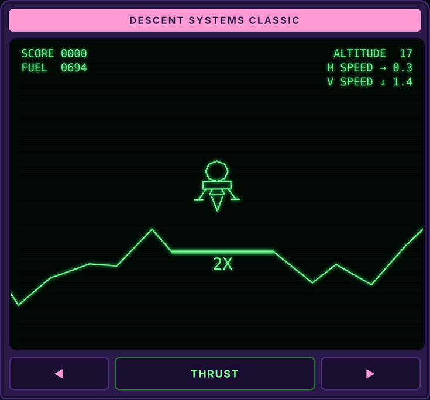</p>

### Photo mode

Press **Take a photo** in the Pad to snap a crisp 1200×600 picture of your cabin, with Apogee and whoever's visiting, and a small "Descent Systems · The Pad" caption in the corner. On iPhone, **Share** opens the share sheet, where **Save Image** puts it in your photos (you can also press and hold the picture). On a computer, **Save** downloads it as a PNG. Saving doesn't work in sandboxed previews, but it does on the hosted game.

### Souvenirs

The first time you land on each world, you bring a souvenir home for your shelf, along with that world's postcard. You can't buy them; the shelf picker shows which ones you still need and where to land to get them:

| World | Souvenir |
|---|---|
| Pluto | A chunk of the heart-shaped ice plain |
| Moon | A Moon rock in a glass case (officially "sample 0047") |
| Europa | An ice shard that sounds like the ocean, or the air vent |
| Ganymede | A bottle of aurora that glows and sometimes plays polka |
| Titan | A jar of orange haze. Do not open |
| Io | A sulfur crystal that smells like a very angry egg |
| Vesta | A rock chip that floats over a magnet stand |
| Mercury | SPF 9000 sunscreen |
| Mars | A vial of red dust that pours like an hourglass |
| Venus | A sealed jar of cloud |
| Earth | A seashell from the ocean by the landing barge |

#### Crumb's finds

Each round trip also brings home a shelf item, found by Crumb: three moon rocks (one looks like Dottie), the old beacon bulb from Mars, one of Rex's ice crystals, a slice of Wren's Europa ice core, the pebble Apogee brought you from Titan, and Juno's lucky keychain from the lost luggage. Show and Tell earns Pim's crayon drawing of you, Biscuit and Crumb for your left wall. They have their own group in the shelf picker. Crumb also visits the Pad, rolling around the floor, and you can tap him there to say hi.

### Company

The Pad isn't empty for long:

- **Apogee** lets herself in on most visits and naps somewhere: on your bunk, the window bench, the rug, sunk into a beanbag, or flat across your keyboard. Tap her, or press **Pet Apogee**, to wake her up. Buy the **cat bed** and she'll use it most of the time, though she'll pretend she isn't impressed.
- **The crew drop by.** About half the time someone is already sitting on your window bench when you walk in: Dottie, Gus, Wren once she's home, or Rex once you've rescued him. Press **Invite someone over** to knock on another door.
- **They notice your decor.** Gus gets excited about the arcade cabinet and the disco ball, Dottie spots the mug she gave you and the red alert lighting, Wren recognizes her star chart and gets misty over the piece of Pluto, and Rex is delighted to find his own poster on your wall. Souvenirs get comments too. If someone's visiting when you buy or place something, they react to it on the spot. Tap them, or press **Chat**, for another comment.

<p align="center">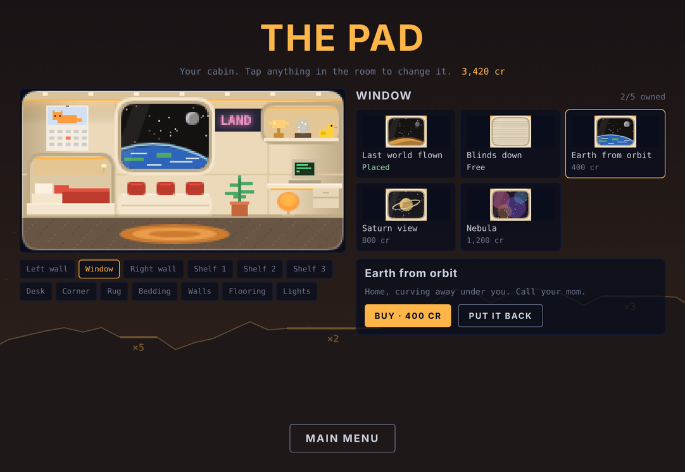</p>

## Endless run

Choose **Endless run** on the flight deck for a roguelike run: how far can one lander go?

- Every site is on a random world. The first two come from the gentler worlds, Io, Mercury and Mars join from site 3, and Earth and Venus from site 6. Terrain gets rougher as you go.
- **Fuel carries over.** Each landing refuels you a little: +15 kg for a ×2 pad, +25 for ×3, +30 for a ×4 moving pad and +40 for ×5.
- After every landing, Gus offers **three perks** and you pick one: a spare fuel canister, a bigger tank, a tuned engine, soft struts, wide feet, steady hands, free gyros, a wind shield, landing radar, a fuel refinery, or (rarely) a spare lander that saves you from one crash.
- One crash ends the run. Your best run (sites cleared and points) shows on the menu.
- Workshop upgrades are switched off during a run, so every run starts on the same lander. Landing points still earn credits.

## Ghost links

After any free-flight landing, press **Challenge a friend**. On iPhone that opens the share sheet. Elsewhere, the link is copied so you can paste it into a message.

When your friend opens the link, the game greets them with "**Ace challenged you**", showing which world and site you flew and the score to beat. They fly the exact same terrain from the exact same start, wind and rovers included, with your ghost flying beside them in pink. At the end, a scorecard shows who won. They can race again as many times as they like, watch the replay, or press **Send your ghost back** to challenge you on the same site with their own run.

<p align="center">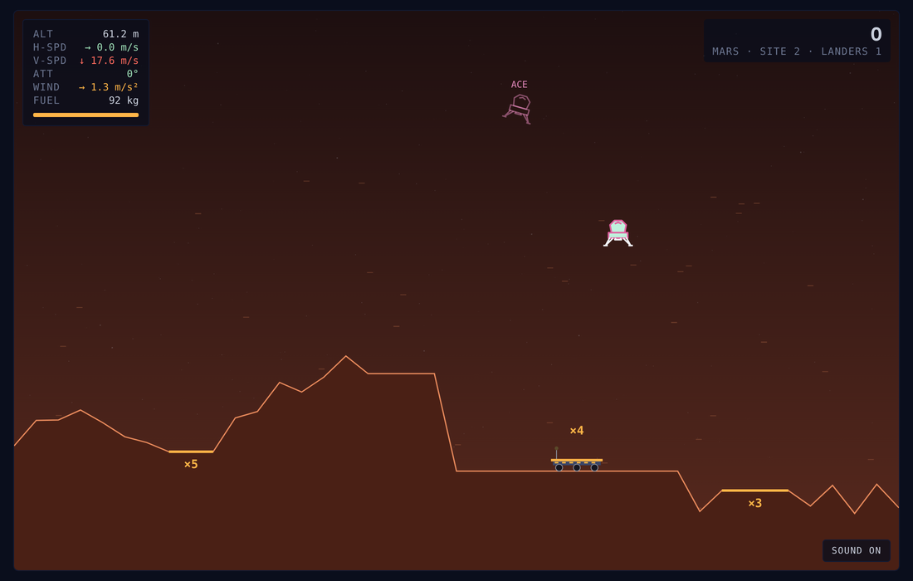</p>

No server or account is involved. Each free-flight site is built from a random seed, so the link only carries the world, the site number, the seed, your score and your flight path, sampled 15 times a second, delta-encoded and compressed. A typical link is a few hundred characters long. Links always open the game on GitHub Pages.

## Hot-seat mode

Choose **Hot-seat** on the flight deck and enter both names.

- A match is 3 rounds, and both pilots fly the exact same descent each round: same terrain, same starting drift, same wind.
- Whoever goes second races a ghost of the first pilot's run.
- The first pilot alternates every round, and the highest total after three rounds wins.

In solo, retrying after a crash also restarts you from the same spot with a ghost of your last attempt.

## Crew requests

Every day the crew posts three small jobs. Open **Crew requests** from the flight deck or the break room to see them. Each one shows who's asking, a progress bar and what it pays:

| From | Request | Pays |
|---|---|---|
| Gus | Land twice under 0.5 m/s | 300 cr |
| Dottie | Land on a given world twice | 250 cr |
| Dottie | Land on a ×5 pad twice | 350 cr |
| Wren | Land with at least half your fuel left | 300 cr |
| Gus | Land twice with under 2° of tilt | 250 cr |
| Gus | Land on a moving rover or the barge | 350 cr |
| Dottie | Reach site 3 in a single free flight | 350 cr |
| Dottie | Earn 3 stars in missions | 300 cr |
| Dottie | Finish all three sites of the daily challenge | 300 cr |
| Gus | Reach site 4 in an endless run | 350 cr |
| Dottie | Send a friend a ghost challenge | 200 cr |
| Apogee | Pet Apogee three times | 150 cr |
| Gus | Score 600 in the arcade (once you own the cabinet) | 300 cr |

Requests count from free flight, missions, the daily challenge, endless runs and ghost races. Credits are paid the moment you finish one, and the crew member who asked pops up at the bottom of the screen to react in their own words. Gus frames your fuel receipt, the rover driver reviews your landing on her roof, and Apogee marks the appointment as completed. Finishing all three adds a 250 credit bonus, plus a gold star on your file from Dottie. Requests change at midnight UTC, the same time as the daily challenge, and everyone gets the same three each day, so friends can compare. Until Wren is home, Gus takes over her request.

## Daily challenge

Choose **Daily challenge** on the flight deck. Everyone who plays on the same day gets the same world, terrain, starting drift and wind.

- You fly 3 sites in a row with one lander. A crash ends the run.
- Retry as often as you like. Your best score for the day is saved.
- **Copy result** gives you a spoiler-free summary to send to friends:
  ```
  Descent Systems daily 2026-11-12
  Mars 🟩🟩🟥 1,240 pts
  ```
- The world rotates daily through all eleven. The challenge changes at midnight UTC, so friends in different time zones always get the same one.

## Install it on your phone

Descent Systems is an installable web app, so it can live on your home screen and play offline.

- **Android (Chrome):** tap **Install app** in the ship menu, or use the browser menu's **Install app** / **Add to Home screen**.
- **iPhone/iPad (Safari):** tap **Install app** in the ship menu for a reminder, then tap the **Share** button and choose **Add to Home Screen**.

Once installed, it opens full-screen and works without a connection. When you're online, it picks up new versions automatically. On iPhone, the home-screen app keeps its own save data, separate from Safari.

## Running locally

1. Clone the repo:
   ```
   git clone https://github.com/ChaseHarding/Descent-Systems.git
   ```
2. Open `index.html` in a browser.

For live reloading while you edit, use the **Live Server** extension in VS Code (right-click `index.html` → *Open with Live Server*).

## Tweaking the game

Most of the tuning lives near the top of the `<script>` block in `index.html`:

- **`WORLDS`**: gravity, engine thrust, drag, wind, colors and terrain roughness for each world. Add an entry here to create a new world.
- **`SAFE_VY`, `SAFE_VX`, `SAFE_ANG`**: the landing limits (soft struts add to `SAFE_VY`).
- **`UPGRADES`**: Gus's workshop upgrades, their prices and effects.
- **`BURN`, `RCS_BURN`**: fuel use for the main engine and rotation.
- **`HULLS`, `FLAMES`**: hangar items and their prices.
- **`ZOOM_MAX`, `ZOOM_START`, `ZOOM_FULL`**: how the auto-zoom camera behaves.
- **`ROUNDS`**: the number of rounds in a hot-seat match.
- **`MISSIONS`, `SIDES`**: the campaign and the side missions. Each entry has its terrain, pads, fuel, star goals and any special rule (`fragile`, `timeLimit`, `comfort`, `rings`).

To give yourself credits while testing, open the browser console on the game page, run the following, and reload:

```js
localStorage.setItem('ds-credits', 5000)
```

## Notes

`manifest.webmanifest`, `sw.js` and the `icon-*.png` / `apple-touch-icon.png` files make the game installable and offline-capable. `sw.js` has a `VERSION` you only need to change if you rename or remove those files.

The `media/` folder holds the images used in this README (`landing.gif`, `crew.png`, `story.png`, `ship-menu.png`, `flight-deck.png`, `missions.png`, `side-missions.png`, `hangar.png`, `badges.png`, `break-room.png`, `pad.png`, `arcade.png`, `license.png`, `intro.png`, `ghost-race.png`, `bulletin-board.png`, `postcards.png` and `maintenance-log.png`, `new-friends.png`, `friends.png`, `date.png`, `round-trip.png`, `hallway.png`, `bridge.png` and `garden.png`) plus `social-preview.png`, the picture GitHub shows when someone shares the repo link (set it under **Settings → General → Social preview**).

`og-image.png` is the share preview: the picture chat apps and social sites show when someone pastes the game's link. The tags that point to it are at the top of `index.html`.

Progress is saved in your browser's local storage, so it stays on that device and browser. Clearing site data resets it, and players sharing one browser share one wallet.

Fonts are [Chakra Petch](https://fonts.google.com/specimen/Chakra+Petch), [IBM Plex Mono](https://fonts.google.com/specimen/IBM+Plex+Mono) and [Caveat](https://fonts.google.com/specimen/Caveat) (the handwriting on the bulletin board), loaded from Google Fonts.
