# Descent Systems

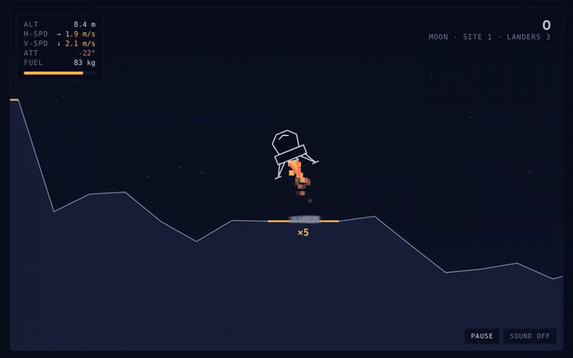

A Lunar Lander–style browser game. Pick a world, fight its gravity and weather, and set your lander down on a flat pad before the fuel runs out.

**▶ Play it here: [chaseharding.github.io/Descent-Systems](https://chaseharding.github.io/Descent-Systems/)**

The whole game is a single `index.html` file: plain HTML, CSS and JavaScript on a canvas, with no frameworks, build step or server.

## Features

- **Eleven worlds** with real surface gravity, each with its own sky, terrain and atmosphere, plus geysers on Europa, eruptions on Io, blinding clouds on Venus, fuel-boiling sunlight on Mercury, a spinning asteroid and instrument-scrambling storms on Ganymede
- **Moving landing pads**: rovers that drive back and forth across most worlds, and a barge rocking on Earth's ocean. Match their speed, then touch down
- **Meteor showers** on airless worlds: red markers and dotted tracks show where each meteor will land, so you can dodge them
- **Guided tutorial** that teaches a first landing step by step
- **Wind and air drag** on worlds with an atmosphere, shown on a live wind gauge
- **Auto-zoom** that eases the camera in for the final approach
- **Landing replays**: rewatch any touchdown or crash with a close camera and slow motion, plus dust, screen shake and a slow-motion beat on soft landings
- **Credits and a hangar** where you spend your banked points on hull finishes and engine flames
- **Gus's workshop**: upgrades for a bigger fuel tank, a more efficient engine, softer landing struts and a landing radar that shows where you'll touch down
- **Mission campaign**: 18 hand-built missions in two acts, with precision landings, cargo runs, canyon flying and rescues, each rated 1–3 stars, plus a story told over the radio by a small pixel-art cast
- **Side missions**: thirteen optional jobs from the crew, each with its own twist: fragile cargo, a coffee countdown, a cat passenger, a survey route through the clouds of Venus, melting ice cream on Mercury, skipping across an asteroid, a blind landing in a magnetic storm, landing on a moving rover, flying a telescope on a swinging cable, landing through a meteor shower, a pad-hopping race against a rival, aurora photography and shadow hopping on Mercury
- **Break room**: hang out with the crew between flights. They chat about how your career is going, and Apogee the cat naps somewhere new every visit. It also holds a bulletin board, a postcard album and Biscuit's maintenance log
- **Endless run**: one lander, random worlds, fuel that carries over, and a perk from Gus after every landing
- **Hot-seat mode** for two players taking turns on the same descents
- **Ghost replay** that lets you race a see-through copy of your friend's run, or your own last attempt
- **Synthesized sound**: engine rumble, thrusters, wind, a low-fuel alarm, touchdowns and crashes, with no audio files
- **Generated music**: slow, drifting pads on the menus, a cozy swung track in the break room, and flight music that speeds up and builds as you get closer to the ground. It's all composed in code as you play
- **Daily challenge**: the same world and terrain for every pilot each day, with a shareable result
- **34 badges** to earn, 25 of which unlock exclusive cosmetics
- **Pause** with P or Esc, and automatic pausing when you switch tabs
- **Touch controls** on phones and tablets
- **Saved progress** for best scores, credits and unlocks, kept in your browser

## Worlds

| World | Gravity | Conditions | Score bonus |
|---|---|---|---|
| Pluto | 0.62 m/s² | No atmosphere, slow and floaty | ×0.75 |
| Vesta | 0.25 m/s² | A tiny asteroid: barely any gravity, ground that curves away at the edges, and a spin that pushes you outward from the middle | ×1.25 |
| Moon | 1.62 m/s² | No atmosphere, the classic | ×1 |
| Europa | 1.31 m/s² | Vapor geysers burst from the ice and shove you upward | ×1.25 |
| Ganymede | 1.43 m/s² | Auroras overhead. Magnetic storms roll in every so often and scramble your instruments, so you land by eye | ×1.5 |
| Titan | 1.35 m/s² | Thick air drag, light wind | ×1 |
| Io | 1.80 m/s² | Volcanic vents glow, then erupt. Touching an eruption is a crash | ×1.75 |
| Mercury | 3.70 m/s² | A huge sun and no air. Sunlight boils fuel out of the tank, so hop between the shadows of crater rims | ×1.75 |
| Mars | 3.71 m/s² | Thin air, gusting dust storms | ×1.5 |
| Earth | 9.81 m/s² | Fast falls, strong wind | ×2.5 |
| Venus | 8.87 m/s² | Extreme mode: crushing air, hurricane winds, and clouds that hide everything except the pad beacons | ×3 |

## Menus

The main menu opens on two big cards with live previews:

- **Hangar**: Biscuit hovering over a pad in her current paint, flame and flag, with your credits and how many items you can afford.
- **Break room**: a live view of the crew at the table, with Apogee asleep somewhere. A **New** tag appears when postcards are waiting.

Below them are the game modes: **Free flight**, **Missions**, **Daily challenge**, **Hot-seat** and **Endless run**. At the bottom are links to **Badges**, **Settings** and **How to play**, which replays the tutorial.

<p align="center">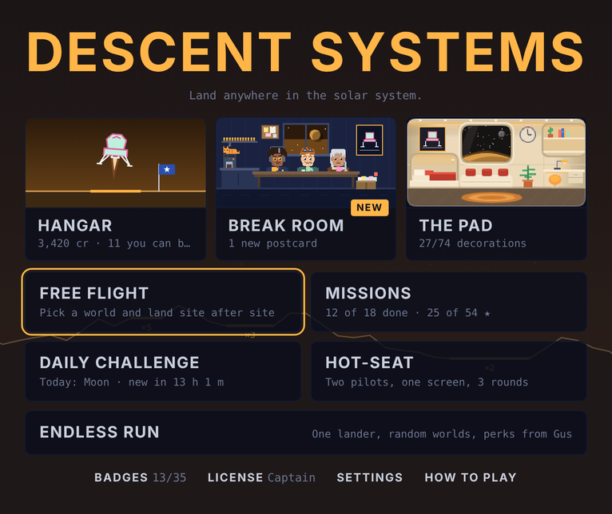</p>

New players are offered the **tutorial** first. It holds the lander in place while you learn to fire the engine and tilt, then switches gravity on and walks you through your first landing.

**Settings** has switches for full 360° rotation, auto-zoom, story scenes, ghosts, sound and music, plus a list of the controls.

## How to play

Land with **both feet on a pad** while staying inside the safe limits:

- Vertical speed under **2 m/s**
- Horizontal speed under **1 m/s**
- Tilt under **10°**

The HUD readouts turn amber, then red, as you go past each limit. If you crash, the game tells you which limit you broke.

### Controls

| Key | Action |
|---|---|
| ↑ / W | Main engine |
| ← → / A D | Rotate |
| ← → (world picker) | Switch world |
| Space / Enter | Start or continue |
| H | Open the hangar |
| R | Open the break room |
| Z | Toggle auto-zoom |
| G | Toggle ghosts |
| M | Toggle sound |
| N | Toggle music |
| P / Esc | Pause and resume (Esc also backs out of menus) |
| B | Open badges |
| Esc | Back out of a menu screen |

On touch screens, on-screen **ROT / THRUST / ROT** buttons appear below the game, and a **Pause** button sits in the corner while you fly.

### Scoring

- Pads pay **×5**, **×3** or **×2**. The narrowest pad pays the most.
- From the second site on, many worlds can add a **moving pad worth ×4**: a rover driving back and forth on a flat track (Pluto, Vesta, the Moon, Ganymede, Titan, Mercury and Mars) or a barge rocking on the sea (Earth). Only your speed relative to the deck counts, so match its speed before you touch down. The driver hits the brakes once you're aboard. Missing the barge means splashing into the ocean.
- From the second site on, Pluto, Vesta, the Moon and Mercury sometimes have a **meteor shower**. Before each meteor lands, a pulsing red marker appears on the ground with a dotted track up into the sky, about two seconds ahead. Getting hit is a crash. The shower's timing is fixed when the site is built, so daily and hot-seat pilots face the same one.
- Unused fuel adds a bonus, and a touchdown under 0.8 m/s adds another 50 points.
- The world's score bonus multiplies the total.
- In solo, you have 3 landers. Each new site has rougher terrain and less fuel.

## Hangar

Every point you score is banked as credits the moment you touch down. Spend them in the hangar on cosmetics. Cosmetics never change how the lander flies.

The hangar is a garage: Biscuit hovers over the pad in front of a big open door looking out on the world you flew last, and Gus works at his bench and comments on everything you put on her.

- **Tabs** for **Hull**, **Flame** and **Flag**, each showing how many you own.
- **Try anything on.** Click an item to see it on Biscuit in the garage.
- **Your look** adds up the hull, flame and flag you're trying on, shows the total cost, and buys and equips everything in one go (or resets to what you had).
- **Locked badge rewards** say which badge earns them and how close you are, with a progress bar where there is one.

### Gus's workshop

The fourth tab in the hangar, **Workshop**, sells upgrades that actually change how Biscuit flies:

| Upgrade | Levels | Effect | Prices |
|---|---|---|---|
| Bigger tank | 3 | +10% / +20% / +30% fuel at the start of every flight | 800 / 1,800 / 3,500 |
| Efficient engine | 3 | The main engine burns 8% / 16% / 24% less fuel | 900 / 2,000 / 3,800 |
| Soft struts | 3 | Safe touchdown speed rises from 2.0 to 2.3 / 2.6 / 3.0 m/s | 1,000 / 2,200 / 4,000 |
| Landing radar | 1 | A dotted line shows where you'll come down if you cut the engine now, with the touchdown speed: green when it would be a safe landing on a pad | 2,500 |

Upgrades apply in free flight and missions. They're always off in the daily challenge, hot-seat, endless run and the tutorial, so those stay fair, and a **Use upgrades** switch turns them off everywhere if you want to fly old-school.

- **Hull finishes:** Mission White, Gold Foil, Mars Rust, Titan Amber, Chrome
- **Engine flames:** Methane Blue, Boron Green, White-Hot, Rainbow, Pulsing Plasma
- **Landing flags:** Pennant (free), Tricolor, Lone Star, Checkered, Jolly Roger, Waving Banner. Your flag plants itself beside the lander after every touchdown.

Badge rewards (Grand Tour, Champion, Pathfinder, Spa Day, Wren's Original and more) appear in the hangar once you earn them.

<p align="center">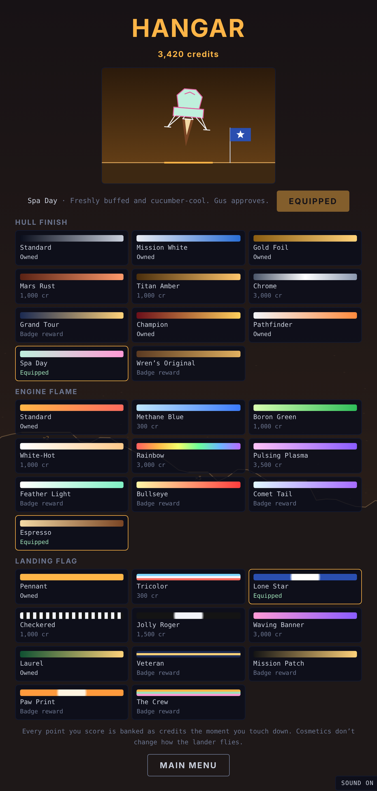</p>

## Missions

Open **Missions** from the start screen. The campaign has 18 hand-built missions in two acts, and finishing one unlocks the next. Act 2 opens once you finish Last Light.

**Act 1 · The Signal**

| # | Mission | World | Type |
|---|---|---|---|
| 1 | First Steps | Pluto | Precision |
| 2 | Tranquility | Moon | Precision |
| 3 | Supply Run | Moon | Cargo |
| 4 | Lifeline | Moon | Rescue |
| 5 | Haze Delivery | Titan | Cargo |
| 6 | Methane Canyon | Titan | Canyon |
| 7 | Dust Ledge | Mars | Precision |
| 8 | Valles Run | Mars | Canyon |
| 9 | Storm Rescue | Mars | Rescue |
| 10 | Heavy Lift | Earth | Cargo |
| 11 | The Needle | Earth | Canyon |
| 12 | Last Light | Earth | Rescue |

**Act 2 · New Frontiers**

| # | Mission | World | Type |
|---|---|---|---|
| 13 | Core Sample | Vesta | Cargo |
| 14 | Edge of the World | Vesta | Precision |
| 15 | Relay Run | Ganymede | Cargo |
| 16 | Mayday | Ganymede | Rescue |
| 17 | Spare Key | Mercury | Precision |
| 18 | Sunrise | Mercury | Rescue, against the clock |

- **Precision:** land on the marked pad, LZ.
- **Cargo:** land on PICKUP and hold still while the crate loads, then fly it to DROP. The crate makes the lander heavier and slower to turn.
- **Canyon:** fly beneath rock overhangs to reach the pad. Touching the rock overhead is a crash.
- **Rescue:** land on CREW and hold still while they board, then climb out of the top of the screen to reach orbit.
- **Pad hopping** (side missions): touch down safely on numbered pads in order.
- **Sling load** (side missions): the cargo hangs on a cable below the lander and swings with momentum, and its pull tugs the lander around. Don't drag it into the ground, and lower it gently onto DROP. While it's hanging, the altitude readout shows the load's height.

<p align="center">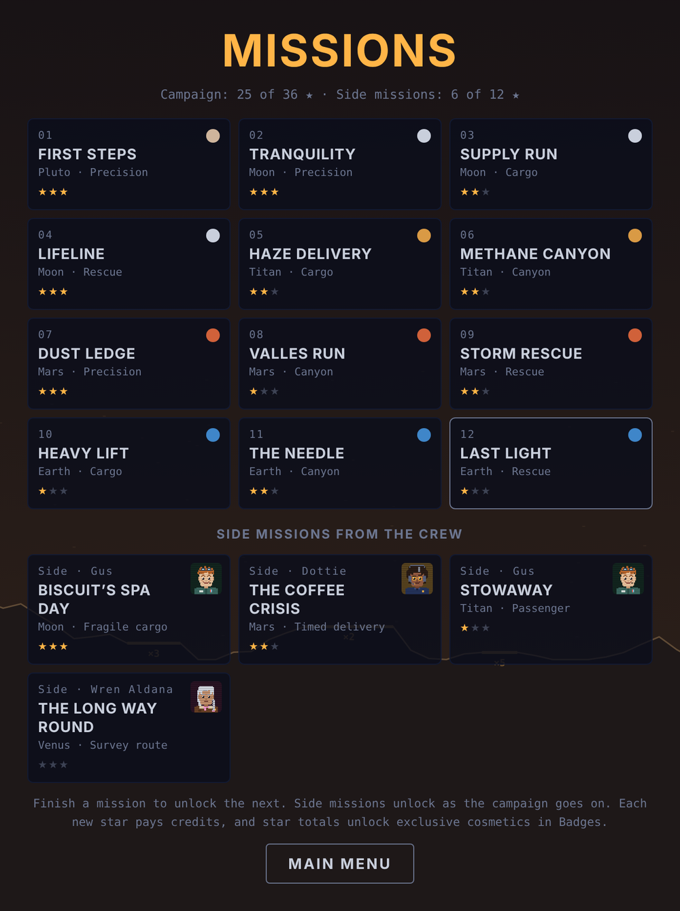</p>

The campaign tells a story over the radio. You fly for Descent Systems, the smallest landing agency in the solar system, alongside Flight Director Dottie Reyes and engineer Gus, who named the lander Biscuit. In Act 1, a mysterious signal on Biscuit's old call sign leads from the Moon across Titan and Mars to Earth. In Act 2, the newly funded agency takes on its first real contracts on Vesta, Ganymede and Mercury, crosses paths with Rex Valor, a smug rival pilot from Apex Aerospace, and races a Mercury sunrise to rescue one of its own. Each character has a pixel-art portrait that talks as their lines type out. Short radio scenes play before each mission (replay them anytime with **Radio log**), mission control reacts to how you flew, and finishing each act unlocks an epilogue. Story scenes can be turned off in Settings.

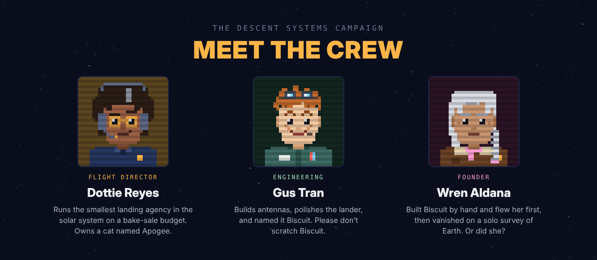

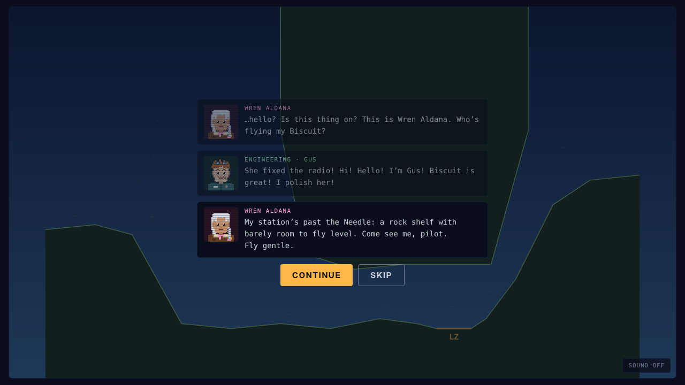

### Side missions

Below the campaign is a row of optional side missions. Each one is a favor for someone on the crew and has its own rule on top of the usual landing limits. Most unlock partway through the campaign. Ice Cream Social, Skipping Stones and Static unlock the first time you land on their world in free flight.

| Side mission | From | World | Unlocks after | The twist |
|---|---|---|---|---|
| Biscuit's Spa Day | Gus | Moon | Tranquility | Fragile cargo: with the crate aboard, touch down slower than 1.2 m/s or it cracks |
| The Coffee Crisis | Dottie | Mars | Dust Ledge | Timed delivery: get a fresh pot to DROP within 70 seconds, while Dottie counts down on the radio |
| Stowaway | Gus | Titan | Haze Delivery | Passenger: Apogee the cat rides along. Turning, tilting past 20° or flying faster than 6 m/s makes her queasy, and her comfort shows in the goal box |
| The Long Way Round | Wren | Venus | Last Light | Survey route: fly through Wren's three numbered markers in order, then land |
| Ice Cream Social | Gus | Mercury | Landing on Mercury in free flight | Melting cargo: sunlight melts the ice cream, shadows stop it. It fails at 100% melted |
| Skipping Stones | Gus | Vesta | Landing on Vesta in free flight | Survey route: fly through four markers over the curve of the asteroid, then land on the far side |
| Static | Dottie | Ganymede | Landing on Ganymede in free flight | Blind landing: a magnetic storm scrambles your instruments the whole way down |
| Ride Along | Gus | Moon | Supply Run | Moving pad: land on Moonbase Pim's supply rover while it drives (its brakes are "on order") |
| Swing Shift | Gus | Moon | Lifeline | Sling load: fly Gus's telescope on a 9-meter cable and set it down on DROP slower than 1.5 m/s |
| Shooting Stars | Dottie | Moon | Tranquility | Meteor shower: reach the far LZ through a heavy shower |
| Hopscotch | Rex | Vesta | Edge of the World | Pad hopping: touch down on pads 1, 2 and 3 in order, and try to beat Rex's 90 seconds |
| Northern Lights | Dottie | Ganymede | Relay Run | Photo route: fly through three markers up in the aurora, then land |
| Shadow Hopper | Wren | Mercury | Spare Key | Pad hopping: hop between three pads in the shadows while the sun boils your fuel |

Side missions pay their own credits and have their own stars, but they don't count toward the campaign badges.

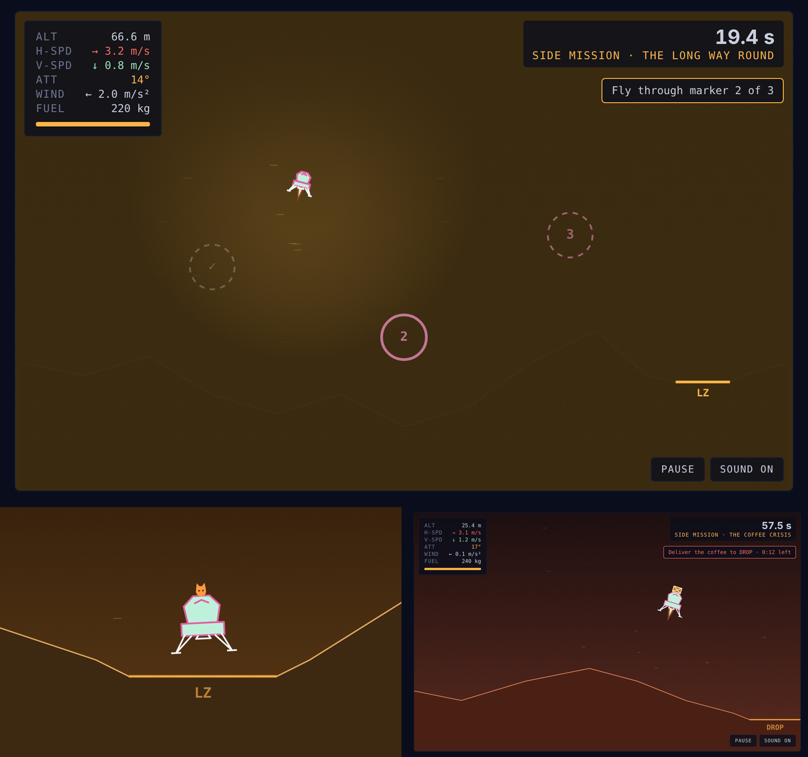

You can set down safely on any pad and lift off again. Each mission awards up to three stars: one for finishing, one for fuel left, and one for time. Every new star pays credits. If you fail, your last attempt flies beside you as a ghost.

## Badges

Open **Badges** from the start screen to see your progress. Twenty-five badges unlock exclusive cosmetics that can't be bought:

| Badge | How to earn it | Reward |
|---|---|---|
| First contact | Land on any pad | |
| Grand Tour | Land on every world | Grand Tour hull |
| Earthling | Land on Earth | |
| Feather | Touch down slower than 0.3 m/s | Feather Light flame |
| Plumb line | Land within 1° of level, drifting under 0.2 m/s | |
| Bullseye | Land on a ×5 pad on Mars or Earth | Bullseye flame |
| Running on fumes | Land with less than 5 kg of fuel left | |
| Clean sweep | Land at 5 sites in one solo mission | |
| Veteran | Land 25 times | Veteran flag |
| Perfect day | Finish a daily challenge without crashing | Laurel flag |
| Rival | Win a hot-seat match | Champion hull |
| Ghostbuster | In hot-seat, outscore the ghost you're racing | |
| Collector | Buy 10 items in the hangar | |
| Saver | Hold 5,000 credits at once | |
| Mission ready | Complete your first mission | |
| Campaign hero | Complete the original 12 missions (Act 1) | Pathfinder hull |
| Star collector | Earn 24 mission stars | Comet Tail flame |
| Flawless | Earn all 36 stars in Act 1 | Mission Patch flag |
| Frontier hero | Finish Act 2: New Frontiers | Apex Gold hull |
| Beat Rex | Finish Hopscotch faster than Rex's 90 seconds | Rex's Racing Flag |
| Spa treatment | Deliver Biscuit's spa crate without a crack | Spa Day hull |
| Barista | Finish The Coffee Crisis with 15 seconds to spare | Espresso flame |
| Cat whisperer | Land Stowaway with Apogee at 75% comfort or better | Paw Print flag |
| Surveyor | Fly Wren's whole survey route on Venus | Wren's Original hull |
| Brain freeze | Deliver Gus's ice cream on Mercury less than half melted | Solar Flare flame |
| Stone skipper | Skip through all four markers on Vesta, then land | Asteroid hull |
| Blind faith | Land on Ganymede in the middle of a magnetic storm | Aurora flag |
| Hitchhiker | Land on a moving rover | Rover Yellow hull |
| Sea legs | Land on the barge rocking on Earth's ocean | Nautical flag |
| Crane operator | Set Gus's telescope down slower than 0.8 m/s | Sodium Orange flame |
| Fully loaded | Max out every upgrade in Gus's workshop | Gus Special hull |
| Long haul | Clear 10 sites in a single endless run | Infinity flag |
| Dodgeball | Land on a pad in the middle of a meteor shower | Shooting Star flag |
| Crew favorite | Earn every side-mission star | The Crew flag |

<p align="center">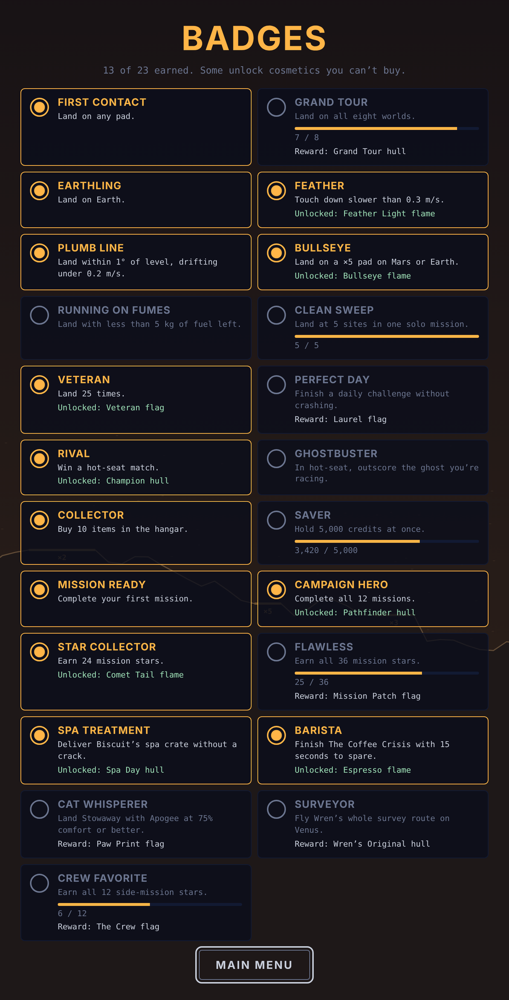</p>

## Break room

Open **Break room** from the start screen to visit the crew between flights. It's a little pixel-art scene: Dottie and Gus at the table, a coffee machine that sounds like a dying whale, a window looking out on the world you flew last, a poster of Biscuit in her current paint, and a shelf with a trophy for each badge you've earned.

- Click someone, or use the buttons below the scene, to hear what's on their mind. Their lines change as you play: Dottie keeps a tally of your crashes, Gus comments on your feather landings and paint jobs, and side missions you've finished come up in conversation.
- Until you finish the campaign, Wren's chair is empty, with a reserved card on the table and her photo on the wall. After the finale, she's there in person.
- Apogee the cat sleeps somewhere different every visit. Click her to pet her. She purrs, usually.

<p align="center">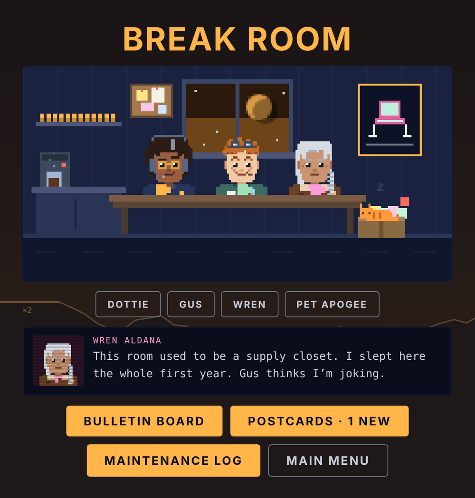</p>

### Postcards

The first time you land on each world, someone on the crew sends you a postcard: a pixel-art picture of that world with Biscuit on a pad (in her current paint) and a note on the back. Open **Postcards** in the break room, or click the box in the corner, to see your album. Tap a card to flip it over. New cards are marked until you read them, and every world has one.

### Maintenance log

Gus writes up every crash and every hard landing in Biscuit's maintenance log. Each entry depends on what went wrong: too fast, tilted, sliding sideways, missing the pad, hitting a canyon roof or flying through an eruption on Io. He also names the dents. Open **Maintenance log** in the break room, or click the Biscuit poster on the wall. It keeps your 40 most recent entries and a running total of repairs.

<p align="center">
  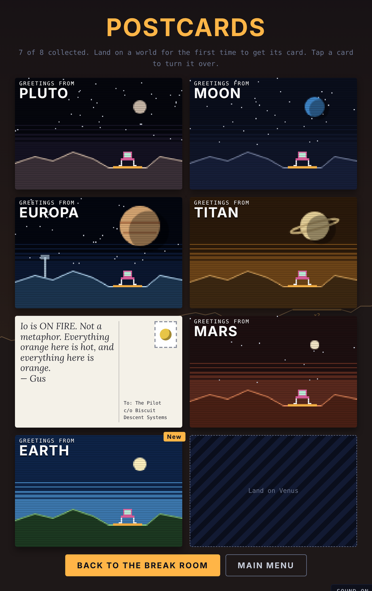
  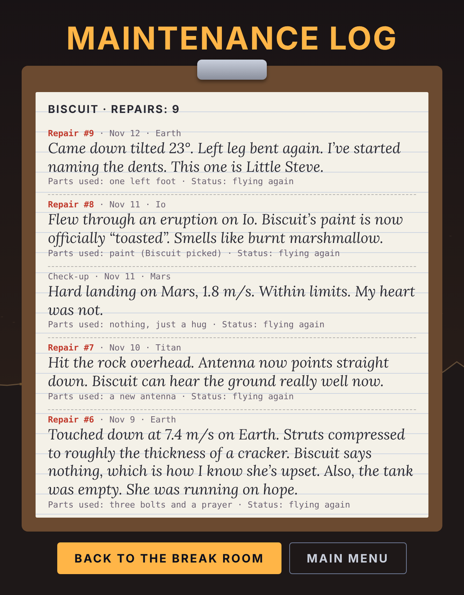
</p>

### Bulletin board

Click the corkboard on the break room wall, or the **Bulletin board** button, to read the notes the crew pins up. They keep track of you:

- Dottie's pad notice ("WHO KEEPS LANDING ON THE ×2 PAD") counts which free-flight pads you land on, with tally marks.
- **Landing of the week** shows your best free-flight landing: the score, the world, the pad and how softly you touched down.
- **Days since last crash** resets every time you crash.
- A lost-cat poster for Apogee, a karaoke sign-up sheet (with your name on it if you set one in hot-seat), Gus's yogurt experiment, today's daily challenge and a progress chart. Some notes change once you've finished certain missions.

<p align="center">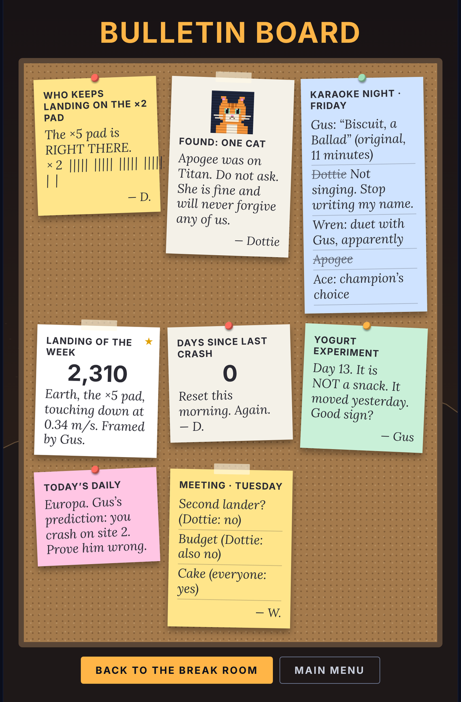</p>

## Endless run

Choose **Endless run** on the main menu for a roguelike run: how far can one lander go?

- Every site is on a random world. The first two come from the gentler worlds, Io, Mercury and Mars join from site 3, and Earth and Venus from site 6. Terrain gets rougher as you go.
- **Fuel carries over.** Each landing refuels you a little: +15 kg for a ×2 pad, +25 for ×3, +30 for a ×4 moving pad and +40 for ×5.
- After every landing, Gus offers **three perks** and you pick one: a spare fuel canister, a bigger tank, a tuned engine, soft struts, wide feet, steady hands, free gyros, a wind shield, landing radar, a fuel refinery, or (rarely) a spare lander that saves you from one crash.
- One crash ends the run. Your best run (sites cleared and points) shows on the menu.
- Workshop upgrades are switched off during a run, so every run starts on the same lander. Landing points still earn credits.

## Hot-seat mode

Switch to **Hot-seat · 2P** on the start screen and enter both names.

- A match is 3 rounds, and both pilots fly the exact same descent each round: same terrain, same starting drift, same wind.
- Whoever goes second races a ghost of the first pilot's run.
- The first pilot alternates every round, and the highest total after three rounds wins.

In solo, retrying after a crash also restarts you from the same spot with a ghost of your last attempt.

## Daily challenge

Choose **Daily** on the start screen. Everyone who plays on the same day gets the same world, terrain, starting drift and wind.

- You fly 3 sites in a row with one lander. A crash ends the run.
- Retry as often as you like. Your best score for the day is saved.
- **Copy result** gives you a spoiler-free summary to send to friends:
  ```
  Descent Systems daily 2026-11-12
  Mars 🟩🟩🟥 1,240 pts
  ```
- The world rotates daily through all eleven. The challenge changes at midnight UTC, so friends in different time zones always get the same one.

## Install it on your phone

Descent Systems is an installable web app, so it can live on your home screen and play offline.

- **Android (Chrome):** tap **Install app** on the main menu, or use the browser menu's **Install app** / **Add to Home screen**.
- **iPhone/iPad (Safari):** tap **Install app** on the main menu for a reminder, then tap the **Share** button and choose **Add to Home Screen**.

Once installed, it opens full-screen and works without a connection. When you're online, it picks up new versions automatically. On iPhone, the home-screen app keeps its own save data, separate from Safari.

## Running locally

1. Clone the repo:
   ```
   git clone https://github.com/ChaseHarding/Descent-Systems.git
   ```
2. Open `index.html` in a browser.

For live reloading while you edit, use the **Live Server** extension in VS Code (right-click `index.html` → *Open with Live Server*).

## Tweaking the game

Most of the tuning lives near the top of the `<script>` block in `index.html`:

- **`WORLDS`**: gravity, engine thrust, drag, wind, colors and terrain roughness for each world. Add an entry here to create a new world.
- **`SAFE_VY`, `SAFE_VX`, `SAFE_ANG`**: the landing limits (soft struts add to `SAFE_VY`).
- **`UPGRADES`**: Gus's workshop upgrades, their prices and effects.
- **`BURN`, `RCS_BURN`**: fuel use for the main engine and rotation.
- **`HULLS`, `FLAMES`**: hangar items and their prices.
- **`ZOOM_MAX`, `ZOOM_START`, `ZOOM_FULL`**: how the auto-zoom camera behaves.
- **`ROUNDS`**: the number of rounds in a hot-seat match.
- **`MISSIONS`, `SIDES`**: the campaign and the side missions. Each entry has its terrain, pads, fuel, star goals and any special rule (`fragile`, `timeLimit`, `comfort`, `rings`).

To give yourself credits while testing, open the browser console on the game page, run the following, and reload:

```js
localStorage.setItem('ds-credits', 5000)
```

## Notes

`manifest.webmanifest`, `sw.js` and the `icon-*.png` / `apple-touch-icon.png` files make the game installable and offline-capable. `sw.js` has a `VERSION` you only need to change if you rename or remove those files.

The `media/` folder holds the images used in this README (`landing.gif`, `crew.png`, `story.png`, `home.png`, `missions.png`, `side-missions.png`, `hangar.png`, `badges.png`, `break-room.png`, `bulletin-board.png`, `postcards.png` and `maintenance-log.png`) plus `social-preview.png`, the picture GitHub shows when someone shares the repo link (set it under **Settings → General → Social preview**).

`og-image.png` is the share preview: the picture chat apps and social sites show when someone pastes the game's link. The tags that point to it are at the top of `index.html`.

Progress is saved in your browser's local storage, so it stays on that device and browser. Clearing site data resets it, and players sharing one browser share one wallet.

Fonts are [Chakra Petch](https://fonts.google.com/specimen/Chakra+Petch), [IBM Plex Mono](https://fonts.google.com/specimen/IBM+Plex+Mono) and [Caveat](https://fonts.google.com/specimen/Caveat) (the handwriting on the bulletin board), loaded from Google Fonts.
